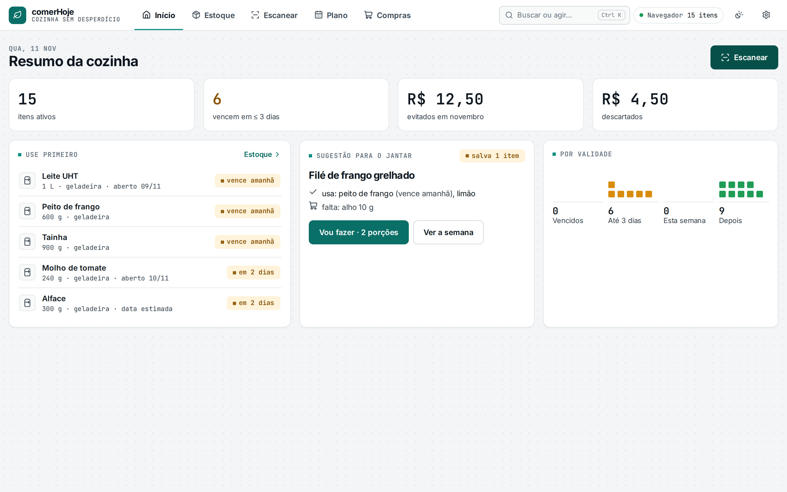
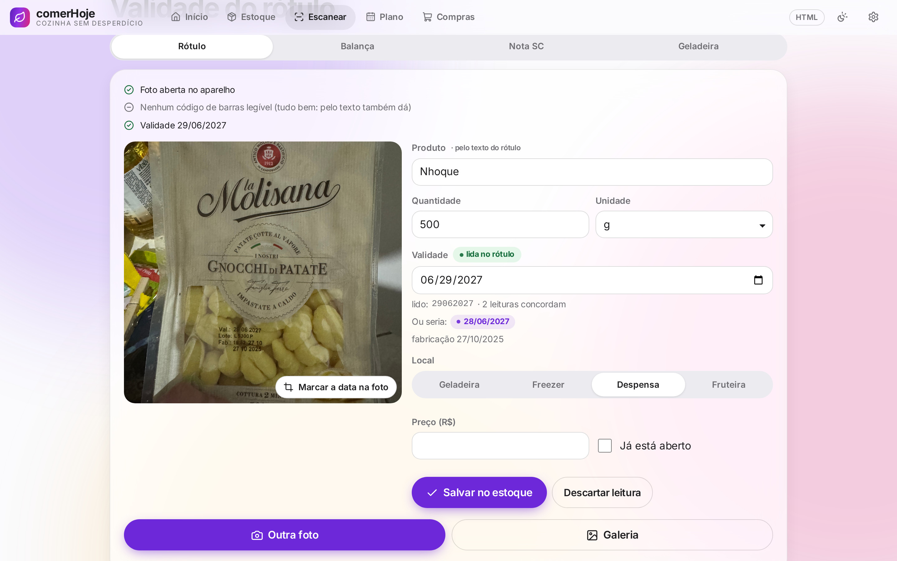
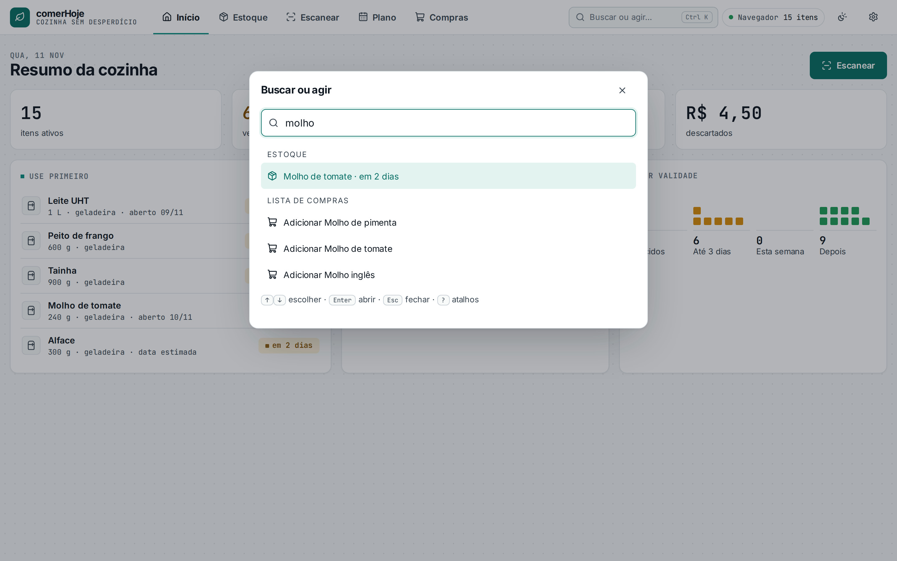
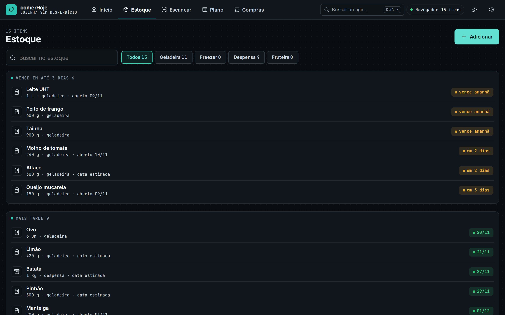

# comerHoje: a kitchen without waste

**comerHoje** registers each package in the kitchen **with its own expiry date**, reading the label in the
phone photo itself, shows what expires first, suggests what to cook to use it up, and mirrors stock and
the shopping list in the household's Google Sheet. Made for Brazil (pt-BR, R$, dd/mm/aaaa, regional
names), with items and receipts from **Santa Catarina**.


*Two styles of the Taiga design system, both in the app (Ajustes → Aparência): **Lumen** (the first two) and **Neue** (the last two).*

## What it does

- **Reads the expiry date on the phone, with no crop.** PaddleOCR (ONNX) runs in the browser, with
  dot-matrix filters, a zoom on "VAL/Validade" and a vote between readings. On the reference photos it
  reads 19/01/2027 (panceta), 29/06/2027 (gnocchi), 19/03/2027 (UHT milk) and 31/03/2027 (tomato sauce
  on foil), and asks when it is not sure. Optional cloud AI only when the phone is unsure.
- **Barcode and scale label:** weight and price from the `2 06584 001489 9` code, and the product from the label text.
- **NFC-e from Santa Catarina:** receipt QR → access key (UF 42) → items from the SEFAZ-SC consultation (on the server).
- **"Abri" counts**: opened sauce, milk or cold cuts get the "consumir em até 3 dias após aberto" deadline.
- **Weekly plan** that uses what expires first (greedy on the phone; MILP on the server if installed).
- **Metadata remover**: GPS, phone model and date never leave the phone; the R tool
  [`limpar_metadados()`](R/metadados.R) cleans files **without recompressing** (identical pixels).
- **SQLite** on the server, with an outbox on the phone: if the connection drops (iPhone locked, 4G),
  nothing is lost and nothing is applied twice.

## Delivery formats (Taiga)

One front end (`srcjs/`), built by `node tools/build.mjs` into the three targets:

| Format | Entry point | Data | Notes |
|---|---|---|---|
| **Shiny** | `comerHoje::run_app()` · `comerhoje_app()` · [`app.R`](app.R) (deploy) | SQLite (`COMERHOJE_DB`) + Google Sheet | cloud AI, NFC-e SC, MILP, automatic sync |
| **Quarto** | `comerHoje::export_quarto("pasta")` · `quarto_block()` | browser + Sheet (Apps Script) | the app among your own text; `embed-resources: true` |
| **Standalone HTML** | `comerHoje::export_html("comerhoje.html")` (`leitor = TRUE` embeds the reader, ~40 MB) | browser + Sheet (Apps Script) | one file, no server or network (1.7 MB without the reader) |

| Capability | Shiny | Quarto | HTML |
|---|---|---|---|
| Works without a server | – | ✓ | ✓ |
| Data shared between phones | ✓ SQLite + Sheet | via Sheet | via Sheet |
| Expiry read on the phone (PaddleOCR) | ✓ | with `leitor = TRUE`* | with `leitor = TRUE` |
| Barcode / scale label | ✓ | ✓ | ✓ |
| Cloud AI, NFC-e SC items, MILP | ✓ | – | – |
| Secrets (AI key, script password on the server) | ✓ only here | – | – (the password is typed on the device) |

\* In Quarto, rebuild the include files with the embedded reader if you need it.

## Quick start

**0. A complete copy.** Use `git clone`, `rsync -a`, or `unzip` in the Terminal. The Finder, some zip tools and
some download tools lose hidden files (`.Rbuildignore`...) and even binary files. Then run
`python3 tools/verificar.py --preflight`. It compares the copy with `tools/manifesto.json`, names anything
missing, puts back the hidden files, and removes what R CMD check trips on. That includes old-version
leftovers, stale `man/` pages and file times in the future, which a zip made in UTC and opened in Brasília
produces.

```sh
npm ci --ignore-scripts          # 1. npm packages: fonts, icons, OCR models, webR (tools/verificar.py runs it if missing)
node tools/build.mjs             # 2. front end -> inst/app/www (Shiny), inst/quarto, inst/standalone/comerhoje.html
```
```r
# R 4.2+: install.packages(c("shiny", "htmltools", "jsonlite", "DBI", "RSQLite", "httr2", "pkgload"))
pkgload::load_all(); run_app()                           # http://127.0.0.1:8080
export_html("comerhoje.html")                            # or open inst/standalone/comerhoje.html directly
export_html("comerhoje-com-leitor.html", leitor = TRUE)  # ~40 MB: the same file with the on-device reader
```
On the iPhone (same Wi-Fi): `run_app(host = "0.0.0.0")`, open `http://<computer-ip>:8080`, then
Share → **Add to Home Screen**.

### As an R package: documentation, tests, R CMD check

```sh
python3 tools/verificar.py --preflight   # repair the copy first (hidden files, stale man/ pages, time stamps)
node tools/build.mjs                     # the Shiny app and export_html() ship what this writes to inst/
python3 tools/simular_tarball.py         # optional: what R CMD build will put in the tarball, with R's rules
```
```r
devtools::document()   # man/*.Rd and NAMESPACE from the roxygen comments in R/ (they are committed too)
devtools::test()       # tests/testthat (also run by R CMD check through tests/testthat.R)
devtools::check()      # R CMD build, then R CMD check --as-cran on the tarball (.Rbuildignore applies)
```
Expected result: **0 errors, 0 warnings, 1 NOTE**. The NOTE is "New submission", which `--as-cran` always
gives for a package that is not on CRAN. The installed size (about 35 MB, almost all of it the on-device
reader's OCR models in `inst/app/www/ocr`) is reported as INFO by R 4.6. Older R versions report it as a
NOTE. Do not run `R CMD check` on the folder itself: only the build step applies `.Rbuildignore`. Without it,
`node_modules/` alone adds the executable, object-file, hidden-file and long-path complaints. For plain
R, run `R CMD build .`, then `R CMD check comerHoje_2.0.2.tar.gz`. Without the optional packages (ompr,
googlesheets4...), also set `_R_CHECK_FORCE_SUGGESTS_=false`.

**Deploy**: [Docker](Dockerfile) (`docker run -p 8080:8080 -v comerhoje-dados:/data --env-file .env comerhoje`),
or shinyapps.io with [`tools/deploy/shinyapps.R`](tools/deploy/shinyapps.R) (**one instance** only; the
Sheet is the durable backup, because the disk there is ephemeral). Variables: [`.env.exemplo`](.env.exemplo).

## Google Sheet (owned by you)

The simplest and safest path is the sheet's **own Apps Script** ([`inst/apps-script/Code.gs`](inst/apps-script/Code.gs)):
Extensões → Apps Script → paste → set the password in the script properties (`COMERHOJE_TOKEN`) →
Implantar → App da Web (*execute as me*, *anyone*). The app reads and writes with the URL + password. It
needs no Google Cloud, and **the sheet does not need to be public**. A link-shared sheet also works,
**read-only** (`COMERHOJE_PLANILHA_ID`): it is enough to restore the stock. Details:
[docs/ARCHITECTURE.md §11](docs/ARCHITECTURE.md#11-google-sheet).

## Photos and privacy

```sh
Rscript tools/limpar_metadados.R references/            # removes GPS, camera, date, XMP; pixels untouched
Rscript tools/limpar_metadados.R foto.jpg --verificar   # only shows what is there
```
The [`references/`](references/) photos are **already clean** (0 GPS tags). ⚠️ The originals with GPS
are still in the **git history** (commit `653fcc0`). Before publishing the repository, rewrite the history
(`git filter-repo --path references/ --invert-paths`, then add the current photos again) or start a new
repository.

## Feature tour

| | |
|---|---|
|  Lumen: home |  Neue: kitchen at a glance |
|  Expiry read on the phone (real photo) |  Neue: command bar (Ctrl K) |
|  Weekly plan |  Neue dark (ink blue): stock |

All the images ([`docs/features/manifest.json`](docs/features/manifest.json)) are made by
[`tools/screens.py`](tools/screens.py) from the **built** HTML target (provenance `live`), with the data from "Carregar exemplo".

## Documents

- [docs/ARCHITECTURE.md](docs/ARCHITECTURE.md): architecture and specification (v2), guides, verification.
- [docs/DESIGN.md](docs/DESIGN.md): Lumen × Neue in comerHoje, tokens, contrast, Taiga conformance.
- [docs/historico/ARCHITECTURE-v1.md](docs/historico/ARCHITECTURE-v1.md): the v1 spec (before the rework).
- [NEWS.md](NEWS.md): changes per version (2.0.1 and 2.0.2: fixes from the real `R CMD check` runs).

## Tests

`python3 tools/verificar.py` runs everything, with no R needed, and writes `docs/verification/last_run.json`.
It starts with the **preflight** described above (the copy against the manifest, hidden files,
stale pages, time stamps). It then runs `npm ci --ignore-scripts` if `node_modules` is missing, and
says what to install if Playwright or Pillow is missing. Then it runs these suites:

- the JS core;
- the **R in webR** with the same fixtures, including R ↔ JS parity of the operations and of the embedded reader;
- the parts of **R CMD check** that need no installed package: `checkRd`, usage vs code, the examples,
  ASCII in the R code, and `man/` in sync with the roxygen comments. There is also a **simulated
  `R CMD build`** that shows what goes into the tarball;
- the **SQLite store** (`repo_sqlite()`) on real SQLite through a DBI/RSQLite stand-in that enforces
  RSQLite's rules (webR has no RSQLite);
- SQL against the schema, and the Apps Script;
- the three targets in Chromium (Lumen/Neue × light/dark × 3 sizes), and contrast;
- the Shiny protocol with real R code (drop, reload, idempotency). It fails in seconds, with the reason, if
  webR cannot load;
- reading the reference photos.

CI also runs the tests in real R and `R CMD check` ([`.github/workflows/ci.yml`](.github/workflows/ci.yml)).

| Symptom in `verificar.py` | Cause | Fix |
|---|---|---|
| build: `ENOENT ... @fontsource/...` | `node_modules` not installed | `npm ci --ignore-scripts` (the preflight now does it) |
| webR: `ERR_MODULE_NOT_FOUND` | same | same |
| Shiny bench: timeout | same (webR is served from `node_modules`) | same; the bench now fails at once and says so |
| links: N broken | hidden files missing from the copy (`.github/`, `.env.exemplo`) | the preflight puts them back (from `tools/manifesto.json`) |
| `ENOENT ... leitor_mini/ocr/...wasm`, `exemplo_com_gps.jpg` missing (2.0.1) | the copy lost binary files | 2.0.2 has no binary test inputs; the preflight names any missing file |
| R CMD check: `node_modules` in hidden files / executables / long paths | `.Rbuildignore` replaced by the RStudio/renv default (4 lines), or `R CMD check` run on the folder | the preflight completes `.Rbuildignore`; check the tarball (`devtools::check()`) |
| R CMD check: future file timestamps | zip made in UTC, opened in UTC−3 | the preflight resets them |
| R CMD check: `linha_de_lote.Rd` undocumented arguments | stale page from an older `document()` | the preflight removes it (so does `devtools::document()`) |
| tests: `Query does not require parameters.` | bug in 2.0.1 `repo_sqlite()` | fixed in 2.0.2 |
