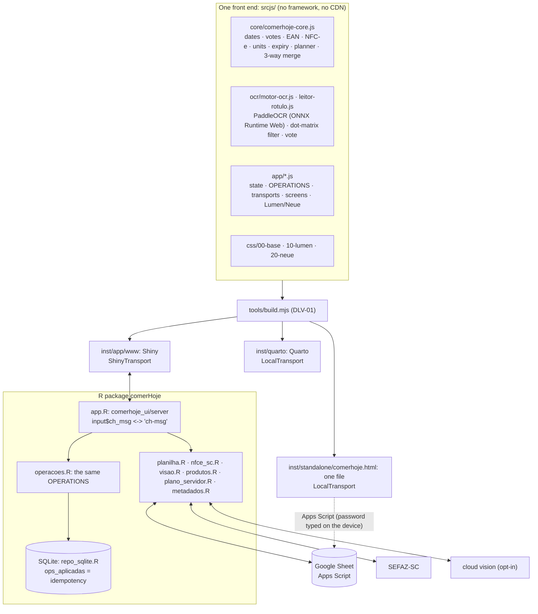

# comerHoje: Architecture & Implementation Specification (v2)

> **Status:** v2.0.2, implemented and verified in this repository · **Date:** 2026-11-11 · **Supersedes:** [v1](historico/ARCHITECTURE-v1.md) · **Changes since 2.0.0:** [NEWS.md](../NEWS.md) (2.0.1 and 2.0.2: fixes from real `R CMD check` runs)
> **Language:** developer text in English. Everything a user sees (UI, catalog, units, user guide) is Brazilian Portuguese.
> **Labels:** **[verified]** = executed while building this version, with the suite named in §20 · **[to verify]** = needs something
> that was not available here (a real R installation with CRAN packages, Quarto, an iPhone, Google, SEFAZ-SC, an AI provider).

## Table of contents

1. [What changed since v1](#1-what-changed-since-v1)
2. [Summary and key decisions](#2-summary-and-key-decisions)
3. [Evidence from the reference photos](#3-evidence-from-the-reference-photos)
4. [Architecture: one front end, three hosts](#4-architecture-one-front-end-three-hosts)
5. [Repository layout](#5-repository-layout)
6. [Operations, persistence and dropped sessions](#6-operations-persistence-and-dropped-sessions)
7. [Data model (SQLite)](#7-data-model-sqlite)
8. [Catalog (pt-BR, Santa Catarina)](#8-catalog-pt-br-santa-catarina)
9. [Reading the expiry date on the device](#9-reading-the-expiry-date-on-the-device)
10. [Barcodes, scale labels, NFC-e (SC), cloud vision](#10-barcodes-scale-labels-nfc-e-sc-cloud-vision)
11. [Google Sheet](#11-google-sheet)
12. [Metadata remover](#12-metadata-remover)
13. [Planning](#13-planning)
14. [UI: Taiga Lumen and Neue](#14-ui-taiga-lumen-and-neue)
15. [Delivery: Shiny, Quarto, HTML](#15-delivery-shiny-quarto-html)
16. [Deployment and configuration](#16-deployment-and-configuration)
17. [Testing](#17-testing)
18. [Risks and open items](#18-risks-and-open-items)
19. [Guides](#19-guides)
20. [Verification summary](#20-verification-summary)

---

## 1. What changed since v1

| Topic | v1 (spec) | v2 (this implementation) | Why |
|---|---|---|---|
| Front end | bslib modules per screen | **one dependency-free JS/CSS front end** (`srcjs/`) built into three targets | Taiga delivery model (DLV-01…32): the same UI in Shiny, Quarto and single-file HTML |
| Visual design | ad-hoc tokens | **Taiga Lumen and Neue**, both selectable | requested; see [DESIGN.md](DESIGN.md) |
| Date reading | crop-first Tesseract on the server | **PaddleOCR PP-OCRv4 in the browser** (ONNX Runtime Web), with no crop, plus optional cloud vision | Tesseract could not read 2 of 4 labels even with crops. PaddleOCR + the §9 pipeline reads all 4 (§3) |
| Persistence | SQLite, one connection per session | SQLite as the truth **+ an outbox on the device + idempotent operations** | "use SQLite to circumvent session data loss": a dropped or reloaded session loses nothing (§6) |
| Google Sheet | service account (googlesheets4) | **the owner's Apps Script** (read + write, password), or a link-shared sheet (read-only), or a service account | the owner owns the sheet and can share it by link; no Google Cloud needed |
| Receipts | generic NFC-e | **Santa Catarina** (cUF 42, SEFAZ-SC consultation) | the household is in SC |
| Privacy | "strip EXIF" (planned) | **metadata remover** in the browser (re-encode) and in R (lossless), CLI; the reference photos are now clean | requested |
| Catalog | 198 items (in the spec) | **212 items (14 from SC)** as CSV in `inst/extdata/`, one source for R and JS | requested, SC |
| Code | prototype files | **R package** `comerHoje` (the old `R/db.R`, `R/solver.R`, `modules/`, `global.R` were removed; they are in git history) | requested ("rework the whole app") |

## 2. Summary and key decisions

comerHoje tracks **each package with its own expiry date**. It reads dates from phone photos **on the
phone**, shows what expires first, proposes meals that use those items, and mirrors the stock to the
household's Google Sheet.

| # | Decision | Evidence |
|---|---|---|
| D1 | Lots, not ingredients: one row per package | several packs of the same item each keep their own date (§7) |
| D2 | Effective expiry = min(printed, opened + days after opening) | two labels print "após aberto, consumir em até 3 dias". Opening the molho moves it from 31/03/2027 to 13/11 [verified, fixtures] |
| D3 | Read dates **on the device** with PaddleOCR, with fidelity-weighted voting and **refuse rather than guess** | all 4 expiry dates read through the real UI. The dot-matrix filter's misreads lose the vote. No date is invented for the fridge photo [verified, §3] |
| D4 | Weight and price from the scale barcode, checked against the OCR of the label | `2 06584 001489 9` = R$ 14,89, and 0,482 kg × R$ 30,90 = 14,89 [verified] |
| D5 | **Operations contract** identical in JS and R, applied idempotently in a transaction | R and JS reach the same state over 22 operations (137 checks) [verified] |
| D6 | Outbox on the device, replayed on reconnect | offline reload keeps the changes, reconnect drains the queue, re-sends are ignored [verified, bench with real R code] |
| D7 | Three-way merge with the Sheet, against the base of the last sync | people edit the Sheet by hand without touching timestamps. 13 cases [verified in JS and R] |
| D8 | Privacy by default | photos are read on the device. Anything sent is re-encoded without metadata. The R remover is lossless [verified] |
| D9 | pt-BR native; "today" = America/Sao_Paulo | fixtures include a UTC timestamp that is the previous day in Brazil [verified] |

## 3. Evidence from the reference photos

The six iPhone 15 Pro Max photos in `references/`. Each carried 13 GPS tags, which are now removed (§12).

| Photo | What the label says | What the app reads on the device [verified: `tests/e2e/test_leitura.py`] |
|---|---|---|
| `porco.jpeg` (El Corte panceta) | `Fab: 19/10/2026 · Val: 19/01/2027 · Lote:1019` | **19/01/2027**, conf 0.9 (fabrication 19/10/2026). The product name is covered by the hand, so the first time the user picks it; **the second time the label is recognised** ("ELCORTE" learned) |
| `nhoque.jpeg` (La Molisana, Italian) | `Val.: 29 06 2027 · Lote: L5300P · Fab.: 18:52 27 10 / 27 10 2025` | **29/06/2027** (2 full-resolution readings agree; 28/06 offered as an alternative), fabrication 27/10/2025, product "Nhoque" and **500 g** from the label text |
| `leite.jpeg` (Piracanjuba UHT) | header `VAL./LOTE:`, ink-jet `190327 01:05 10` | **19/03/2027**, conf 0.7, so the UI shows "confira" |
| `molho_tomate.jpeg` (Heinz sachet, foil) | dot-matrix `VAL:03/2027` (= 31/03/2027) | **31/03/2027** via the dot-matrix filter; the crumpled **barcode 7896102503814 is read** (ZXing) |
| `porco2.jpeg` (scale label, upside down) | `PESAGEM 06/11/26`, `0,482 kg`, `R$/kg 30,90`, `TOTAL 14,89` | panceta (OCR "FANCETA", fuzzy match), **482 g, R$ 14,89**, weighing date 06/11/2026, **no expiry invented** |
| `geladeira.jpeg` (open fridge) | many items, no dated label | **no date** (correct). Fridge mode = quick check of the items registered as in the fridge, or cloud vision |

**Why PaddleOCR.** The v1 experiment (`docs/verification/ocr_experiment.py`, Tesseract 5.3.4) read 0 of 4
dates on the full frame. With a manual crop it read the panceta and (weakly) the milk. Even with the
Portuguese model and a grid of 72 preprocessing variants per photo, Tesseract read the gnocchi in 0/72
variants and the tomato sauce in 2/72, and produced **wrong dates with high confidence** in 5 variants
(03→08, 29→20/25). PaddleOCR PP-OCRv4 on the **uncropped** photo read `Val:29062027`, `Val: 19/01/2027`
and `DATA PESAGEH:06/11/26`, and with a grey erosion filter it read `VAL:03/2027` on the foil. The §9
pipeline turns that into 4/4.

## 4. Architecture: one front end, three hosts



**Transports** (`srcjs/app/30-transporte.js`):

- **LocalTransport** (HTML, Quarto): state in `localStorage`, operations applied in the browser.
- **ShinyTransport** (Shiny): operations are applied locally (instant UI) and queued in an outbox in
  `localStorage`, then sent over `input$ch_msg`. The server answers on `ch-msg`. Queries
  (`estado.carregar`, `plano.milp`, `sync.agora`, `nfce.consultar`, `visao.ler`, `produto.gtin`) are
  request/response.

**Dependency rule.** The core and the OCR know nothing about the DOM host or Shiny. R never generates
front-end assets. It only serves them (Shiny) or copies them (`export_*`).

## 5. Repository layout

```text
comerHoje/
├── DESCRIPTION · NAMESPACE · LICENSE · NEWS.md · app.R (deploy) · Dockerfile · package.json
├── .Rbuildignore · .gitignore · .dockerignore · .env.exemplo · .github/workflows/ci.yml   (hidden: copy with git/rsync)
├── srcjs/                       the ONLY front-end source
│   ├── core/comerhoje-core.js   pure logic (tests/js + R parity)
│   ├── ocr/                     motor-ocr.js (PaddleOCR), leitor-rotulo.js (pipeline)
│   ├── app/00…90-*.js           base, catalog, store/operations, transports, photo, UI, screens, extras, boot
│   └── css/00-base · 10-lumen · 20-neue
├── R/                           the package (server, operations, SQLite, sheet, NFC-e SC, vision, exports, remover)
├── man/                         *.Rd from the roxygen comments (devtools::document(); tools/gerar_man.py without R)
├── inst/
│   ├── extdata/                 schema.sql · categorias/unidades/ingredientes/conversoes/receitas*.csv · catalogo.json (built)
│   ├── app/www/                 built: comerhoje.{js,css}, fonts/, zxing/, ocr/ (~30 MB, not committed)
│   ├── app/tema-inicial.js      theme before the first paint (built)
│   ├── quarto/                  comerhoje.qmd + _comerhoje-{head,body}.html (built)
│   ├── standalone/comerhoje.html  standalone target (built; inst/html is reserved by R)
│   └── apps-script/Code.gs      the sheet's script
├── tools/                       build.mjs · lib/com-leitor.mjs · verificar.py · manifesto.py + manifesto.json · simular_tarball.py
│                                gerar_man.py · r_ascii.py · screens.py
│                                limpar_metadados.R · gerar_fixtures.mjs · webr/ · deploy/
├── tests/
│   ├── testthat.R               runs tests/testthat under R CMD check
│   ├── fixtures/                golden_{datas,codigos,planner,operacoes,sync}.json · nfce/ · fotos/ · leitor_mini/ (text only)
│   ├── testthat/                R tests (webR here; real R in CI and R CMD check)
│   ├── webr/                    shim + runner (R 4.6 in WebAssembly) · check_rd.R (the R CMD check parts that need no install)
│   │                            dbi_node_sqlite.R (DBI/RSQLite stand-in on real SQLite: node:sqlite)
│   ├── js/                      run_golden.js · test_apps_script.js · test_com_leitor.mjs
│   ├── sql/test_sqlite.py       SQL of repo_sqlite.R against the schema
│   └── e2e/                     test_html · test_contraste · test_leitura · test_protocolo_shiny (+ bancada-shiny/)
├── docs/                        ARCHITECTURE.md · DESIGN.md · features/ (screenshots + manifest) · verification/ · historico/
├── references/                  the 6 photos (metadata removed)
├── dist/                        not committed: comerhoje-com-leitor.html (node tools/build.mjs --html-ocr)
└── data-raw/                    catalogo_md_para_csv.py (one-off, from v1)
```

## 6. Operations, persistence and dropped sessions

Every change is an **operation** `{id, op, args, t}`. The `id` is a UUID made **on the device** and `t` is
an ISO timestamp. `srcjs/app/20-loja.js::aplicarOp` (JS) and `R/operacoes.R::aplicar_op` (R) implement the
same contract:

| Operation | Effect |
|---|---|
| `lote.salvar` | insert (defaults, `quantidade_inicial`, an `entrada` movement) or merge fields into an existing lot |
| `lote.baixar` | `consumo` / `descarte` (a discard needs a reason). Deducts, closes at 0, records a movement with `valor_estimado` (price × fraction) and `a_tempo` (day in Brazil ≤ effective expiry) |
| `lote.abrir` · `lote.mover` · `lote.excluir` | opened on, location (+ freezer expiry), tombstone |
| `compras.salvar` · `compras.marcar` · `compras.excluir` | shopping list |
| `plano.salvar` · `refeicao.marcar` | the week's plan (a JSON document) and meal status |
| `sobra.salvar` · `sobra.baixar` | leftovers |
| `config.salvar` · `produto.salvar` · `sinonimo.aprender` · `tudo.apagar` | settings, GTIN → ingredient, learned label term, wipe (keeps settings and learning) |

**Surviving a dropped session.** This is the "SQLite to circumvent session data loss" requirement:
1. The server applies each operation inside `BEGIN IMMEDIATE … COMMIT` and records its id in
   `ops_aplicadas`. An id that was already applied is ignored (`aplicar_op_unica`), and an error rolls
   everything back.
2. The device keeps the last known state and the **outbox** in `localStorage`. Offline, the app keeps
   working. On `shiny:connected` it drains the outbox in order, reloads the server state, and re-applies
   whatever is still pending on top ("rebase").
3. Shiny: `session$allowReconnect(TRUE)`. The grey disconnection overlay is hidden, because the app stays usable.
4. On shinyapps.io the disk itself is ephemeral, so the **Sheet** is the durable copy (§11.4).

[verified] `tests/e2e/test_protocolo_shiny.py` runs the **real R code** (`ch_despachar`, `aplicar_op`,
`repo_memoria`) in webR and the **real front end** in Shiny mode in an iframe. It covers: sample data saved
on the server; offline changes queued; **the page reloaded while offline keeps both the changes and the
queue**; reconnect drains the queue and the server applies it; a re-sent id is not re-applied; a fresh
device receives the stock from the server. The SQLite store itself could not run here (no RSQLite in
webR). Its SQL is checked against the real schema in SQLite (§17).

## 7. Data model (SQLite)

Full DDL: [`inst/extdata/schema.sql`](../inst/extdata/schema.sql) (schema v2). Main tables:

| Table | Role |
|---|---|
| `lotes` | one package with its own `validade`, `validade_origem` (rótulo / estimada / usuário), `aberto_em`, `quantidade` and `quantidade_inicial` in the base unit (g / ml / un), price, origin |
| `movimentos` | ledger (`entrada`, `consumo`, `descarte` + motivo, `ajuste`), `valor_estimado`, `a_tempo` |
| `lista_compras` · `planos` (JSON) · `sobras` | list, plan, leftovers |
| `config` · `produtos` · `ingrediente_sinonimos` (`origem = 'aprendido'`) | settings, GTIN cache, learned terms |
| `ops_aplicadas` · `rascunhos` | idempotency, drafts |
| `sync_base` · `sync_estado` | base of the three-way merge, sync state |
| catalog tables | seeded idempotently from the CSVs by `catalogo_semear()`. It **upserts** (`ON CONFLICT … DO UPDATE`): `INSERT OR REPLACE` would delete the old row and, through the `ON DELETE CASCADE` of `ingrediente_sinonimos`, the synonyms the household taught (fixed in 2.0.1; tested in SQLite and in `test-repo_sqlite.R`) |
| views `v_estoque` · `v_desperdicio_mensal` | effective expiry; waste per month in R$ |

"Today" is never computed in SQL (`date('now')` is UTC). R uses `hoje_br()`, JS uses `CH.hoje()`, both in `America/Sao_Paulo` (`COMERHOJE_TZ`).

## 8. Catalog (pt-BR, Santa Catarina)

Source: `inst/extdata/*.csv`. `tools/build.mjs` turns it into `catalogo.json`, the **same file** that feeds
the HTML / Quarto payload and that R reads.

- **212 ingredients** in 15 categories ordered by market section. 554 normalized terms (names + regional
  synonyms + foreign label words: "gnocchi di patate", "crispy chilli in oil", "liquid seasoning"…).
  **29 units** (xícara 240 mL, colher, copo americano, lata, maço, pé, dente…), **48 conversions**,
  **23 recipes** (112 lines, all convertible).
- **Santa Catarina (new):** tainha, berbigão, ostra, marisco (mexilhão), marreco, pinhão, nata, queijo
  colonial, linguiça Blumenau, chucrute, pão caseiro, cuca, chimia, melado. Also synonyms: "farinha para
  polenta" (fubá), "salame colonial", "chimarrão" (erva-mate), and the South's **aipim** and **bergamota**.
  SC recipes: tainha assada, pinhão cozido, berbigão ensopado.
- **Matching** (`casarIngrediente` / `casar_ingrediente`): exact synonym, containment, **without the
  particles** de/da/do/com… (receipts write "MOLHO TOMATE"), without spaces (OCR "GNOCCHIDI PATATE"), one
  wrong letter (OCR "FANCETA"), and **learned terms** (the brand on a label, after one confirmation).
- Shelf-life defaults (`validade_padrao_dias`, `aberto_dias`) are conservative **planning estimates**. A
  printed date always wins.

## 9. Reading the expiry date on the device

**Engine** (`srcjs/ocr/motor-ocr.js`): PaddleOCR PP-OCRv4 detection + recognition + angle classifier,
from the ONNX models in `@gutenye/ocr-models`, run with `onnxruntime-web` (WASM). The post-processing is
written in plain JS (no OpenCV): DB threshold, connected components, unclip, CTC decoding. The page
orientation (0/180°) is decided once, by the classifier on the 5 widest boxes.

**Pipeline** (`srcjs/ocr/leitor-rotulo.js`):

| Pass | What | Weight |
|---|---|---|
| A · overview | the whole photo at 1600 px, detection at 1280 px. Boxes are recognised **largest first**, and the pass stops once it has a confident date (plus up to 15 more boxes if the product is still unknown) | 0.7 |
| B · zoom on the anchor | around each "VAL / VALIDADE / VENC / VAL/LOTE" box, at full resolution (the date may be on the line below): original, 1.5× enlarged, and **only if those fail** the dot-matrix filters | 1.0 / 1.0 / 0.6 |
| C · dot-matrix | only if nothing was read: the whole photo at 1600 px with grey erosion k = 7 and 5 (joins ink-jet and dot-matrix dots) | 0.6 |
| D · manual crop | "Marcar a data na foto" (optional): the same variants on the marked region | 1.0 |

**Vote** (`votarDatas` / `votar_datas`). The winner has the largest Σ conf × weight. Agreement adds 0.05
per extra reading. A strong rival (≥ 80 % of the winner's weighted maximum) caps confidence at **0.6**,
and the UI then shows "confira" with the rival as a chip. The search stops early with a confident
separator-style reading (≥ 0.85) or **two full-resolution readings that agree**. This rule exists because of
the gnocchi: the overview read 28, the filters turned 29 into 20, and only the unfiltered zoom read 29 twice.

**Parser** (`extrairDatas` / `extrair_datas`). Always day-first. Formats: DD/MM/AAAA (/ . - or space),
DD/MM/AA, DD MMM AAAA, MMM/AAAA, MM/AAAA (last day of the month), **DDMMAAAA** (`29062027`), **DDMMAA**
(also when glued to a time: `19032701:0510`), **MMAAAA** (only when anchored: `VRL:032027`), ISO.
Anchors (with OCR variants): VAL / VALIDADE / **VBL / VRL / VAI** / VENC / CONSUMIR ATÉ / EXP /
SCAD / DA CONSUMARSI → validade · FAB / PROD / EMB → fabricação · PESAG* → pesagem · LOTE / L: → ignored
(`VALJLOTE` becomes `VAL/LOTE`). Times are never dates (`18:52`, `01:05`). Plausibility windows apply.
Full-width punctuation (`，`, emitted by the Chinese-trained model) is normalized.
**Refuse rather than guess:** garbled text gives `null`. Fixtures: `tests/fixtures/golden_datas.json`
(36 texts: real Tesseract and PaddleOCR outputs from these photos, label transcriptions, synthetic cases;
4 voting cases).

**Product and quantity from the text.** The 10 largest lines are matched against the catalog, and
ingredient lists, which are small type, are ignored. Learned terms come next. The weight comes from
patterns like `500 g` / `500ge` (℮).

**Costs** [verified, this sandbox: 4 vCPU, single-threaded WASM, Chromium; they vary with load]: about 8–18 s per label photo
(the first photo also loads the models: 14–34 s) and 20–27 s for the scale label and the fridge (more text), across two runs. The first photo also loads the models (~30 MB: ORT WASM
14.2 MB, rec 10.8 MB, det 4.7 MB, cls 0.6 MB), which the browser caches afterwards. An iPhone 15 Pro Max
should be faster than this sandbox [to verify on the device]. The reader is loaded **only when scanning**,
so the rest of the app does not pay for it.

## 10. Barcodes, scale labels, NFC-e (SC), cloud vision

- **Barcodes**: ZXing (`zxing-wasm`, 0.95 MB WASM, also embedded in the HTML) on the device. EAN-13/8,
  UPC-A, QR. It read the crumpled sachet (`7896102503814`). The panceta's barcode is covered by the hand
  and cannot be read at any resolution. GTINs are also recovered from OCR digits when the check digit is
  valid (`gtinsDoTexto`). Confirmed GTIN → ingredient mappings are learned (`produto.salvar`). In Shiny,
  unknown GTINs can be looked up in Open Food Facts (`produto_por_gtin`) [to verify: network].
- **Scale label** (prefix 2, `parseEtiquetaBalanca`): `2 | PLU(5) | value(6) | DV` → **R$ 14,89**.
  `lerBalancaTexto` reads weight, R$/kg and total from the OCR text and checks that they agree within 1 %.
- **NFC-e Santa Catarina**: the receipt's QR is read on the device and `chaveNfce` validates the 44-digit
  key (mod-11 DV; cUF **42** = SC, model 65). The check-digit algorithm is confirmed on the NF-e
  documentation example. In **Shiny**, `nfce_sc_consultar()` fetches the SEFAZ-SC public page (it only
  accepts `*.sef.sc.gov.br` URLs) and parses the items (the common layout `txtTit / Rqtd / RUN / RvlUnit / valor`,
  plus a generic fallback). The items are matched to the catalog and added with **estimated** expiry.
  [verified] QR → "Santa Catarina nº 12345" + a SEFAZ-SC link (synthetic QR), and the parser on a synthetic
  page. [to verify] the real SEFAZ-SC layout with a real receipt (`tests/fixtures/nfce/`). In HTML / Quarto
  the app shows the receipt and opens the SEFAZ-SC page, because the browser cannot fetch it (CORS).
- **Cloud vision** (`R/visao.R`, opt-in, Shiny only): Anthropic or OpenAI (`COMERHOJE_VISAO_*`). It is used
  **only when the device is unsure** (or always / never, in Ajustes). The server receives the re-encoded
  copy without metadata (≤ 1600 px) and strips it again. The prompt is in pt-BR and asks for JSON.
  **`visao_validar` checks the answer:** valid JSON, plausible dates, confidence capped at 0.9, and the
  quoted snippet must parse to the same date in our own parser, otherwise confidence drops to ≤ 0.6. The
  cloud reading enters the same vote as the on-device readings. Fridge mode returns item candidates
  (cookware with food → "sobra?"). [verified: validation; to verify: the real APIs]

## 11. Google Sheet

### 11.1 Three ways in (owner's choice)

| Way | Configuration | Reads | Writes | Notes |
|---|---|---|---|---|
| **Apps Script of the sheet** (recommended) | `COMERHOJE_PLANILHA_SCRIPT` + `COMERHOJE_PLANILHA_TOKEN` (server); in HTML/Quarto, Ajustes → Planilha (URL + password, kept **on the device**) | ✓ | ✓ | runs as the owner; the sheet **does not need to be public** |
| Link-shared sheet ("anyone with the link can view") | `COMERHOJE_PLANILHA_ID` | ✓ (CSV `gviz`) | – | restores the stock on a cold start. Anyone with the link sees the stock: low risk, but deliberate |
| Service account | `COMERHOJE_PLANILHA_ID` + `COMERHOJE_GSA_JSON_B64` (`googlesheets4`) | ✓ | ✓ | needs Google Cloud; kept as an option |

### 11.2 Apps Script protocol ([`inst/apps-script/Code.gs`](../inst/apps-script/Code.gs))

`GET ?acao=ler&token=…` → `{ok, revisao, abas: {estoque, compras, sobras}}` (dates typed as dates in the
sheet come back as ISO). `POST` (text/plain JSON) `{acao: "gravar", token, aba, campos, linhas, revisao_esperada}`
→ writes the whole tab under a `LockService` lock and **refuses if the revision changed**, because another
phone wrote in the meantime. `onEdit` bumps the revision on **hand edits** (API writes do not trigger it).
`clearContent` keeps formatting and checkboxes. [verified: 9 cases against a simulated SpreadsheetApp; to
verify: the real Google runtime and CORS of `script.google.com` for the HTML target]

### 11.3 Three-way merge

`mesclar3vias` / `mesclar_3vias`, with FNV-1a 32-bit hashes that are identical in JS and R (exact
arithmetic in R doubles). It compares local × sheet × the base of the last sync over the fields a person
edits (item, quantity, unit, location, expiry, opened on, price, deleted). There are 13 cases (new on
either side, a change on one side, the same change on both, conflicting changes → **the sheet wins** because
a person edited it, deletion in the sheet vs an edit in the app → **the edit wins**, compaction). [verified
in JS and R with the same fixture]

### 11.4 When it runs

Shiny: every 5 minutes while a session is open, and on "Sincronizar agora". **Cold start** (empty SQLite,
e.g. after a shinyapps.io restart): the base is empty, so every row in the sheet is a "pull" and the
stock is restored. HTML / Quarto: on "Sincronizar" (Apps Script) or "importar" (public link).

## 12. Metadata remover

- **Browser** (`srcjs/app/40-foto.js`). The photo is decoded with its EXIF orientation (upright pixels),
  and the app reports what the original contained (GPS / model / date) so the UI can say so. **Any copy
  that leaves the device** (cloud vision) is re-encoded from pixels on a canvas, so it carries no metadata.
  The on-device reading uses the pixels, never the file's metadata.
- **R, lossless** ([`R/metadados.R`](../R/metadados.R), base R only). It keeps SOI, APP0 (JFIF), the APP2 ICC
  profile and the image data untouched. It removes APP1 (Exif, XMP: GPS, device, date), APP2 MPF,
  APP3–APP15 (**APP10 "AROT" from Apple**, APP13 IPTC), comments, and anything after the image's EOI (HDR
  gain maps, depth). It writes a **minimal Exif containing only Orientation**, so the photo stays upright.
  PNG: tEXt / zTXt / iTXt / eXIf / tIME. Writes are atomic. `limpar_metadados_raw()` does the same on
  uploads, on the server.
- **CLI**: `Rscript tools/limpar_metadados.R <files|folders> [--saida=DIR] [--verificar]`.
- **`foto_exemplo()`** writes a synthetic JPEG with fake GPS (0, 0), camera, date, comment and IPTC, from bytes kept in the R code, so the examples and a curious user can try the remover without a personal photo.
- [verified] On all 6 photos (run in webR): 13 GPS tags → 0, orientation 6 → 6 (3 → 3), ICC kept, "iPhone"
  strings gone, **decoded pixels identical** (PIL) and the compressed scan bytes identical (R test), and a
  second run is a no-op. A synthetic photo with fake GPS (0,0), a camera name, a comment and APP13 is part of
  the tests. **`references/` was cleaned in place.** ⚠️ The originals remain in **git history**
  (commit `653fcc0`): rewrite the history before publishing (§19.1).

## 13. Planning

- **Device (all targets)**: `planejarGuloso`. For each slot of the week (lunch and / or dinner, skipping
  meals already past today), pick the recipe with the best coverage + 5 × urgency (`1/(1+days)`, 0 if expired),
  consuming lots **first-expired-first-out**. No repetition within 2 slots. Staples (sal, óleo…) are
  outside the calculation. What is missing goes to the shopping list.
- **Server (Shiny, optional)**: `planejar_milp` (ompr + GLPK, 10 s limit) maximises Σ urgency × value × use
  − λ × purchases, with one meal per slot, lot capacity, no use after expiry, and no repetition. It falls back to
  the same greedy planner in R (`planejar_guloso`, identical to JS on the fixture). [to verify: ompr/GLPK in R]
- **Cooking** ("Vou fazer" / "Feito"): consumption FEFO as explicit `lote.baixar` operations (so the
  server receives the same thing), with `a_tempo` for the waste metric, plus leftovers (3 days).

## 14. UI: Taiga Lumen and Neue

Full comparison, tokens, contrast and conformance: **[DESIGN.md](DESIGN.md)**. In short:

- **Same markup and screens** (Início, Estoque, Escanear, Plano, Compras, Ajustes). Lumen (default: the
  cinematic daylight / cinema style, açaí accent, glass for what floats, ambient light, headline promise,
  one dot per package) and Neue (instrument: ruled panels on a dot grid, teal, mono figures, command bar,
  density / text / contrast settings).
- **iPhone**: bottom tab bar with safe areas (`env(safe-area-inset-*)`, `viewport-fit=cover`), a raised
  "Escanear", 44 pt targets (also in compact Neue on touch screens), inputs ≥ 16 px (no zoom),
  `inputmode="decimal"` (comma keypad), native date picker, `format-detection: telephone=no` (EAN ≠
  phone number), `100dvh`, two photo inputs (camera with `capture`, gallery without).
- **Desktop** (≥ 980 px): top nav, 3-column grids, sheets as dialogs, Neue's table-like stock.
- **Accessibility**: WCAG AA measured on the rendered tokens (48/48 pairs ≥ 4.5:1), focus rings, `aria-current`,
  `role="status"/"alert"`, reduced motion, expiry shown with colour + text, `lang="pt-BR"`.

## 15. Delivery: Shiny, Quarto, HTML

| | Shiny | Quarto | HTML |
|---|---|---|---|
| R entry point | `run_app()`, `comerhoje_app()`, `app.R` | `export_quarto(dir)`, `quarto_block()` | `export_html(file, leitor = FALSE)` |
| Assets | `htmlDependency` (inst/app/www) | `_comerhoje-head.html` (styles) + `_comerhoje-body.html` (root, payload, scripts) | everything inline: fonts as data URIs, ZXing WASM in base64 |
| Size | JS 0.17 MB, CSS 0.05 MB + reader 30 MB (lazy) | 1.7 MB | **1.7 MB** (with the reader: 41 MB) |
| With the reader | always (`inst/app/www/ocr`) | rebuild the include files | `export_html(file, leitor = TRUE)` (from the installed package) or `node tools/build.mjs --html-ocr` → `dist/`; the same insertion, tested byte for byte against one fixture |
| Transport | ShinyTransport (SQLite) | LocalTransport | LocalTransport |
| Capabilities | everything | no server | no server |

HTML on an iPhone: a file opened from the Files app is shown as a **preview without JavaScript**. Host it
(any static host) or use it on a computer. Safari may erase the `localStorage` of sites that were not opened
for 7 days, but not of web apps added to the Home Screen. Sync with the Sheet often.

## 16. Deployment and configuration

| Variable | Default | |
|---|---|---|
| `COMERHOJE_DB` | `comerhoje.db` | SQLite path (Docker: `/data/comerhoje.db` on a volume) |
| `COMERHOJE_TZ` | `America/Sao_Paulo` | "today" |
| `COMERHOJE_FRAMEWORK` | `lumen` | default style (each device can change it) |
| `COMERHOJE_PLANILHA_SCRIPT` / `_TOKEN` | — | Apps Script (secret) |
| `COMERHOJE_PLANILHA_ID` | — | public link (read-only) or service account |
| `COMERHOJE_GSA_JSON_B64` | — | service account (secret) |
| `COMERHOJE_VISAO_PROVEDOR` / `_API_KEY` / `_MODELO` | — | cloud vision (secret; the model must be multimodal) |

- **Docker** ([Dockerfile](../Dockerfile)): Node stage (front end + reader) → `rocker/r-ver:4.6.0` with
  shiny, htmltools, jsonlite, DBI, RSQLite, httr2, pkgload (`--build-arg MILP=true` adds ompr + GLPK).
  Volume `/data`, port 8080, healthcheck. Use HTTPS in front (the camera and Add to Home Screen need it).
  [to verify: image build]
- **shinyapps.io** ([tools/deploy/shinyapps.R](../tools/deploy/shinyapps.R)): build first, the bundle takes
  the reader. **One instance** (each instance would have its own SQLite). The disk is ephemeral, so configure
  the Apps Script sheet: changes go there, and a cold start restores from it. Secrets in Settings →
  Environment variables. [to verify: deploy]
- **renv**: the old `renv.lock` predates the rework. Run `renv::install()` and then `renv::snapshot()`
  once in R (the dependencies are in `DESCRIPTION`).

## 17. Testing

| Suite | Runs | Covers |
|---|---|---|
| `tests/js/run_golden.js` | node | JS core vs the 5 fixture files (dates, votes, EAN, scale, NFC-e keys, scale text, planner, FNV-1a, merge) |
| `tests/testthat/*.R` via `tests/webr/run_all.R` | **webR** (R 4.6 WASM); CI: real R | the same fixtures in R + operation parity with JS + protocol + remover + NFC-e + vision checks + catalog |
| `tests/sql/test_sqlite.py` | SQLite | every column list and literal query of `repo_sqlite.R` against `schema.sql`; seed; constraints; views |
| `tests/js/test_apps_script.js` | node + simulated SpreadsheetApp | password, revision, hand edit, dates, rewrite |
| `tests/e2e/test_html.py` | Chromium | HTML: 2 styles × 2 themes × 393 / 375 / 1440 px × 6 screens (no errors, no network, no horizontal overflow, the right navigation); NFC-e QR; the Quarto host |
| `tests/e2e/test_contraste.py` | Chromium | WCAG on the rendered tokens |
| `tests/e2e/test_protocolo_shiny.py` | Chromium + webR | Shiny protocol with real R code: drop, reload, reconnect, idempotency |
| `tests/e2e/test_leitura.py` | Chromium | reading the 6 photos through the real UI, plus learning |
| `tests/js/test_com_leitor.mjs` + `tests/testthat/test-exportar.R` | node + R | the reader embedded in the HTML: node and R produce the same bytes from `tests/fixtures/leitor_mini` |
| `tests/testthat/test-repo_sqlite.R` | real R with RSQLite; in webR on real SQLite through `tests/webr/dbi_node_sqlite.R` (RSQLite's binding rules enforced) | SQLite reaches the memory store's state over the 22 reference operations, survives close/reopen, re-seeding keeps learned synonyms |
| `tests/webr/check_rd.R` | webR | the R CMD check steps that need no installed package: `checkRd` on every Rd, `\usage` = formals (codoc), every argument documented, every export documented, the examples run, ASCII in the R code, DESCRIPTION |
| `tools/gerar_man.py --verificar` · `tools/r_ascii.py --verificar` | python | `man/` and `NAMESPACE` match the roxygen comments; no non-ASCII in R strings |
| `tools/simular_tarball.py` | python | R's own `R CMD build` rules (.Rbuildignore as case-insensitive Perl regexes + R's built-in exclusions): top level, hidden files, long paths, executables, future time stamps |
| `R CMD check` (CI, and `devtools::check()` locally) | real R | the built tarball with `--as-cran`: expected 0 errors, 0 warnings, 1 NOTE ("New submission"); installed size ~35 MB as INFO (R 4.6) |
| `tools/verificar.py` | everything | preflight (the copy against `tools/manifesto.json`: missing files named, hidden files restored, stale `man/` pages removed, future time stamps reset; npm packages; Playwright), then all of the above, the photos (no GPS) and the document links |

Fixtures generated from the JS reference: `node tools/gerar_fixtures.mjs` (operations, sync).

## 18. Risks and open items

| Item | Status / mitigation |
|---|---|
| Real R with CRAN packages (shiny, RSQLite, httr2, ompr) | not available here. The base-R code, the Rd files and their examples ran in webR, and the SQL ran in SQLite. CI runs testthat and `R CMD check` in real R. Two real checks on the owner's Mac (2.0.0, 2.0.1) found packaging problems and one RSQLite bug; all fixed in 2.0.1/2.0.2 ([NEWS.md](../NEWS.md)). Since 2.0.2 the SQLite store also runs here on real SQLite with RSQLite's rules |
| Copies that lose files | two copies reached the Mac without hidden files and (2.0.1) without new binary files: `tools/manifesto.json` + the preflight name and repair them |
| Quarto render | not installed. The include files were tested in the page Quarto assembles; the `.qmd` is ready for `quarto render` |
| iPhone: reading time and memory (30 MB of models, canvases ≤ 3200 px) | sources capped to fit iOS canvas limits; reader loaded only when scanning; cloud vision as an alternative. Measure on the device |
| SEFAZ-SC page layout | parser for the common layout + fallback; confirm with a real receipt; a failure degrades to "abrir a nota / adicionar à mão" |
| Apps Script CORS for the HTML target | Shiny does not depend on it (the server calls it). For the HTML target, confirm from a real browser |
| shinyapps.io: ephemeral disk, several instances | one instance + Sheet as the durable store (§16) |
| Shelf-life defaults read as safety advice | labelled as estimates; a printed date always wins; "confira antes de consumir" |
| Git history still contains the GPS of the photos | rewrite the history before publishing (§19.1) |

## 19. Guides

### 19.1 Developer quick start

0. **Get a complete copy** (`git clone`, `rsync -a`, or `unzip` in the Terminal), then
   `python3 tools/verificar.py --preflight`. It checks the copy against `tools/manifesto.json`, restores
   hidden files, and removes old leftovers, stale `man/` pages and future time stamps. After changing
   the repository, run `python3 tools/manifesto.py --gravar`.
1. `npm ci --ignore-scripts && node tools/build.mjs` (add `--html-ocr` for `dist/comerhoje-com-leitor.html`).
2. In R ≥ 4.2: `install.packages(c("shiny","htmltools","jsonlite","DBI","RSQLite","httr2","pkgload"))`, then
   `pkgload::load_all(); run_app()`. Optional: `renv::snapshot()` to update the lockfile.
3. Package checks in R: `devtools::document()` (regenerates `man/` and `NAMESPACE`), `devtools::test()`,
   `devtools::check()`. Expected with `--as-cran` (the devtools default): 0 errors, 0 warnings, 1 NOTE ("New
   submission"). The installed size (about 35 MB, from the OCR models in `inst/app/www/ocr` that the Shiny
   app ships) is reported as INFO by R 4.6. `python3 tools/simular_tarball.py` shows what the tarball will
   contain. With plain `R CMD check`, check the **tarball** from `R CMD build .`, not the folder. Without the optional packages (ompr, googlesheets4…), set
   `_R_CHECK_FORCE_SUGGESTS_=false`.
4. Tests without R: `python3 tools/verificar.py`. It runs `npm ci` when needed and tells you what else is
   missing (Playwright: `python3 -m pip install playwright pillow && python3 -m playwright install chromium`).
5. **Before publishing the repository**: the photos are already clean on disk, but the history is not:
   `git filter-repo --path references/ --invert-paths`, add `references/` again, then force-push.
   Alternatively, start a new repository from the current tree.

### 19.2 Google Sheet setup (Apps Script)

1. Create the sheet (owned by you) with tabs `estoque`, `compras`, `sobras` (the script creates any that are missing).
2. Extensões → Apps Script → paste [`Code.gs`](../inst/apps-script/Code.gs) → save.
3. Configurações do projeto → Propriedades do script → `COMERHOJE_TOKEN` = a long password.
4. Implantar → Nova implantação → **App da Web** → Executar como: **Eu** · Quem pode acessar: **Qualquer pessoa** → copy the `/exec` URL.
5. Server: `COMERHOJE_PLANILHA_SCRIPT` and `COMERHOJE_PLANILHA_TOKEN`. HTML / Quarto: Ajustes → Planilha Google.
6. In the app: Ajustes → **Sincronizar agora**. Family members can edit the sheet by hand: the next sync brings it in (and if the app changed the same row, the sheet wins).
7. Optional: Compartilhar → "qualquer pessoa com o link: leitor" + `COMERHOJE_PLANILHA_ID` gives a read-only backup.

### 19.3 Deployment

Docker: `docker build -t comerhoje .` → `docker run -d -p 8080:8080 -v comerhoje-dados:/data --env-file .env comerhoje`,
with HTTPS in front (Caddy or nginx). shinyapps.io: `node tools/build.mjs` → `Rscript tools/deploy/shinyapps.R` → set
the variables in the dashboard → **1 instance**.

### 19.4 Guia do usuário (pt-BR)

> **comerHoje em 5 minutos**
>
> 1. **Instale no iPhone:** abra o endereço no Safari → Compartilhar → *Adicionar à Tela de Início*.
> 2. **Escaneie** (botão do meio): fotografe a embalagem com a validade aparecendo, **sem precisar recortar**. A leitura é feita no próprio celular. Confira a data (verde = lida com segurança, amarelo = confira) e toque em *Salvar no estoque*. Se a data não aparecer, digite-a ou toque em *Marcar a data na foto*.
> 3. **Balança** (açougue, padaria): fotografe a etiqueta; o peso e o preço vêm do código de barras.
> 4. **Nota fiscal de SC**: fotografe o QR code da nota. No app do servidor, os itens vêm da SEFAZ-SC.
> 5. **Abri?** Toque em *Abri* no item: molhos, leite e frios passam a valer "até 3 dias depois de aberto".
> 6. **Início** mostra o que vence antes e uma sugestão para o almoço ou o jantar. Cozinhou? Toque em *Vou fazer* e o estoque é baixado sozinho.
> 7. **Plano** monta a semana e manda o que falta para **Compras**, que também aparece na Planilha Google da casa.
> 8. **Ajustes → Aparência**: experimente os estilos **Lumen** e **Neue**, claro ou escuro.
>
> **Privacidade:** localização, modelo do celular e data da foto não saem do aparelho. As fotos não são guardadas.

### 19.5 Contributing (catalog, recipes)

Edit `inst/extdata/*.csv` (ids in ASCII that never change, names in pt-BR with accents, conservative
shelf-life values, regional synonyms separated by `;`), run `node tools/build.mjs` and `python3 tools/verificar.py`.
The tests reject synonym collisions and recipe lines without a conversion.

## 20. Verification summary

Run with `python3 tools/verificar.py` on 2026-11-12 for 2.0.2 (Node 22, Python 3.12, SQLite 3.45, Chromium 141, webR 0.6 =
R 4.6.0 in WebAssembly; **no native R, no Quarto, no network to Google / SEFAZ / AI**). Details: [`verification/last_run.json`](verification/last_run.json).

| Suite | Result | Time | What it checks |
|---|---|---|---|
| ✅ preflight | ok | 0 s | the copy against `tools/manifesto.json` (165 files; missing ones named, 5 hidden files restored/completed), v1/2.0.0 leftovers, stale roxygen pages, future time stamps, npm packages, Playwright/Pillow. Also run on a damaged copy (RStudio-default `.Rbuildignore`, no hidden files, a stale `linha_de_lote.Rd`, a future-dated README, a missing photo): it repaired the first four and named the photo |
| ✅ build: 3 entregas a partir de srcjs/ | 1713 KB | 5 s | one source → Shiny (`inst/app/www`), Quarto (`inst/quarto`), HTML (`inst/standalone`) + `dist/comerhoje-com-leitor.html` (41 MB) |
| ✅ JS: núcleo contra as fixtures | 73 | 0 s | dates (36 texts, incl. real PaddleOCR and Tesseract outputs from the photos), votes, EAN, scale, NFC-e keys, scale text, planner, FNV-1a, 13 merge cases |
| ✅ Leitor embutido no HTML: node = R (fixture) | 6 | 1 s | `tools/lib/com-leitor.mjs` against `tests/fixtures/leitor_mini/esperado.html` (the same file R must produce); the fake reader files come from `ocr.json` (text) |
| ✅ Apps Script da planilha (simulado) | 9 | 0 s | password, revision (stale write refused), hand edit bumps the revision, typed dates → ISO, shorter rewrite |
| ✅ R no webR: mesmas fixtures + paridade | 599 | 35 s | the same fixtures in R; **R = JS** on 22 operations; idempotency; rollback; protocol; remover (7 photos + `foto_exemplo()`); NFC-e; vision checks; catalog; reader embedding = node; **`repo_sqlite()` on real SQLite with RSQLite's rules (53 checks: same state as memory, close/reopen, re-seed keeps learned synonyms)**. With the 2.0.1 code this suite reproduces the Mac's `Query does not require parameters.` |
| ✅ R CMD check no webR: Rd, usage, exemplos, ASCII | 40 | 11 s | `tools::checkRd` on the 44 Rd files; `\usage` = formals (codoc); every argument and export documented; **40 examples run**, incl. `repo_sqlite()` (only `quarto_block()` skipped: htmltools); `.check_package_ASCII_code`; DESCRIPTION |
| ✅ Código R só com ASCII (R CMD check) | 20 | 0 s | `tools/r_ascii.py --verificar` over `R/*.R` |
| ✅ Tarball do R CMD build (simulado) | 124 | 0 s | R's `R CMD build` rules: top level = DESCRIPTION, LICENSE, NAMESPACE, NEWS.md, R, README.md, inst, man, tests; no hidden files, executables, long paths or future time stamps; 35.7 MB |
| ✅ man/ e NAMESPACE em dia com o roxygen | 44 | 0 s | `tools/gerar_man.py --verificar`; example/usage lines ≤ 100 characters |
| ✅ SQLite: SQL do repo_sqlite x esquema | 13 | 0 s | column lists and literal queries of `repo_sqlite.R` against `schema.sql`; seed with FKs; CHECKs; views; re-seed keeps learned synonyms (UPSERT) |
| ✅ HTML + Quarto: 2 estilos x 2 temas x 3 tamanhos | 198 | 64 s | Lumen/Neue × light/dark × 393/375/1440 px × 6 screens: no errors, **no network**, no horizontal overflow, right navigation; NFC-e SC QR; Quarto host |
| ✅ Contraste WCAG (tokens renderizados) | 48/48 | 12 s | all text/button/chip/link pairs ≥ 4.5:1 (lowest 4.91:1) |
| ✅ Protocolo Shiny com R real (webR) | 10 | 22 s | ShinyTransport ↔ `ch_despachar` in R: offline queue, reload while offline, reconnect drains, re-sent id not applied, fresh device gets the server state; fails in seconds when webR cannot load |
| ✅ Leitura da validade no aparelho (fotos) | ok | 159 s | the 6 photos through the real UI (table below) + learning; 0 page errors, 0 network requests |
| ✅ Fotos de referência sem GPS | 6/6 | 0 s | `references/*.jpeg` after `limpar_metadados()` |
| ✅ Links relativos nos documentos | 0 quebrados | 0 s | README, NEWS, docs/*.md |

**16/16 suites ok** (times from a loaded sandbox; on the owner's Mac the suites run 2–5× faster).

Real `R CMD check --as-cran` on the owner's Mac for 2.0.1 (`00check.log`) gave 2 ERRORs, 3 WARNINGs and
4 NOTEs. They came from 3 causes, all addressed in 2.0.2:

- a real bug in `repo_sqlite()`;
- a copy without hidden files or the new binary fixtures, so the `.Rbuildignore` was RStudio's default
  and `node_modules/` went into the check;
- a zip-timezone time-stamp shift.

Every other step passed on real R: code, Rd files, cross-references, code/documentation, dependencies,
and "possible problems".

Reading on the device, last run (times in this sandbox, single-threaded WASM, vary with load; the first photo includes loading the models):

| Photo | Expiry read | Product | Quantity / price | Time |
|---|---|---|---|---|
| `porco.jpeg` (panceta (label)) | 19/01/2027 | — (learned on the 2nd photo) | — | 34 s |
| `nhoque.jpeg` (gnocchi) | 29/06/2027 | nhoque | 500 g | 18 s |
| `leite.jpeg` (UHT milk) | 19/03/2027 | — | — | 16 s |
| `molho_tomate.jpeg` (tomato sauce (foil)) | 31/03/2027 | — | — | 9 s |
| `porco2.jpeg` (scale label) | — (asks; correct) | panceta | 482 g · R$ 14,89 | 26 s |
| `geladeira.jpeg` (fridge) | — (asks; correct) | — | — | 22 s |

**Not verified here** (and where it gets verified): the app under native R with CRAN packages, `R CMD check`
on the built tarball, real roxygen2 output, and `test-repo_sqlite.R` with RSQLite (CI, or `devtools::check()`
on your machine); the `.qmd` render (`quarto render`); the Docker image and the shinyapps.io deploy; the
iPhone (reading time, `capture`, safe areas, the native date picker); the real Google Apps Script, SEFAZ-SC,
Open Food Facts and the AI providers; ompr + GLPK.
