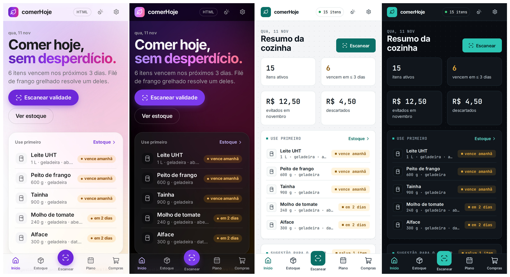
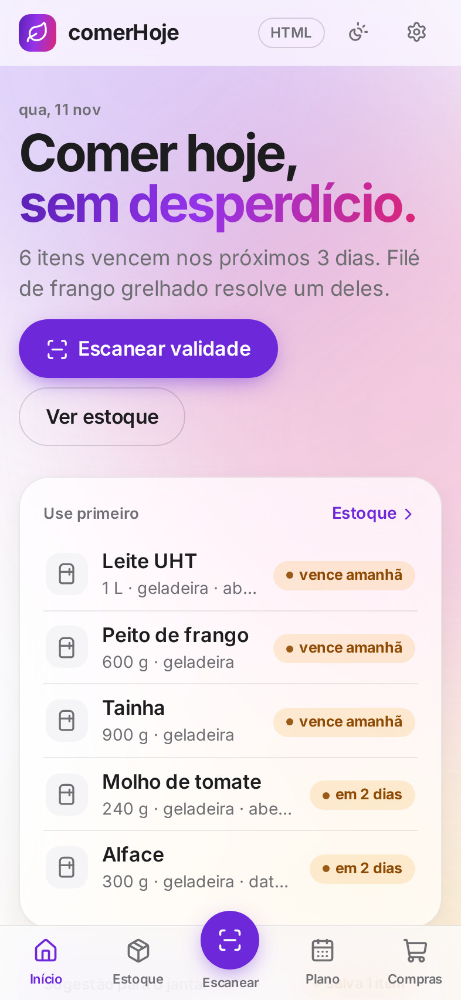
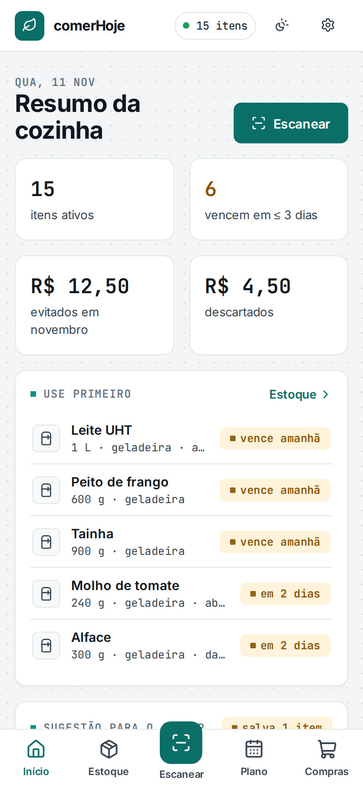
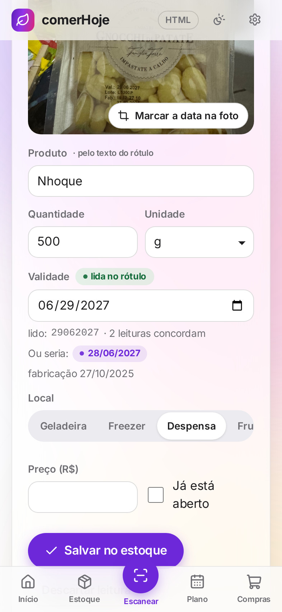
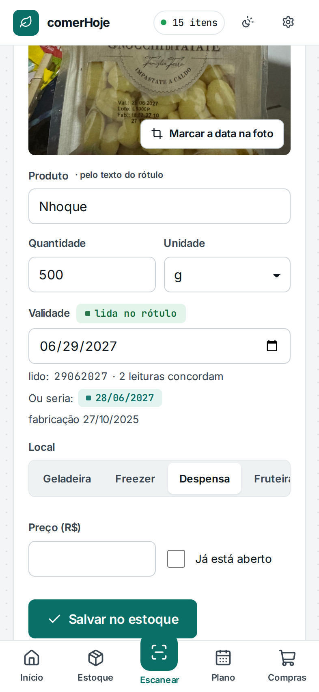
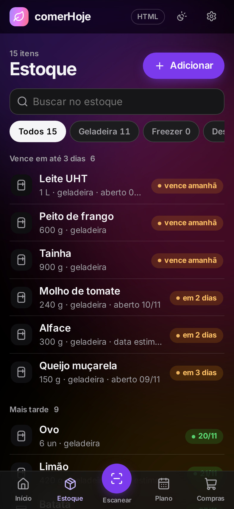
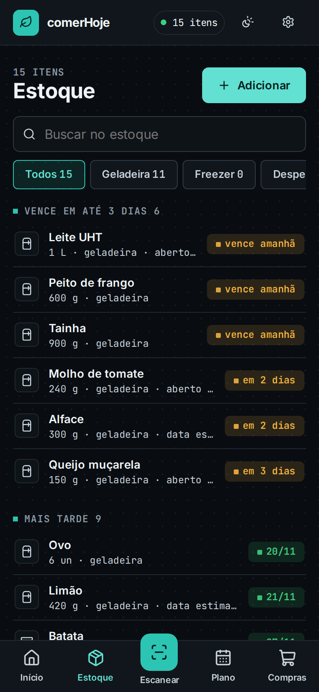
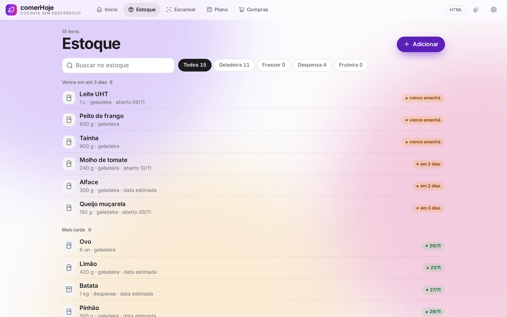
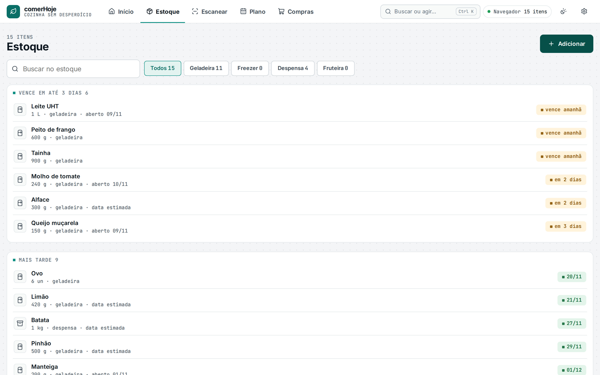

# comerHoje in the Taiga design system: Lumen × Neue

comerHoje implements **both** Taiga frameworks over the **same markup**. The person picks one in Ajustes →
Aparência ("experimente os dois"), the choice is saved on the device and applied **before the first paint**
(DLV-07). Lumen is the default, and the app can start in Neue with `options(comerHoje.framework = "neue")`
or `COMERHOJE_FRAMEWORK=neue`. This document compares the two in the app, records the decisions, and
checks conformance with `taiga-design-system/{lumen,neue}/REQUIREMENTS.md`.

## 1. Recommendation

| Question (Taiga: *When to choose*) | comerHoje | Points to |
|---|---|---|
| Who is the reader? | a household, non-technical, on the phone | **Lumen** |
| Session shape | minutes: scan, check what expires, cook | **Lumen** |
| Density | low: one decision per screen (what do I use today?) | **Lumen** |
| Is there hours-long work with lots of data? | only for whoever organises the whole pantry on the computer | Neue (desktop) |

**Default: Lumen.** It is guided, the promise on the first screen ("Comer hoje, *sem desperdício*.", LUM-P-01),
the numbers come with explanations (LUM-P-02), and there is one dot per package as the data story (LUM-C-08).
**Neue stays as an option** for those who manage the stock on the computer: dense table, mono figures, command
bar (Ctrl K), keyboard shortcuts, density and text size. Both use the same data, screens and operations.

## 2. How each framework shows up

| | Lumen (cinematic) | Neue (instrument) |
|---|---|---|
| Canvas | daylight `#fbfbfd` / cinema `#000`, **ambient light** (3 blobs, 26–34 s, switchable) | dot grid `#f3f5f6` / ink blue `#090d11` (switchable to plain) |
| Accent | **açaí** `#6d28d9` (dark `#7c3aed`) + gradient on **key words** only | teal: `#0e8f83` for indicators, accent-ink `#0a6f66` for filled buttons |
| Type | system stack, 17 px body, display `clamp(42px, 11.2vw, 104px)` at −0.045em | Inter 14 px (shipped, OFL), **JetBrains Mono** for quantities, dates, codes and status |
| Shape | pill buttons with a glow, radii 34/26/18/12 | ruled panels, radii 14/12/8/6, 34 px controls (44 px on touch screens) |
| Glass | header, tab bar, sheets, cards over the light (with an `@supports not` fallback) | none (NEU-V-03) |
| Navigation | glass nav + **mode chip** (Shiny / Quarto / HTML) + theme toggle; the status only appears when something is pending | header with **status pill** (source · items · sync), tab rail with a 2 px underline, command field |
| Home | hero with the promise, bento of cards, one dot per package, **big numbers with explanations** | KPI tiles in mono, ruled "Use primeiro" table, by-expiry panel |
| Extras | — | Ctrl K / "/", shortcuts (1–5, n, e, t, ?), text S–XL, density, high contrast, plain canvas |

Semantic colours (ok / warn / bad) never double as brand colour, in either framework. That is why the
Lumen accent is not green: **green means "fine"** on the expiry chips. Expiry is always shown with
**colour + text** ("vence amanhã", "em 2 dias", "20/11").

## 3. Tokens

- Lumen: [`srcjs/css/10-lumen.css`](../srcjs/css/10-lumen.css), values from `lumen/lumen-tokens.css` (QuantSkill daylight
  + cinema), prefix renamed `--lm-` → `--ch-` as the sheet instructs. Components only read `--ch-*` (LUM-V-01).
- Neue: [`srcjs/css/20-neue.css`](../srcjs/css/20-neue.css), values verbatim from `neue/neue-tokens.css` (teal_neue light and
  **ink blue** dark: one dark palette per product, NEU-V-06), with the appearance attributes `data-ch-text`,
  `data-ch-density`, `data-ch-contrast` and `data-ch-canvas`.
- Structure: [`srcjs/css/00-base.css`](../srcjs/css/00-base.css), everything under `.ch` (DLV-03).

## 4. Contrast (measured on the rendered tokens)

[`tests/e2e/test_contraste.py`](../tests/e2e/test_contraste.py) reads the computed styles and blends the
translucent surfaces as the browser does. **48/48 pairs ≥ 4.5:1, the lowest 4.91:1** (Lumen light, text 2 on the canvas).

| Pair | Lumen light | Lumen dark | Neue light | Neue dark |
|---|---|---|---|---|
| Text on the canvas | 16.28 | 19.29 | 16.50 | 17.44 |
| Text 2 on the canvas | 4.91 | 8.16 | 8.83 | 12.55 |
| Filled-button label | **7.10** | **5.70** | **6.04** | 7.95 |
| "Urgent" chip | 5.86 | 8.63 | 5.76 | 7.50 |

The two contrast problems that `tokens/contrast.md` reported in the Taiga apps were avoided. White on Neue's
teal (3.98:1) was replaced by accent-ink `#0a6f66` (6.04:1), as the Neue guide suggests. White on QuantSkill's
dark blue (3.65:1) has no counterpart here: the dark açaí accent gives 5.70:1.

## 5. Conformance

✓ meets · ◐ partly · – not applicable

| Requirement | | Where |
|---|---|---|
| DLV-01 one front end, one build | ✓ | `srcjs/` → `tools/build.mjs` → `inst/app/www`, `inst/quarto`, `inst/standalone` |
| DLV-02 no external requests | ✓ | fonts, icons (Lucide, ISC) and WASM in the bundle; test: 0 requests |
| DLV-03 namespaced styles | ✓ | `.ch` + `html.ch-host` |
| DLV-04 host detection | ✓ | `data-mode` = shiny / quarto / html; Quarto: no fixed bar |
| DLV-05/06 safe JSON, ASCII assets, no `<script` / `</body` / `<!--` | ✓ | checked by the build (fails otherwise) |
| DLV-07 theme before the first paint | ✓ | `inst/app/tema-inicial.js` after the root |
| DLV-10/11 Shiny: `run_app()` / `comerhoje_app()`, protocol `input$ch_msg` ↔ `ch-msg`, reconnect | ✓ | `R/app.R`; bench `tests/e2e/test_protocolo_shiny.py` |
| DLV-12/13 `export_quarto()`, `quarto_block()`, `export_html()` | ✓ | `R/exportar.R` |
| DLV-20 secrets only in Shiny | ✓ | AI key and script password on the server; in HTML the password is typed on the device (not embedded) |
| DLV-30/31 smoke tests of the targets, R↔JS parity | ✓ | `tools/verificar.py` |
| LUM-V-02 light + dark | ✓ | daylight and cinema |
| LUM-V-04 button labels ≥ 4.5 | ✓ | 7.10 / 5.70 |
| LUM-V-07 glass only on what floats, with a fallback | ✓ | + `@supports not` |
| LUM-V-08 switchable ambient light | ✓ | Ajustes → Luz ambiente; frozen for capture |
| LUM-M-02 reduced motion | ✓ | `prefers-reduced-motion` |
| LUM-C-01 glass nav with mode chip and theme toggle | ✓ | |
| LUM-C-08 data story | ✓ | one dot per package, with a legend |
| LUM-K-01 screenshots from the build + manifest | ✓ | `tools/screens.py` → `docs/features/` |
| LUM-K-03 promo video | – | not produced (the QuantSkill utility is not in this upload) |
| NEU-V-01 token layers and Bootstrap bridge | ◐ | layers and appearance attributes yes; the `--bs-*` bridge does not apply (there is no Bootstrap) |
| NEU-X-01/02 appearance (mode, text, density, contrast, canvas) before paint | ✓ | corners and user accent not implemented |
| NEU-N-01 command bar | ✓ | Ctrl/Cmd+K and "/" |
| NEU-N-02 deep links | ✓ | `#/estoque`, `#/plano/2026-11-13` |
| NEU-P-03 provenance always visible | ✓ | status pill (source · items · sync · pending) |
| NEU-A-02 accent button ≥ 4.5 | ✓ | 6.04 |

## 6. Gallery

All images: [`features/manifest.json`](features/manifest.json).

| Lumen | Neue |
|---|---|
|  |  |
|  |  |
|  |  |
|  |  |
