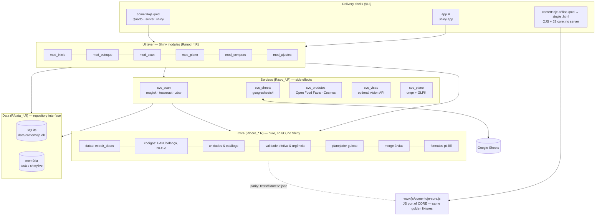
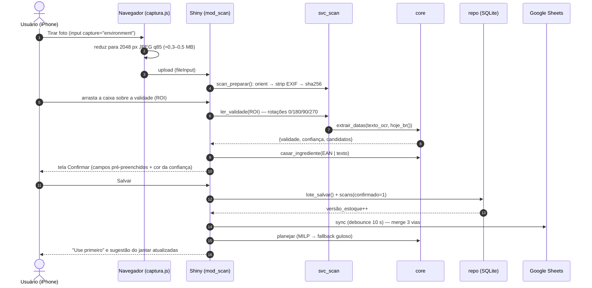
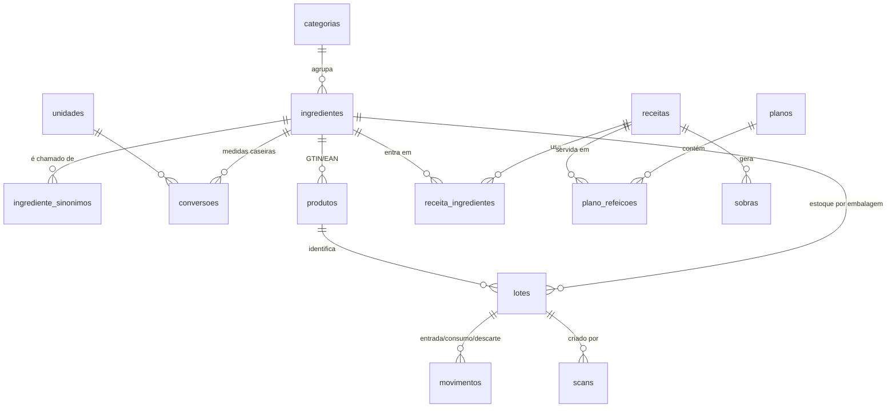
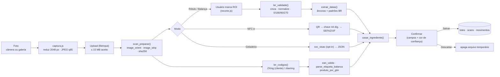

> **Superseded.** This is the v1 specification (2026-11-11, before the rework). The current version is [../ARCHITECTURE.md](../ARCHITECTURE.md).

# comerHoje — Architecture & Implementation Specification

> **Status:** v1.0 — proposed baseline for implementation · **Date:** 2026-11-11 · **Repo state audited:** commit `653fcc0` ("baseline")
> **Audience:** developers (English) · **App language:** Brazilian Portuguese (pt-BR) throughout: UI, catalog, units, wireframes and the end-user guide (§20.4).
> **Scope:** this document specifies *what to build and how*. It changes no external systems: no Google project, spreadsheet, API or deployment was created or contacted while writing it. The only files added to the repository are this document, its verification scripts and their outputs (§21.3).

**Conventions.** MUST / SHOULD / MAY follow RFC 2119. Code blocks preceded by `<!-- extract: path -->` are **normative artifacts**: the verification script (§21) extracts them to those paths and tests them. Each claim is labelled **[verified]** (executed or measured while writing this spec, see §21) or **[to verify]** (depends on an environment we did not have: R, Quarto, an iPhone, Google APIs, internet).

---

## Table of contents

1. [Executive summary](#1-executive-summary)
2. [Product context, goals and principles](#2-product-context-goals-and-principles)
3. [Baseline audit of the current repository](#3-baseline-audit-of-the-current-repository)
4. [Evidence from the reference photos](#4-evidence-from-the-reference-photos)
5. [System architecture](#5-system-architecture)
6. [Repository layout and code loading](#6-repository-layout-and-code-loading)
7. [Data model (SQLite)](#7-data-model-sqlite)
8. [Localized ingredient database](#8-localized-ingredient-database)
9. [Meal planning and waste optimization](#9-meal-planning-and-waste-optimization)
10. [Image upload and processing workflow](#10-image-upload-and-processing-workflow)
11. [Google Sheets integration](#11-google-sheets-integration)
12. [UI/UX specification (iPhone and desktop)](#12-uiux-specification-iphone-and-desktop)
13. [Triple-format delivery](#13-triple-format-delivery)
14. [Module contracts](#14-module-contracts)
15. [Configuration and secrets](#15-configuration-and-secrets)
16. [Testing strategy](#16-testing-strategy)
17. [Deployment and operations](#17-deployment-and-operations)
18. [Roadmap and acceptance criteria](#18-roadmap-and-acceptance-criteria)
19. [Risks and open questions](#19-risks-and-open-questions)
20. [Guides](#20-guides)
21. [Verification summary](#21-verification-summary)
22. [Appendix: glossary (pt-BR → EN)](#22-appendix-glossary-pt-br--en)

---

## 1. Executive summary

**comerHoje** ("eat today") is a mobile-first meal planner for Brazilian households. Its goal is to **eat what is about to expire before it expires**. It tracks each package in the kitchen (with its own expiry date), reads expiry dates from phone photos, proposes meals built around the most urgent items, and mirrors inventory and the shopping list to a Google Sheet the family already uses.

The key decisions, and what drove each one:

| # | Decision | Why (evidence) |
|---|---|---|
| D1 | **Track lots (one row per package), not ingredients.** | The current `pantry.ingredient UNIQUE` + `INSERT OR REPLACE` overwrites the first pack's expiry date when a second pack is added (§3, A6). |
| D2 | **Effective expiry = min(printed date, opened-on + days-after-opening).** | Two of the five labels print "após aberto, consumir em até 3 dias" (§4). Opening the molho de tomate moves its expiry from 31/03/2027 to 13/11/2026, and the planner reacts [verified, §9.4]. |
| D3 | **Scanning = crop to the date → OCR → parse → *human confirmation*.** Barcodes are read for identity and price, never for dates. | Full-frame OCR found **0 of 5** expiry dates. Cropping to the date region found the dates in 2 labels (plus a weighing date on the scale label), and OCR ran about **4× faster** (0.2–0.9 s per crop vs 1.1–3.2 s per full frame). The parser **refuses** garbled text instead of guessing [verified, §4.2]. |
| D4 | **Read weight and price from the scale barcode, not from OCR.** | OCR misread R$ 30,90 as 30,92. The barcode `2 06584 001489 9` decodes reliably at every resolution and its value 001489 = R$ 14,89 matches the printed total [verified]. |
| D5 | **Put all business logic in a pure core layer; Shiny modules are thin; there are three delivery shells.** | One code base serves the Shiny app, the Quarto `server: shiny` document, and a single-file offline HTML. The offline file uses a JS port of the core that is held to the *same golden fixtures* (31/31 passing) [verified]. |
| D6 | **Sync Google Sheets with a three-way merge against a stored base snapshot.** | Family members edit the Sheet by hand without touching `atualizado_em`. Last-writer-wins on timestamps would silently overwrite those edits (§11.4). |
| D7 | **pt-BR is native, not translated.** Formatting uses explicit helpers and a fixed time zone (`America/Sao_Paulo`). | Servers run in UTC. After 21:00 in Brasília, `Sys.Date()` is already "tomorrow", so "vence hoje" would be wrong (§3, A10). |
| D8 | **Privacy by default:** strip EXIF and GPS on ingest and keep no photos. | All six reference photos carry **GPS coordinates** and are committed to git [verified]. |

---

## 2. Product context, goals and principles

### 2.1 Who it's for

- **Primary persona — "quem cuida da cozinha"**: shops weekly (supermercado + feira), cooks lunch on weekdays, stores leftovers in the pot in the fridge (see the pressure cooker in `geladeira.jpeg`), and uses an iPhone with one hand, often standing in front of the open fridge.
- **Secondary — the household**: checks the shopping list at the market, usually in the Google Sheets app, and adds items by hand.
- **Developer/maintainer**: an R/Shiny developer who wants one code base and three outputs (§13).

### 2.2 Goals (measurable)

| Goal | Metric | Target (after 8 weeks of use) |
|---|---|---|
| Less food thrown away | `v_desperdicio_mensal.valor_rs` | −50 % vs the first 2 weeks |
| Fast capture | Time from tapping "Escanear" to a saved lot (label mode, good light) | ≤ 20 s median |
| Trustworthy dates | Share of saved lots whose expiry was auto-filled **wrong** and not corrected | 0 % (the parser must refuse rather than guess) |
| Plans people actually cook | Share of planned meals marked "Feito" | ≥ 60 % |

### 2.3 Non-goals (v1)

Nutrition coaching or diets (calories are optional constraints only), price comparison between stores, multi-household SaaS with in-app login (use platform authentication, §17), native iOS app, push notifications.

### 2.4 Design principles

1. **Waste first.** Every ranking (home screen, planner, shopping list) is driven by *effective* expiry.
2. **Suggest, never auto-commit.** OCR, barcodes, receipts and vision produce *candidates*. A person confirms before anything is written to stock.
3. **Refuse rather than guess.** A `null` date ("digite a validade") is always better than a confident wrong date.
4. **Thumb-first.** Design the layout for a 375–430 pt-wide screen and one hand, then enhance it for desktop.
5. **Brazil by default.** dd/mm/aaaa, R$ 1.234,56, vírgula decimal, xícara/colher/lata, regional ingredient names (aipim = macaxeira = mandioca), almoço as the main meal.
6. **One core, many shells.** Pure functions hold the business rules. UIs, storage and delivery formats are adapters around them.

---

## 3. Baseline audit of the current repository

The repository is a working English-language prototype ("Smart Pantry & Waste Optimizer"): `app.R`, `global.R`, `R/db.R`, `R/solver.R`, `modules/mod_pantry.R`, `modules/mod_planner.R`, an `renv` setup for R 4.6.0, and the six reference photos. The foundations are good (bslib, modules, SQLite, a MILP solver). The findings below are what must change. Severity: **C** critical · **H** high · **M** medium · **L** low.

| # | Area | Finding | Evidence | Sev. | Resolution |
|---|---|---|---|---|---|
| A1 | Reproducibility | `renv.lock` lists 31 packages (shiny/bslib and their dependencies) but **not** DT, DBI, RSQLite, magick, ompr, ompr.roi, ROI.plugin.glpk, dplyr or tidyr. They *are* installed in the local renv library (DT 0.34.0, RSQLite 3.53.3, magick 2.9.1, ompr 1.0.4…), so the lockfile was never re-snapshotted. On a fresh clone `renv::restore()` succeeds, then `library(DT)` fails. | Parsed `renv.lock`; read the renv cache links in `renv/library/…` [verified] | C | §20.1 step 2: `renv::snapshot()` with the full dependency list (§17.1). |
| A2 | Privacy | All 6 reference photos contain **13 GPS EXIF tags** (latitude/longitude of the home) and are tracked in git. | PIL EXIF dump [verified] | H | Strip GPS before the repo is ever made public (§20.1 step 3). The ingest pipeline MUST `image_strip()` (§10.9). |
| A3 | Repo hygiene | 125 of the 144 tracked files are macOS `__MACOSX/` resource forks. | `git ls-files` [verified] | L | Remove them; add `__MACOSX/` and `.DS_Store` to `.gitignore`. |
| A4 | Image pipeline | `image_modulate(img, brightness = 120, contrast = 150)`: magick's `image_modulate()` takes `brightness`, `saturation` and `hue`, but **no `contrast`**, so every upload should fail with "unused argument". The processed image is then thrown away, and nothing ever reads it. | magick's documented signature; not executed (no R here) [to verify] | H | Replace with the §10 pipeline. |
| A5 | Image pipeline | No EXIF auto-orientation. **Every** reference photo has Orientation ≠ 1 (five are `6` = rotated 90°, `porco2` is `3` = 180°). Without `image_orient()`, OCR sees sideways text. There is also no `capture` attribute, `accept` is limited to PNG/JPEG, and the default 5 MB `shiny.maxRequestSize` leaves little headroom (`geladeira.jpeg` is 3.8 MB at 24 MP). | EXIF tag 274 [verified] | H | Client-side resize + `image_orient()` + rotation search (§10.4–10.6). |
| A6 | Data model | `ingredient TEXT UNIQUE` + `INSERT OR REPLACE`: adding a second pack of an item replaces the first, **including its expiry date**. A waste minimizer cannot work without per-package dates. | `R/db.R` L14, L64 | C | `lotes` table (§7). |
| A7 | Units | `recipes` has no unit column, and the solver subtracts recipe quantities from pantry quantities whatever their units ("12 units" of eggs vs "3"). | `R/db.R`, `R/solver.R` | H | Base units + `conversoes` (§8.2). |
| A8 | Solver | (a) `recipe_list` follows order of appearance while `recipe_scores` is sorted by `recipe_id`, so the selected indices can map to the wrong recipes. (b) The calorie constraint binds `i` both inside `sum_over()` and as a quantifier: ill-formed, at best *n* duplicate constraints. (c) No availability constraint, no lower calorie bound, no meal slots: it returns a *set* of recipes, not a schedule. (d) `pmax(1, days)` gives **expired** items the maximum urgency, so it plans meals around spoiled food. (e) Calories are repeated on every ingredient row. | Code reading | H | New formulation (§9.3) + greedy baseline (§9.4). |
| A9 | Table styling | `formatStyle('expiry_date', styleInterval(as.numeric(dates)))`: DT sends Dates to the browser as strings, so numeric cut-points are unlikely to compare correctly. | Code reading [to verify] | M | Compute `dias_restantes` in R; style on that column (§12). |
| A10 | Localization / time | Every string, seed row and category is in English. `Sys.Date()` uses the server time zone (UTC on typical hosts), so after 21:00 BRT "today" is wrong. | Code reading | H | §8, §12.6, `hoje_br()`. |
| A11 | Code loading | `global.R` sources `R/db.R` and `R/solver.R`, and Shiny (≥ 1.5) also autoloads `R/`, so both files are sourced twice. `init_db()` runs at source time. | Code reading | L | `bootstrap.R` + `R/_disable_autoload.R` (§6.2). |
| A12 | Persistence | `pantry.db` lives in the working directory. On shinyapps.io local files are not durable across redeploys or instance restarts. | Platform behaviour | H | `COMERHOJE_DB` path + Sheets as durable mirror (§11, §17). |
| A13 | Quality | No tests, CI or linting. | — | M | §16. |

---

## 4. Evidence from the reference photos

The six photos in `references/` (iPhone 15 Pro Max, 12–24 MP JPEG, taken indoors at night, 11/11/2026) are the **design inputs** for the scanning workflow. Each one shows a different class of problem.

### 4.1 What each photo shows and what it requires

| Photo | Content | What is on it | Difficulty | Requirement derived |
|---|---|---|---|---|
| `geladeira.jpeg` | Open fridge, 5712×4284, warm incandescent light | Leite Piracanjuba; Batavo *manteiga extra com sal*; Maggi "Liquid Seasoning"; "Crispy Chilli in Oil" jar; garlic; hot-sauce bottles; cold cuts / raw pork packs; sliced cheese; limes in the crisper; **pressure cooker and pot on the shelves** (likely leftovers); **empty egg tray** | Not an OCR problem: many objects, occlusion, English/Chinese labels, cookware, colour cast | "Geladeira" mode = *assisted inventory* (optional vision + confirmation chips, §10.8). Catalog with foreign synonyms (§8.3). A `sobras` table. Ignore non-food, but offer "is there food in this pot?" |
| `leite.jpeg` | Top of a UHT milk carton | Header `VAL./LOTE:`; ink-jet `190327 01:05 10` / `6292M9` | Compact DDMMAA with no separators, next to a time and a lot code | DDMMAA pattern anchored by the *previous* line. `01:05` must not become a date |
| `molho_tomate.jpeg` | Heinz sachet, back | `VAL:03/2027`, `L:31 12:06 M3-2`, EAN `7896102503814`, nutrition table (4 portions × 60 g = 240 g), "após aberto… consumir em até 3 dias" | Reflective foil + dot-matrix print; crumpled barcode | MM/AAAA = last day of the month; `aberto_dias`; EAN fallback = OCR the printed digits + check digit |
| `nhoque.jpeg` | La Molisana gnocchi 500 g (imported, Italian label) | `Val.: 29 06 2027`, `Lote: L5300P`, `Fab.: 18:52 27 10` / `27 10 2025`, "Gnocchi di patate", `500g℮` | Date printed over a transparent window with the product behind it; two dates; space separators | Tell *Val* from *Fab*; space-separated dates; Italian synonyms → "Nhoque" |
| `porco.jpeg` | El Corte panceta, back | `Fab: 19/10/2026`, `Val: 19/01/2027`, `Lote:1019`, EAN `7898916348674`, "VENDA POR PESO", "0 a 7 °C", preparation method, "após aberto… até 3 dias" | OCR reads `/` as `'` | Normalize OCR confusions. The panceta recipe comes from this label |
| `porco2.jpeg` | Supermarket **scale label** on the same pack | "PANCETA EL CORTE KG TEMPERADA RESFRIADO", `DATA PESAGEM: 06/11/26 23:15`, tare 0,010 kg, **0,482 kg**, **R$/kg 30,90**, **TOTAL R$ 14,89**, EAN `2 06584 001489 9` | Label is **upside down even after EXIF correction** (Tesseract OSD could not tell); OCR misread the price | Try rotations 0/180/90/270 and score them. Take price and weight from the barcode. "Pesagem" is *not* an expiry date |

Cross-cutting observations: **every label uses DD/MM** (never MM/DD). Decimal commas appear in weights and prices (`0,482`, `30,90`). Labels can be in Portuguese, Italian, English or Chinese. Light is poor, and plastic or foil reflections are the norm. The consistency check 0,482 kg × R$ 30,90 = R$ 14,89 holds, which gives a validation rule for scale labels.

### 4.2 OCR and barcode experiment [verified]

A reproducible experiment (`docs/verification/ocr_experiment.py`, §21) ran Tesseract 5.3.4 and OpenCV's barcode detector on the photos (EXIF-oriented). The sandbox only had the `eng` language pack; production uses `por`. Digits and date keywords don't depend on language packs, but words with accents do.

| Photo | Full frame, no preprocessing | Full frame, CLAHE + `--psm 11` | **Crop to date region** + CLAHE, `--psm 6` | Parser result on the crop | Barcode (OpenCV) |
|---|---|---|---|---|---|
| leite | no date (2 tokens) | noise | `190327 ay …` | **19/03/2027**, confidence 0.25 → shown as a suggestion only | — (none on label) |
| molho_tomate | 0 tokens | noise | `URL GS e0e7` | `null` → "digite a validade" | ✗ full and crop (pack is crumpled). Printed-digit OCR: `05814` (partial) |
| nhoque | no date | noise | `Val.: 26906 2027…` | `null` (correctly **refused**) | — |
| porco | 311 tokens of ingredient text, no date | no date | `Fab: 19/10'2026 │ Val: 19/01'2027` | **19/01/2027**, 0.9 (after `'`→`/` normalization) | ✓ `7898916348674` (crop only) |
| porco2 | mirrored text | noise | at 0°: garbage; **at 180°**: `PESAGEN: 06/11/26 │ … 0,010ks │ U,482kat │ RS/kss 30,92` | pesagem 06/11/2026, no expiry (correct) | ✓ `2065840014899` at 1000/1600/2400/4032 px |

**Timing** (reproducible run, 4 vCPU sandbox; absolute numbers vary with load): full-frame OCR at 2048 px took 1.1–3.2 s per photo; OCR on the crop took 0.2–0.9 s, about 4× less in aggregate (porco: 3.17 s → 0.46 s). An earlier ad-hoc run measured 5.9 s → 0.5 s for porco. Either way, only the crops produced dates. **Upload size:** re-encoding at 2048 px long side, JPEG q85, turns 1.2–3.8 MB originals into 290–493 KB (4–9× smaller).

**What follows from this:**
1. Cropping is mandatory. The UI asks the user to drag a box over the date (wireframe M3b). Full-frame OCR is a fallback only.
2. Dot-matrix on foil (molho) and print over a product window (nhoque) defeat classical OCR. The confirmation screen with manual entry is the **main path** for them, not an edge case. An optional vision model (§10.8) MAY help.
3. Barcodes are the reliable channel for *identity* (EAN → product) and *price/weight* (scale labels). They never carry the expiry date.
4. EXIF orientation is necessary but not enough (porco2). Rotation search is required.

---

## 5. System architecture

### 5.1 Layers



**Dependency rule (MUST):** arrows point downward only. `core_*` imports nothing beyond base R, `stringi`, `jsonlite` and `digest`. Modules never call `DBI` directly; they go through the repository object. Services never touch `input`/`output`.

### 5.2 Runtime data flow: "scan a label → plan a meal"



### 5.3 Technology choices

| Concern | Choice | Notes |
|---|---|---|
| Language/runtime | R 4.6.0 (lockfile), Shiny 1.14.0, bslib 0.12.0 | Already in `renv.lock` |
| UI kit | bslib (Bootstrap 5) + ~250 lines of custom CSS (`www/comerhoje.css`) | System font stack. No Google Fonts download (privacy, offline, speed) |
| Storage | SQLite via DBI/RSQLite, WAL mode | One file; a household-scale workload |
| Images | magick 2.9.1 (ImageMagick) | orient / strip / scale / crop / rotate / normalize |
| OCR | `tesseract` R package + `tesseract-ocr-por` | Crop-first (§4.2) |
| Barcodes | Client: ZXing-based WASM library (live camera). Server fallback: `zbarimg` CLI | iOS Safari has no native `BarcodeDetector` [to verify on current iOS] |
| Optimization | ompr 1.0.4 + ompr.roi + ROI.plugin.glpk (GLPK) | Already used by the prototype. Greedy fallback |
| Sheets | googlesheets4 + gargle (service account in prod) | Scope `…/auth/spreadsheets` only |
| Static build | Quarto HTML, `embed-resources: true`, OJS + `comerhoje-core.js` | No server, no CDN at runtime |
| Tests | testthat, shinytest2, node (`run_golden.js`) | Shared JSON fixtures |

---

## 6. Repository layout and code loading

### 6.1 Target tree

```text
comerHoje/
├── app.R                        # Shell 1: Shiny app (thin: ui_app() + servidor_comerhoje())
├── comerHoje.qmd                # Shell 2: Quarto interactive document (server: shiny)
├── comerHoje-offline.qmd        # Shell 3: source of the single-file offline HTML
├── bootstrap.R                  # the ONLY loader (explicit, ordered); used by all shells + tests
├── Makefile                     # make app | doc | offline | test | lint
├── R/
│   ├── _disable_autoload.R      # stops Shiny's implicit R/ sourcing (bootstrap.R is the loader)
│   ├── core_datas.R             # extrair_datas(), normalizar_ocr()              (pure)
│   ├── core_codigos.R           # ean_valido(), parse_etiqueta_balanca(), chave_nfce_valida()
│   ├── core_unidades.R          # converter_para_base(), fmt_qtd()
│   ├── core_catalogo.R          # normalizar_termo(), casar_ingrediente()
│   ├── core_validade.R          # validade_efetiva(), urgencia(), hoje_br()
│   ├── core_planejador.R        # planejar_guloso(), preparar_problema()
│   ├── core_sync.R              # mesclar_3vias()
│   ├── core_formatos.R          # fmt_num(), fmt_brl(), fmt_data(), DIAS_SEMANA …
│   ├── data_sqlite.R            # repo_sqlite(): the repository interface over DBI
│   ├── data_memoria.R           # repo_memoria(): same interface, in-memory (tests)
│   ├── data_seed.R              # catalogo_carregar(): CSV → tables, idempotent
│   ├── svc_scan.R               # scan_preparar(), ler_validade(), ler_codigos()
│   ├── svc_produtos.R           # produto_por_gtin(): cache → OFF → Cosmos
│   ├── svc_nfce.R               # NFC-e QR → items (per-UF parsers)
│   ├── svc_visao.R              # optional vision provider (interface + 1 adapter)
│   ├── svc_plano.R              # planejar_milp() (ompr/GLPK) with greedy fallback
│   ├── svc_sheets.R             # sheets_autenticar(), sincronizar_aba()
│   ├── ui_componentes.R         # cartao_lote(), chip_validade(), barra_abas(), input_foto() …
│   ├── ui_tema.R                # tema_comerhoje() (bs_theme), head_mobile()
│   ├── ui_app.R                 # ui_app(): page shell for app.R
│   ├── servidor.R               # servidor_comerhoje(): wires modules; reused by app.R and .qmd
│   └── mod_inicio.R · mod_estoque.R · mod_scan.R · mod_plano.R · mod_compras.R
│       · mod_ajustes.R · mod_urgentes.R
├── data/
│   ├── schema.sql               # §7 (normative)
│   ├── categorias.csv · unidades.csv · ingredientes.csv · sinonimos.csv
│   ├── conversoes.csv · receitas.csv · receita_ingredientes.csv   # generated from §8 tables
│   └── comerhoje.db             # runtime (gitignored); path from COMERHOJE_DB
├── www/
│   ├── comerhoje.css            # tokens, safe areas, tab bar, cards (§12)
│   ├── js/comerhoje-core.js     # JS core (§9.4, §10.5) — offline build + browser helpers
│   ├── js/captura.js            # client-side resize before upload (§10.3)
│   ├── js/recorte.js            # ROI cropper (pointer events) → input$<id>_roi
│   ├── js/codigos.js            # live barcode (ZXing WASM, vendored, not CDN)
│   ├── manifest.webmanifest · icons/apple-touch-icon-180.png
├── tests/
│   ├── fixtures/golden_datas.json · golden_codigos.json · golden_planner.json
│   ├── testthat/test-core_*.R · test-data_sqlite.R · test-catalogo.R · test-sync.R
│   ├── shinytest2/test-fluxos.R # iPhone 393×852 and desktop 1440×900
│   ├── js/run_golden.js
│   └── ocr/                     # benchmark photos (GPS-stripped) + expected.json
├── docs/
│   ├── ARCHITECTURE.md          # this document
│   └── verification/            # verify_spec.py, ocr_experiment.py (§21)
├── references/                  # original photos (strip GPS, see A2)
├── renv.lock · renv/ · .Rprofile · comerHoje.Rproj · .gitignore
```

The existing files migrate like this: `R/db.R` → `data_sqlite.R` (+ migration §7.4) · `R/solver.R` → `svc_plano.R` + `core_planejador.R` · `modules/mod_pantry.R` → `mod_estoque.R` + `mod_scan.R` · `modules/mod_planner.R` → `mod_plano.R` + `mod_compras.R` · `global.R` → `bootstrap.R`.

### 6.2 One loader for every shell

Shiny autoloads `R/` for `app.R` apps. Quarto documents and `testthat` don't. If we relied on the autoloader, each shell would load code in a different way. Instead, `R/_disable_autoload.R` (an empty file — Shiny's documented opt-out) turns autoloading off, and every shell calls `bootstrap.R`:

<!-- extract: bootstrap.R -->
```r
# bootstrap.R — carregador único do comerHoje (app.R, comerHoje.qmd, comerHoje-offline.qmd, testes)
carregar_comerhoje <- function(raiz = ".", so_core = FALSE) {
  Sys.setenv(TZ = Sys.getenv("COMERHOJE_TZ", "America/Sao_Paulo"))
  pacotes_core <- c("stringi", "jsonlite", "digest")
  pacotes_app  <- c("shiny", "bslib", "htmltools", "DBI", "RSQLite", "magick",
                    "uuid", "dplyr", "ompr", "ompr.roi", "ROI.plugin.glpk")
  for (p in if (so_core) pacotes_core else c(pacotes_core, pacotes_app)) {
    if (!requireNamespace(p, quietly = TRUE)) stop("Pacote ausente: ", p, " — rode renv::restore()")
  }
  arquivos <- list.files(file.path(raiz, "R"), pattern = "\\.R$", full.names = TRUE)
  arquivos <- arquivos[basename(arquivos) != "_disable_autoload.R"]
  ordem <- c("core_", "data_", "svc_", "ui_", "mod_", "servidor")        # dependências descem
  if (so_core) arquivos <- arquivos[startsWith(basename(arquivos), "core_")]
  rank <- vapply(basename(arquivos), function(b) which(startsWith(b, ordem))[1], integer(1))
  for (a in arquivos[order(rank, basename(arquivos))]) sys.source(a, envir = globalenv())
  invisible(TRUE)
}
```

Loading has **no side effects**: no DB connection, no network, no `init_db()` at source time. Each shell opens resources inside its server function (`servidor_comerhoje()`). This makes `bootstrap.R` safe to use at Quarto render time and in tests.

---

## 7. Data model (SQLite)

### 7.1 Entity overview



### 7.2 Rules that the schema enforces

- **Lot granularity.** One row in `lotes` is one physical package (or one weighed portion) with *its own* `validade`. Two packs of panceta are two rows.
- **Quantities are stored in the ingredient's base unit** (`g`, `ml` or `un`). Any other unit is converted on input (§8.2) and formatted on output (`fmt_qtd()`: 1500 g → "1,5 kg").
- **Effective expiry** is computed by the `v_estoque` view: `min(validade (printed or estimated), aberto_em + aberto_dias)`. If there is no printed date, `validade_base = data_compra + validade_padrao_dias` and `validade_origem = 'estimada'`.
- **"Today" is never computed in SQL.** SQLite's `date('now')` is UTC. Days remaining are computed in R with `hoje_br()`.
- **Soft deletes (`excluido = 1`) on every synced table**, so deletions can propagate to the Sheet (§11).
- **Every stock decrease writes a `movimentos` row.** Discards require a `motivo`, which feeds the waste dashboard (`v_desperdicio_mensal`).

### 7.3 DDL (normative)

<!-- extract: data/schema.sql -->
```sql
-- comerHoje — esquema SQLite v1 (data/schema.sql). Datas: TEXT ISO-8601 'AAAA-MM-DD'.
-- Timestamps: TEXT ISO-8601 com fuso ('2026-11-11T21:05:00-03:00'). Nunca use date('now') em
-- consultas de negócio: o SQLite calcula em UTC e o "hoje" do usuário é America/Sao_Paulo.
PRAGMA foreign_keys = ON;

CREATE TABLE meta (chave TEXT PRIMARY KEY, valor TEXT NOT NULL);

CREATE TABLE categorias (
  id            TEXT PRIMARY KEY,
  nome          TEXT NOT NULL UNIQUE,
  secao_mercado TEXT NOT NULL,            -- agrupamento da lista de compras
  ordem         INTEGER NOT NULL
);

CREATE TABLE unidades (
  codigo        TEXT PRIMARY KEY,
  nome_singular TEXT NOT NULL,
  nome_plural   TEXT NOT NULL,
  abreviacao    TEXT NOT NULL,
  tipo          TEXT NOT NULL CHECK (tipo IN ('massa','volume','contagem','especifica','qualitativa')),
  fator_base    REAL,                     -- massa→g, volume→mL, contagem→un
  CHECK ((tipo IN ('massa','volume','contagem') AND fator_base > 0)
      OR (tipo IN ('especifica','qualitativa') AND fator_base IS NULL))
);

CREATE TABLE ingredientes (
  id                   TEXT PRIMARY KEY CHECK (id GLOB '[a-z]*' AND id NOT GLOB '*[^a-z0-9_]*'),
  nome                 TEXT NOT NULL UNIQUE,
  categoria_id         TEXT NOT NULL REFERENCES categorias(id),
  unidade_base         TEXT NOT NULL REFERENCES unidades(codigo) CHECK (unidade_base IN ('g','ml','un')),
  armazenamento        TEXT NOT NULL CHECK (armazenamento IN ('geladeira','freezer','despensa','fruteira')),
  validade_padrao_dias INTEGER NOT NULL CHECK (validade_padrao_dias > 0),  -- sem data impressa
  aberto_dias          INTEGER CHECK (aberto_dias IS NULL OR aberto_dias > 0), -- após aberto/cortado
  basico               INTEGER NOT NULL DEFAULT 0 CHECK (basico IN (0,1)),   -- sal, óleo…: fora do solver
  kcal_100             REAL,              -- preenchido pela importação TACO (seção 8.8)
  proteina_100         REAL,
  fonte_nutricional    TEXT,
  ativo                INTEGER NOT NULL DEFAULT 1 CHECK (ativo IN (0,1))
);

CREATE TABLE ingrediente_sinonimos (
  sinonimo_norm  TEXT PRIMARY KEY,        -- normalizar_termo(): minúsculo, sem acento, espaço simples
  sinonimo       TEXT NOT NULL,
  ingrediente_id TEXT NOT NULL REFERENCES ingredientes(id) ON DELETE CASCADE,
  origem         TEXT NOT NULL DEFAULT 'seed' CHECK (origem IN ('seed','usuario','aprendido'))
);

CREATE TABLE conversoes (                 -- medidas caseiras / embalagens → unidade-base
  ingrediente_id TEXT NOT NULL REFERENCES ingredientes(id) ON DELETE CASCADE,
  unidade        TEXT NOT NULL REFERENCES unidades(codigo),
  qtd_base       REAL NOT NULL CHECK (qtd_base > 0),
  aproximado     INTEGER NOT NULL DEFAULT 1 CHECK (aproximado IN (0,1)),
  PRIMARY KEY (ingrediente_id, unidade)
);

CREATE TABLE produtos (                   -- GTIN → ingrediente (cache de OFF/Cosmos + aprendizado)
  gtin              TEXT PRIMARY KEY CHECK (length(gtin) IN (8,12,13,14)),
  ingrediente_id    TEXT REFERENCES ingredientes(id),
  descricao         TEXT,
  marca             TEXT,
  qtd_embalagem     REAL,                 -- na unidade_base do ingrediente
  fonte             TEXT NOT NULL CHECK (fonte IN ('openfoodfacts','cosmos','usuario','nfce')),
  atualizado_em     TEXT NOT NULL
);

CREATE TABLE lotes (                      -- 1 linha = 1 embalagem/porção física com SUA validade
  id              TEXT PRIMARY KEY,       -- UUID v4; também é a chave na planilha
  ingrediente_id  TEXT NOT NULL REFERENCES ingredientes(id),
  gtin            TEXT REFERENCES produtos(gtin),
  descricao       TEXT,                   -- "Panceta El Corte temperada"
  quantidade      REAL NOT NULL CHECK (quantidade >= 0),   -- na unidade_base
  local           TEXT NOT NULL CHECK (local IN ('geladeira','freezer','despensa','fruteira')),
  data_compra     TEXT,
  validade        TEXT CHECK (validade IS NULL OR validade GLOB '[0-9][0-9][0-9][0-9]-[0-9][0-9]-[0-9][0-9]'),
  validade_origem TEXT NOT NULL CHECK (validade_origem IN ('rotulo','estimada','usuario')),
  aberto_em       TEXT,
  preco_total     REAL CHECK (preco_total IS NULL OR preco_total >= 0),
  origem          TEXT NOT NULL CHECK (origem IN ('manual','scan_rotulo','scan_balanca','nfce','visao','planilha','sobra')),
  status          TEXT NOT NULL DEFAULT 'ativo' CHECK (status IN ('ativo','consumido','descartado')),
  criado_em       TEXT NOT NULL,
  atualizado_em   TEXT NOT NULL,
  excluido        INTEGER NOT NULL DEFAULT 0 CHECK (excluido IN (0,1))   -- tombstone p/ sync
);
CREATE INDEX idx_lotes_ingrediente ON lotes(ingrediente_id) WHERE status = 'ativo' AND excluido = 0;

CREATE TABLE receitas (
  id          TEXT PRIMARY KEY,
  nome        TEXT NOT NULL UNIQUE,
  tipo        TEXT NOT NULL CHECK (tipo IN ('prato_unico','base','mistura','guarnicao','salada','cafe_lanche')),
  porcoes     INTEGER NOT NULL CHECK (porcoes > 0),
  tempo_min   INTEGER,
  rende_sobras INTEGER NOT NULL DEFAULT 0 CHECK (rende_sobras IN (0,1)),
  modo_preparo TEXT,
  ativo       INTEGER NOT NULL DEFAULT 1 CHECK (ativo IN (0,1))
);

CREATE TABLE receita_ingredientes (
  receita_id     TEXT NOT NULL REFERENCES receitas(id) ON DELETE CASCADE,
  ingrediente_id TEXT NOT NULL REFERENCES ingredientes(id),
  quantidade     REAL NOT NULL CHECK (quantidade >= 0),
  unidade        TEXT NOT NULL REFERENCES unidades(codigo),
  opcional       INTEGER NOT NULL DEFAULT 0 CHECK (opcional IN (0,1)),
  PRIMARY KEY (receita_id, ingrediente_id)
);

CREATE TABLE planos (
  id        INTEGER PRIMARY KEY AUTOINCREMENT,
  inicio    TEXT NOT NULL,
  fim       TEXT NOT NULL,
  metodo    TEXT NOT NULL CHECK (metodo IN ('milp','guloso','manual')),
  objetivo  REAL,
  criado_em TEXT NOT NULL
);

CREATE TABLE plano_refeicoes (
  id         INTEGER PRIMARY KEY AUTOINCREMENT,
  plano_id   INTEGER NOT NULL REFERENCES planos(id) ON DELETE CASCADE,
  data       TEXT NOT NULL,
  refeicao   TEXT NOT NULL CHECK (refeicao IN ('cafe','almoco','lanche','jantar')),
  receita_id TEXT REFERENCES receitas(id),         -- NULL = "sobras" / comer fora
  porcoes    INTEGER NOT NULL DEFAULT 2 CHECK (porcoes > 0),
  status     TEXT NOT NULL DEFAULT 'planejado' CHECK (status IN ('planejado','feito','pulado')),
  UNIQUE (plano_id, data, refeicao)
);

CREATE TABLE movimentos (                 -- livro-razão: toda baixa/entrada de estoque
  id             INTEGER PRIMARY KEY AUTOINCREMENT,
  lote_id        TEXT NOT NULL REFERENCES lotes(id),
  tipo           TEXT NOT NULL CHECK (tipo IN ('entrada','consumo','descarte','ajuste')),
  quantidade     REAL NOT NULL,             -- na unidade_base; negativo = saída
  motivo         TEXT CHECK (motivo IS NULL OR motivo IN ('venceu','estragou','sobra_esquecida','nao_gostou','outro')),
  valor_estimado REAL,                      -- R$ proporcional (métrica de desperdício)
  refeicao_id    INTEGER REFERENCES plano_refeicoes(id),
  criado_em      TEXT NOT NULL,
  CHECK (tipo <> 'descarte' OR motivo IS NOT NULL)
);

CREATE TABLE lista_compras (
  id             TEXT PRIMARY KEY,          -- UUID (chave na aba 'compras')
  ingrediente_id TEXT REFERENCES ingredientes(id),
  descricao      TEXT NOT NULL,
  quantidade     REAL,
  unidade        TEXT REFERENCES unidades(codigo),
  plano_id       INTEGER REFERENCES planos(id),
  comprado       INTEGER NOT NULL DEFAULT 0 CHECK (comprado IN (0,1)),
  atualizado_em  TEXT NOT NULL,
  excluido       INTEGER NOT NULL DEFAULT 0 CHECK (excluido IN (0,1))
);

CREATE TABLE scans (                      -- auditoria; a IMAGEM não é guardada por padrão
  id              TEXT PRIMARY KEY,
  modo            TEXT NOT NULL CHECK (modo IN ('rotulo','balanca','nfce','geladeira')),
  sha256          TEXT NOT NULL,
  largura         INTEGER, altura INTEGER, rotacao INTEGER,
  texto_ocr       TEXT,
  codigos         TEXT,                     -- JSON: [{"tipo":"EAN_13","valor":"..."}]
  candidatos_json TEXT,                     -- JSON: saída de extrair_datas() etc.
  confirmado      INTEGER NOT NULL DEFAULT 0 CHECK (confirmado IN (0,1)),
  lote_id         TEXT REFERENCES lotes(id),
  duracao_ms      INTEGER,
  criado_em       TEXT NOT NULL
);

CREATE TABLE sync_estado (
  aba           TEXT PRIMARY KEY,           -- 'estoque' | 'compras' | 'descartes'
  ultima_revisao INTEGER NOT NULL DEFAULT 0,
  ultima_sync   TEXT,
  ultimo_erro   TEXT
);

CREATE TABLE sobras (                     -- comida pronta guardada (marmita, panela na geladeira)
  id            TEXT PRIMARY KEY,
  receita_id    TEXT REFERENCES receitas(id),
  descricao     TEXT NOT NULL,              -- "Feijão (panela de pressão)"
  porcoes       REAL NOT NULL CHECK (porcoes >= 0),
  feita_em      TEXT NOT NULL,
  validade      TEXT NOT NULL,              -- padrão: feita_em + 3 dias (geladeira) / + 60 (freezer)
  local         TEXT NOT NULL DEFAULT 'geladeira' CHECK (local IN ('geladeira','freezer')),
  status        TEXT NOT NULL DEFAULT 'ativa' CHECK (status IN ('ativa','consumida','descartada')),
  atualizado_em TEXT NOT NULL,
  excluido      INTEGER NOT NULL DEFAULT 0 CHECK (excluido IN (0,1))
);

CREATE TABLE sync_base (                  -- "ancestral comum" do merge de 3 vias (seção 11.4)
  aba             TEXT NOT NULL,
  id              TEXT NOT NULL,
  hash            TEXT NOT NULL,            -- sha1 dos campos sincronizáveis na última sync
  sincronizado_em TEXT NOT NULL,
  PRIMARY KEY (aba, id)
);

-- Estoque com validade efetiva = min(validade impressa | estimada, aberto_em + aberto_dias).
CREATE VIEW v_estoque AS
WITH base AS (
  SELECT l.*, i.nome, i.categoria_id, i.unidade_base, i.aberto_dias, i.basico,
         COALESCE(l.validade,
                  date(COALESCE(l.data_compra, substr(l.criado_em, 1, 10)),
                       '+' || i.validade_padrao_dias || ' days')) AS validade_base,
         CASE WHEN l.aberto_em IS NOT NULL AND i.aberto_dias IS NOT NULL
              THEN date(l.aberto_em, '+' || i.aberto_dias || ' days') END AS limite_aberto
  FROM lotes l JOIN ingredientes i ON i.id = l.ingrediente_id
  WHERE l.status = 'ativo' AND l.excluido = 0 AND l.quantidade > 0
)
SELECT *,
       CASE WHEN limite_aberto IS NOT NULL AND limite_aberto < validade_base
            THEN limite_aberto ELSE validade_base END AS validade_efetiva
FROM base;

-- Desperdício por mês (R$ e quantidade), para o painel "Quanto evitamos jogar fora".
CREATE VIEW v_desperdicio_mensal AS
SELECT substr(m.criado_em, 1, 7) AS mes, i.categoria_id,
       COUNT(*) AS descartes, SUM(-m.quantidade) AS qtd_base, SUM(m.valor_estimado) AS valor_rs
FROM movimentos m JOIN lotes l ON l.id = m.lote_id JOIN ingredientes i ON i.id = l.ingrediente_id
WHERE m.tipo = 'descarte'
GROUP BY 1, 2;

INSERT INTO meta (chave, valor) VALUES ('schema_version', '1');
```

Connection setup (in `repo_sqlite()`): `PRAGMA journal_mode = WAL; PRAGMA foreign_keys = ON; PRAGMA busy_timeout = 5000;`. Use one connection per Shiny session, opened in the server function and closed in `session$onSessionEnded()`.

### 7.4 Migration from the prototype

| Prototype (`pantry.db`) | v1 | Rule |
|---|---|---|
| `pantry(ingredient, qty, unit, expiry_date, category)` | `lotes` | `ingrediente_id = casar_ingrediente(ingredient)` (English seed names are synonyms in the catalog: "eggs", "rice", "chicken breast", "olive oil"…). Unmatched rows go to a review queue. `validade_origem = 'usuario'`. `origem = 'manual'` |
| `recipes(recipe_id, recipe_name, ingredient, required_qty, calories, protein)` | `receitas` + `receita_ingredientes` | Quantities default to the base unit. Calories move to the recipe level (or are recomputed from TACO, §8.6) |
| — | `meta.schema_version = '1'` | `migrar_se_preciso(con)` runs numbered `data/migracoes/NNN_*.sql` files in a transaction |

---

## 8. Localized ingredient database

### 8.1 Design

- **Canonical names are in Brazilian Portuguese**, with accents, as a Brazilian shopper would write them ("Feijão carioca", "Queijo muçarela", "Pão francês").
- **IDs are stable ASCII snake_case** (`queijo_mucarela`). They never change; names can.
- **Synonyms are first-class.** Regional variants (aipim / macaxeira / mandioca; mexerica / bergamota / tangerina; pão de sal / cacetinho / pão francês), common misspellings (mussarela, beringela, catchup), brand names used as nouns (maisena, miojo, catupiry, leite moça) and **foreign label terms** seen on imported goods ("gnocchi di patate", "crispy chilli in oil", "liquid seasoning", "soy sauce") all map to one ingredient.
- **Units are Brazilian household measures** (xícara 240 mL, colher de sopa 15 mL, copo americano 190 mL) plus package units (lata, caixinha, sachê, maço, pé, dente…). A per-ingredient conversion table resolves them.
- **Storage and shelf-life defaults** drive expiry estimates when there is no printed date (fresh produce, açougue, padaria).
- **Categories follow supermarket sections**, so the shopping list comes out in aisle order.

### 8.2 Seed data (normative)

The tables below are the seed. `data-raw/gerar_seed.R` MUST produce the CSVs in `data/` from them, and `catalogo_carregar()` loads the CSVs idempotently (`INSERT … ON CONFLICT(id) DO UPDATE`). Seed synonyms never overwrite synonyms with `origem = 'usuario'`. The verification script (§21) parses these tables, loads them into the §7.3 schema, and checks foreign keys, uniqueness and that every recipe line can be converted.

#### 8.2.1 Categorias (`categorias`)

Categories follow **supermarket sections**, so the shopping list comes out in walking order.

| id | nome | secao_mercado | ordem |
|---|---|---|---|
| frutas | Frutas | Hortifrúti | 1 |
| verduras_legumes | Verduras e legumes | Hortifrúti | 2 |
| carnes | Carnes, aves e suínos | Açougue | 3 |
| peixes | Peixes e frutos do mar | Peixaria | 4 |
| frios | Frios e embutidos | Frios e laticínios | 5 |
| laticinios_ovos | Ovos e laticínios | Frios e laticínios | 6 |
| padaria | Padaria | Padaria | 7 |
| graos_farinhas | Grãos, farinhas e castanhas | Mercearia | 8 |
| massas | Massas | Mercearia | 9 |
| enlatados | Enlatados e conservas | Mercearia | 10 |
| temperos_molhos | Temperos, molhos e condimentos | Mercearia | 11 |
| basicos | Óleos, açúcares e fermentos | Mercearia | 12 |
| doces | Doces e confeitaria | Mercearia | 13 |
| bebidas | Café, chá e mate | Bebidas | 14 |
| congelados | Congelados | Congelados | 15 |

#### 8.2.2 Unidades de medida (`unidades`)

`tipo = especifica` means "depends on the ingredient" (a *lata* of leite condensado ≠ a *lata* of milho), so it needs a row in `conversoes`. `qualitativa` (*a gosto*) is shown in recipes but excluded from the solver.

| codigo | singular | plural | abrev | tipo | fator_base |
|---|---|---|---|---|---|
| g | grama | gramas | g | massa | 1 |
| kg | quilo | quilos | kg | massa | 1000 |
| ml | mililitro | mililitros | mL | volume | 1 |
| l | litro | litros | L | volume | 1000 |
| un | unidade | unidades | un | contagem | 1 |
| dz | dúzia | dúzias | dz | contagem | 12 |
| c_sopa | colher de sopa | colheres de sopa | c. sopa | volume | 15 |
| c_sobremesa | colher de sobremesa | colheres de sobremesa | c. sobrem. | volume | 10 |
| c_cha | colher de chá | colheres de chá | c. chá | volume | 5 |
| c_cafe | colher de café | colheres de café | c. café | volume | 2.5 |
| xic | xícara (chá) | xícaras (chá) | xíc. | volume | 240 |
| copo_americano | copo americano | copos americanos | copo am. | volume | 190 |
| copo_requeijao | copo de requeijão | copos de requeijão | copo req. | volume | 250 |
| lata | lata | latas | lata | especifica | |
| caixinha | caixinha | caixinhas | cx. | especifica | |
| pacote | pacote | pacotes | pct. | especifica | |
| sache | sachê | sachês | sachê | especifica | |
| pote | pote | potes | pote | especifica | |
| bandeja | bandeja | bandejas | bdj. | especifica | |
| garrafa | garrafa | garrafas | gf. | especifica | |
| tablete | tablete | tabletes | tab. | especifica | |
| maco | maço | maços | maço | especifica | |
| pe | pé | pés | pé | especifica | |
| cabeca | cabeça | cabeças | cab. | especifica | |
| dente | dente | dentes | dente | especifica | |
| fatia | fatia | fatias | fatia | especifica | |
| folha | folha | folhas | folha | especifica | |
| pitada | pitada | pitadas | pitada | especifica | |
| a_gosto | a gosto | a gosto | a gosto | qualitativa | |

#### 8.2.3 Catálogo de ingredientes (`ingredientes` + `ingrediente_sinonimos`)

Column legend: **base** = base unit in which stock is held · **arm.** = default storage · **val.** = `validade_padrao_dias`, a *conservative planning default* used only when there's no printed date (the printed label always wins) · **aberto** = `aberto_dias`, the days allowed after opening or cutting (— = not applicable) · **bás.** = `basico` (assumed always on hand; excluded from the solver and the shopping list unless the user turns that on) · **sinônimos** = regional variants, common misspellings, genericised brand names and foreign label terms, separated by `;`.

> ⚠️ `val.`/`aberto` are **planning heuristics, not food-safety guidance**. The UI always shows "conforme rótulo" when a printed date exists, and users can edit every default (Ajustes → Catálogo). Values marked in §4 come from the reference labels themselves (e.g., molho de tomate and panceta: "após aberto, consumir em até 3 dias").

**Frutas**

| id | nome | categoria | base | arm. | val. | aberto | bás. | sinônimos |
|---|---|---|---|---|---|---|---|---|
| abacate | Abacate | frutas | g | fruteira | 5 | 1 | 0 | abacate manteiga; avocado |
| abacaxi | Abacaxi | frutas | g | fruteira | 5 | 3 | 0 | ananás |
| acerola | Acerola | frutas | g | geladeira | 3 | — | 0 | |
| banana_prata | Banana-prata | frutas | g | fruteira | 5 | — | 0 | banana prata; banana |
| banana_nanica | Banana-nanica | frutas | g | fruteira | 4 | — | 0 | banana nanica; banana d'água; banana-d'água; banana caturra |
| goiaba | Goiaba | frutas | g | geladeira | 4 | — | 0 | goiaba vermelha |
| laranja | Laranja | frutas | g | fruteira | 10 | 1 | 0 | laranja-pera; laranja pera; laranja-lima |
| limao | Limão | frutas | g | geladeira | 14 | 2 | 0 | limão-taiti; limão taiti; lima ácida |
| limao_siciliano | Limão-siciliano | frutas | g | geladeira | 14 | 2 | 0 | limão siciliano |
| maca | Maçã | frutas | g | geladeira | 21 | 1 | 0 | maçã gala; maçã fuji |
| mamao | Mamão | frutas | g | fruteira | 4 | 2 | 0 | mamão papaia; mamão formosa; papaia |
| manga | Manga | frutas | g | fruteira | 4 | 2 | 0 | manga palmer; manga tommy |
| maracuja | Maracujá | frutas | g | fruteira | 7 | 2 | 0 | maracujá azedo |
| melancia | Melancia | frutas | g | fruteira | 10 | 3 | 0 | |
| melao | Melão | frutas | g | fruteira | 7 | 3 | 0 | melão amarelo |
| morango | Morango | frutas | g | geladeira | 3 | — | 0 | morangos |
| tangerina | Tangerina | frutas | g | fruteira | 7 | — | 0 | mexerica; bergamota; mimosa; poncã; ponkan |
| uva | Uva | frutas | g | geladeira | 5 | — | 0 | uva thompson; uva niágara |

**Verduras e legumes**

| id | nome | categoria | base | arm. | val. | aberto | bás. | sinônimos |
|---|---|---|---|---|---|---|---|---|
| abobora | Abóbora | verduras_legumes | g | despensa | 30 | 4 | 0 | jerimum; abóbora cabotiá; abóbora japonesa; moranga |
| abobrinha | Abobrinha | verduras_legumes | g | geladeira | 5 | 2 | 0 | abobrinha italiana |
| agriao | Agrião | verduras_legumes | g | geladeira | 3 | — | 0 | |
| alface | Alface | verduras_legumes | g | geladeira | 5 | — | 0 | alface crespa; alface americana; alface lisa |
| alho | Alho | verduras_legumes | g | despensa | 60 | 10 | 0 | alho branco; alho roxo; cabeça de alho; garlic |
| batata | Batata | verduras_legumes | g | despensa | 21 | — | 0 | batata inglesa; batata-inglesa; batata monalisa |
| batata_doce | Batata-doce | verduras_legumes | g | despensa | 14 | — | 0 | batata doce |
| berinjela | Berinjela | verduras_legumes | g | geladeira | 5 | — | 0 | beringela |
| beterraba | Beterraba | verduras_legumes | g | geladeira | 14 | — | 0 | |
| brocolis | Brócolis | verduras_legumes | g | geladeira | 4 | — | 0 | brócolis ninja; brócolis ramoso; brocolos |
| cebola | Cebola | verduras_legumes | g | despensa | 30 | 5 | 0 | cebola branca; cebola amarela |
| cebola_roxa | Cebola-roxa | verduras_legumes | g | despensa | 30 | 5 | 0 | cebola roxa |
| cebolinha | Cebolinha | verduras_legumes | g | geladeira | 5 | — | 0 | cebolinha verde |
| cenoura | Cenoura | verduras_legumes | g | geladeira | 14 | — | 0 | |
| cheiro_verde | Cheiro-verde | verduras_legumes | g | geladeira | 5 | — | 0 | cheiro verde; salsinha e cebolinha |
| chuchu | Chuchu | verduras_legumes | g | geladeira | 7 | — | 0 | |
| coentro | Coentro | verduras_legumes | g | geladeira | 4 | — | 0 | |
| couve | Couve-manteiga | verduras_legumes | g | geladeira | 4 | — | 0 | couve; couve manteiga |
| couve_flor | Couve-flor | verduras_legumes | g | geladeira | 5 | — | 0 | couve flor |
| espinafre | Espinafre | verduras_legumes | g | geladeira | 4 | — | 0 | spinach |
| gengibre | Gengibre | verduras_legumes | g | geladeira | 21 | 7 | 0 | |
| hortela | Hortelã | verduras_legumes | g | geladeira | 4 | — | 0 | |
| inhame | Inhame | verduras_legumes | g | despensa | 14 | — | 0 | taro |
| jilo | Jiló | verduras_legumes | g | geladeira | 5 | — | 0 | |
| mandioca | Mandioca | verduras_legumes | g | despensa | 3 | — | 0 | aipim; macaxeira |
| mandioquinha | Mandioquinha | verduras_legumes | g | geladeira | 5 | — | 0 | batata-baroa; batata baroa; batata-salsa; batata salsa |
| manjericao | Manjericão | verduras_legumes | g | geladeira | 4 | — | 0 | basilicão; basil |
| maxixe | Maxixe | verduras_legumes | g | geladeira | 4 | — | 0 | |
| milho_espiga | Milho (espiga) | verduras_legumes | g | geladeira | 2 | — | 0 | espiga de milho; milho em espiga |
| pepino | Pepino | verduras_legumes | g | geladeira | 6 | 2 | 0 | pepino japonês |
| pimenta_dedo_de_moca | Pimenta dedo-de-moça | verduras_legumes | g | geladeira | 10 | — | 0 | pimenta dedo de moça; pimenta vermelha |
| pimentao | Pimentão | verduras_legumes | g | geladeira | 7 | 3 | 0 | pimentão verde; pimentão vermelho; pimentão amarelo |
| quiabo | Quiabo | verduras_legumes | g | geladeira | 3 | — | 0 | |
| repolho | Repolho | verduras_legumes | g | geladeira | 14 | 5 | 0 | repolho verde; repolho roxo |
| rucula | Rúcula | verduras_legumes | g | geladeira | 3 | — | 0 | |
| salsinha | Salsinha | verduras_legumes | g | geladeira | 5 | — | 0 | salsa crespa; salsa lisa |
| tomate | Tomate | verduras_legumes | g | fruteira | 5 | 2 | 0 | tomate italiano; tomate débora; tomate cereja |
| vagem | Vagem | verduras_legumes | g | geladeira | 4 | — | 0 | |

**Carnes, aves e suínos**

| id | nome | categoria | base | arm. | val. | aberto | bás. | sinônimos |
|---|---|---|---|---|---|---|---|---|
| acem | Acém | carnes | g | geladeira | 3 | — | 0 | |
| alcatra | Alcatra | carnes | g | geladeira | 3 | — | 0 | |
| contrafile | Contrafilé | carnes | g | geladeira | 3 | — | 0 | contra-filé; contra filé |
| costela_bovina | Costela bovina | carnes | g | geladeira | 3 | — | 0 | costela de boi |
| coxao_duro | Coxão duro | carnes | g | geladeira | 3 | — | 0 | chã de fora |
| coxao_mole | Coxão mole | carnes | g | geladeira | 3 | — | 0 | chã de dentro |
| cupim | Cupim | carnes | g | geladeira | 3 | — | 0 | |
| fraldinha | Fraldinha | carnes | g | geladeira | 3 | — | 0 | |
| lagarto | Lagarto | carnes | g | geladeira | 3 | — | 0 | |
| maminha | Maminha | carnes | g | geladeira | 3 | — | 0 | maminha de alcatra |
| musculo | Músculo | carnes | g | geladeira | 3 | — | 0 | |
| patinho | Patinho | carnes | g | geladeira | 3 | — | 0 | |
| picanha | Picanha | carnes | g | geladeira | 3 | — | 0 | |
| carne_moida | Carne moída | carnes | g | geladeira | 1 | — | 0 | carne moida; moída de patinho; moída de acém |
| figado_bovino | Fígado bovino | carnes | g | geladeira | 1 | — | 0 | bife de fígado |
| carne_de_sol | Carne de sol | carnes | g | geladeira | 4 | — | 0 | carne do sertão; carne de sereno |
| carne_seca | Carne-seca | carnes | g | geladeira | 30 | 3 | 0 | carne seca; jabá |
| charque | Charque | carnes | g | despensa | 90 | 3 | 0 | charque bovino |
| frango_inteiro | Frango inteiro | carnes | g | geladeira | 2 | — | 0 | frango resfriado; galinha |
| peito_frango | Peito de frango | carnes | g | geladeira | 2 | — | 0 | filé de frango; filé de peito; peito de frango sem osso; chicken breast |
| coxa_frango | Coxa de frango | carnes | g | geladeira | 2 | — | 0 | coxa de galinha |
| sobrecoxa_frango | Sobrecoxa de frango | carnes | g | geladeira | 2 | — | 0 | sobrecoxa |
| asa_frango | Asa de frango | carnes | g | geladeira | 2 | — | 0 | coxinha da asa; meio da asa; tulipa |
| moela | Moela de frango | carnes | g | geladeira | 2 | — | 0 | moela |
| coracao_frango | Coração de frango | carnes | g | geladeira | 2 | — | 0 | coraçãozinho |
| bisteca_suina | Bisteca suína | carnes | g | geladeira | 3 | — | 0 | bisteca de porco; bisteca |
| costelinha_suina | Costelinha suína | carnes | g | geladeira | 3 | — | 0 | costela de porco; costelinha |
| lombo_suino | Lombo suíno | carnes | g | geladeira | 3 | — | 0 | lombo de porco; lombo |
| pernil | Pernil suíno | carnes | g | geladeira | 3 | — | 0 | pernil |
| panceta | Panceta suína | carnes | g | geladeira | 3 | 3 | 0 | panceta; pancetta; panceta temperada; barriga suína; barriga de porco |

**Peixes e frutos do mar**

| id | nome | categoria | base | arm. | val. | aberto | bás. | sinônimos |
|---|---|---|---|---|---|---|---|---|
| tilapia | Tilápia (filé) | peixes | g | geladeira | 2 | — | 0 | tilápia; filé de tilápia |
| merluza | Merluza | peixes | g | geladeira | 2 | — | 0 | filé de merluza |
| pescada | Pescada | peixes | g | geladeira | 2 | — | 0 | pescada amarela; pescada branca |
| salmao | Salmão | peixes | g | geladeira | 2 | — | 0 | filé de salmão |
| sardinha | Sardinha fresca | peixes | g | geladeira | 1 | — | 0 | sardinha |
| camarao | Camarão | peixes | g | geladeira | 1 | — | 0 | camarão cinza; camarão rosa |
| bacalhau | Bacalhau salgado | peixes | g | geladeira | 90 | 2 | 0 | bacalhau |

**Frios e embutidos**

| id | nome | categoria | base | arm. | val. | aberto | bás. | sinônimos |
|---|---|---|---|---|---|---|---|---|
| bacon | Bacon | frios | g | geladeira | 30 | 7 | 0 | toucinho defumado; bacon em cubos; bacon fatiado |
| linguica_toscana | Linguiça toscana | frios | g | geladeira | 5 | 2 | 0 | linguiça de porco; linguiça fresca |
| linguica_calabresa | Linguiça calabresa | frios | g | geladeira | 30 | 7 | 0 | calabresa; linguiça defumada |
| paio | Paio | frios | g | geladeira | 30 | 7 | 0 | |
| presunto | Presunto | frios | g | geladeira | 10 | 3 | 0 | presunto cozido; presunto fatiado; fiambre |
| mortadela | Mortadela | frios | g | geladeira | 15 | 3 | 0 | |
| salame | Salame | frios | g | geladeira | 60 | 15 | 0 | salame italiano; salaminho |
| peito_peru | Peito de peru | frios | g | geladeira | 10 | 3 | 0 | peito de peru defumado |
| salsicha | Salsicha | frios | g | geladeira | 15 | 3 | 0 | salsicha hot dog; salsicha viena |

**Ovos e laticínios**

| id | nome | categoria | base | arm. | val. | aberto | bás. | sinônimos |
|---|---|---|---|---|---|---|---|---|
| ovo | Ovo | laticinios_ovos | un | geladeira | 21 | — | 0 | ovos; ovo de galinha; ovo branco; ovo vermelho; eggs |
| leite_uht | Leite UHT | laticinios_ovos | ml | despensa | 120 | 3 | 0 | leite longa vida; leite de caixinha; leite integral; leite desnatado; leite semidesnatado; milk |
| leite_pasteurizado | Leite pasteurizado | laticinios_ovos | ml | geladeira | 4 | 2 | 0 | leite de saquinho |
| manteiga | Manteiga | laticinios_ovos | g | geladeira | 90 | 30 | 0 | manteiga com sal; manteiga sem sal; manteiga extra; butter |
| margarina | Margarina | laticinios_ovos | g | geladeira | 120 | 30 | 0 | |
| requeijao | Requeijão cremoso | laticinios_ovos | g | geladeira | 60 | 5 | 0 | requeijão; catupiry |
| creme_de_leite | Creme de leite | laticinios_ovos | g | despensa | 180 | 3 | 0 | creme de leite de caixinha; creme de leite em lata |
| leite_condensado | Leite condensado | laticinios_ovos | g | despensa | 270 | 5 | 0 | leite moça |
| iogurte_natural | Iogurte natural | laticinios_ovos | g | geladeira | 21 | 3 | 0 | iogurte; iogurte integral |
| queijo_mucarela | Queijo muçarela | laticinios_ovos | g | geladeira | 30 | 5 | 0 | muçarela; mussarela; muzarela; mozarela; mozzarella; queijo mussarela |
| queijo_prato | Queijo prato | laticinios_ovos | g | geladeira | 30 | 5 | 0 | queijo lanche |
| queijo_minas | Queijo minas frescal | laticinios_ovos | g | geladeira | 10 | 4 | 0 | queijo minas; queijo branco; minas frescal |
| queijo_coalho | Queijo coalho | laticinios_ovos | g | geladeira | 30 | 7 | 0 | queijo de coalho |
| queijo_parmesao | Queijo parmesão | laticinios_ovos | g | geladeira | 90 | 30 | 0 | parmesão; parmesão ralado; parmigiano |
| ricota | Ricota | laticinios_ovos | g | geladeira | 7 | 3 | 0 | |

**Padaria**

| id | nome | categoria | base | arm. | val. | aberto | bás. | sinônimos |
|---|---|---|---|---|---|---|---|---|
| pao_frances | Pão francês | padaria | g | despensa | 1 | — | 0 | pão de sal; pãozinho; cacetinho; pão careca |
| pao_forma | Pão de forma | padaria | g | despensa | 7 | 5 | 0 | pão de forma tradicional; pão de forma integral |
| biscoito_agua_sal | Biscoito água e sal | padaria | g | despensa | 180 | 30 | 0 | bolacha água e sal; cream cracker |
| torrada | Torrada | padaria | g | despensa | 180 | 30 | 0 | torradas |

**Grãos, farinhas e castanhas**

| id | nome | categoria | base | arm. | val. | aberto | bás. | sinônimos |
|---|---|---|---|---|---|---|---|---|
| arroz_branco | Arroz branco | graos_farinhas | g | despensa | 365 | 180 | 0 | arroz; arroz agulhinha; arroz tipo 1; rice |
| arroz_integral | Arroz integral | graos_farinhas | g | despensa | 180 | 90 | 0 | |
| feijao_carioca | Feijão carioca | graos_farinhas | g | despensa | 365 | 180 | 0 | feijão; feijão carioquinha; feijão rajado |
| feijao_preto | Feijão preto | graos_farinhas | g | despensa | 365 | 180 | 0 | |
| feijao_fradinho | Feijão-fradinho | graos_farinhas | g | despensa | 365 | 180 | 0 | feijão fradinho; feijão-de-corda; feijão de corda; feijão macassar |
| feijao_branco | Feijão branco | graos_farinhas | g | despensa | 365 | 180 | 0 | |
| lentilha | Lentilha | graos_farinhas | g | despensa | 365 | 180 | 0 | |
| grao_de_bico | Grão-de-bico | graos_farinhas | g | despensa | 365 | 180 | 0 | grão de bico |
| aveia | Aveia em flocos | graos_farinhas | g | despensa | 270 | 90 | 0 | aveia; flocos de aveia |
| canjica | Canjica de milho | graos_farinhas | g | despensa | 365 | 180 | 0 | canjica; milho para canjica; mungunzá; munguzá |
| milho_pipoca | Milho de pipoca | graos_farinhas | g | despensa | 365 | 180 | 0 | milho para pipoca; pipoca |
| fuba | Fubá | graos_farinhas | g | despensa | 180 | 90 | 0 | fubá mimoso; farinha de milho fina |
| flocao_milho | Flocão de milho | graos_farinhas | g | despensa | 180 | 90 | 0 | flocão; farinha de milho flocada; milharina; massa para cuscuz |
| farinha_mandioca | Farinha de mandioca | graos_farinhas | g | despensa | 365 | 180 | 0 | farinha de mesa; farinha d'água; farinha torrada; farinha de mandioca torrada |
| farinha_trigo | Farinha de trigo | graos_farinhas | g | despensa | 180 | 90 | 0 | farinha de trigo tipo 1; trigo |
| farinha_rosca | Farinha de rosca | graos_farinhas | g | despensa | 180 | 60 | 0 | farinha de pão |
| goma_tapioca | Goma de tapioca | graos_farinhas | g | despensa | 120 | 7 | 0 | tapioca; massa para tapioca; goma hidratada |
| polvilho_doce | Polvilho doce | graos_farinhas | g | despensa | 365 | 180 | 0 | |
| polvilho_azedo | Polvilho azedo | graos_farinhas | g | despensa | 365 | 180 | 0 | |
| amido_milho | Amido de milho | graos_farinhas | g | despensa | 365 | 180 | 0 | maisena; maizena |
| amendoim | Amendoim | graos_farinhas | g | despensa | 180 | 60 | 0 | amendoim torrado |
| castanha_caju | Castanha de caju | graos_farinhas | g | despensa | 180 | 60 | 0 | castanha-de-caju |
| castanha_para | Castanha-do-pará | graos_farinhas | g | despensa | 180 | 60 | 0 | castanha-do-brasil; castanha do pará |

**Massas**

| id | nome | categoria | base | arm. | val. | aberto | bás. | sinônimos |
|---|---|---|---|---|---|---|---|---|
| macarrao_espaguete | Macarrão espaguete | massas | g | despensa | 365 | 90 | 0 | espaguete; spaghetti |
| macarrao_parafuso | Macarrão parafuso | massas | g | despensa | 365 | 90 | 0 | parafuso; fusilli |
| macarrao_penne | Macarrão penne | massas | g | despensa | 365 | 90 | 0 | penne; pena |
| lasanha | Massa para lasanha | massas | g | despensa | 365 | 90 | 0 | lasanha; massa de lasanha |
| macarrao_instantaneo | Macarrão instantâneo | massas | g | despensa | 270 | — | 0 | miojo; lámen; lamen |
| nhoque | Nhoque | massas | g | despensa | 180 | 3 | 0 | nhoque de batata; gnocchi; gnocchi di patate |

**Enlatados e conservas**

| id | nome | categoria | base | arm. | val. | aberto | bás. | sinônimos |
|---|---|---|---|---|---|---|---|---|
| molho_tomate | Molho de tomate | enlatados | g | despensa | 365 | 3 | 0 | molho de tomate tradicional; molho de tomate com pedaços; molho pronto; tomato sauce |
| extrato_tomate | Extrato de tomate | enlatados | g | despensa | 365 | 3 | 0 | massa de tomate; concentrado de tomate |
| milho_lata | Milho verde em conserva | enlatados | g | despensa | 730 | 2 | 0 | milho verde; milho em lata; milho em conserva |
| ervilha_lata | Ervilha em conserva | enlatados | g | despensa | 730 | 2 | 0 | ervilha; ervilha em lata |
| palmito | Palmito em conserva | enlatados | g | despensa | 730 | 3 | 0 | palmito pupunha; palmito açaí |
| azeitona | Azeitona | enlatados | g | despensa | 365 | 30 | 0 | azeitona verde; azeitona preta |
| atum_lata | Atum em lata | enlatados | g | despensa | 730 | 2 | 0 | atum; atum sólido; atum ralado |
| sardinha_lata | Sardinha em lata | enlatados | g | despensa | 730 | 2 | 0 | sardinha em conserva; sardinha enlatada |
| leite_coco | Leite de coco | enlatados | ml | despensa | 365 | 3 | 0 | leite de côco |

**Temperos, molhos e condimentos**

| id | nome | categoria | base | arm. | val. | aberto | bás. | sinônimos |
|---|---|---|---|---|---|---|---|---|
| sal | Sal | temperos_molhos | g | despensa | 1825 | — | 1 | sal refinado; sal de cozinha |
| sal_grosso | Sal grosso | temperos_molhos | g | despensa | 1825 | — | 0 | sal para churrasco |
| pimenta_do_reino | Pimenta-do-reino | temperos_molhos | g | despensa | 730 | 365 | 1 | pimenta do reino; pimenta preta |
| oregano | Orégano | temperos_molhos | g | despensa | 365 | 180 | 1 | |
| louro | Louro | temperos_molhos | g | despensa | 365 | 180 | 1 | folha de louro; folhas de louro |
| cominho | Cominho | temperos_molhos | g | despensa | 365 | 180 | 1 | |
| colorau | Colorau | temperos_molhos | g | despensa | 365 | 180 | 1 | colorífico; urucum |
| paprica | Páprica | temperos_molhos | g | despensa | 365 | 180 | 0 | páprica doce; páprica defumada; páprica picante |
| canela | Canela | temperos_molhos | g | despensa | 730 | 365 | 0 | canela em pó; canela em pau |
| cravo | Cravo-da-índia | temperos_molhos | g | despensa | 730 | 365 | 0 | cravo; cravo da índia |
| caldo_galinha | Caldo de galinha | temperos_molhos | g | despensa | 365 | 90 | 0 | caldo de galinha em tablete; tablete de caldo |
| shoyu | Shoyu | temperos_molhos | ml | despensa | 730 | 180 | 0 | molho de soja; molho shoyu; soy sauce |
| molho_ingles | Molho inglês | temperos_molhos | ml | despensa | 730 | 180 | 0 | worcestershire |
| molho_pimenta | Molho de pimenta | temperos_molhos | ml | despensa | 365 | 180 | 0 | pimenta líquida; hot sauce |
| oleo_pimenta_crocante | Óleo de pimenta crocante | temperos_molhos | g | despensa | 365 | 180 | 0 | crispy chilli in oil; chili crisp; óleo de pimenta |
| tempero_liquido | Tempero líquido | temperos_molhos | ml | despensa | 730 | 180 | 0 | liquid seasoning; tempero líquido maggi |
| ketchup | Ketchup | temperos_molhos | g | despensa | 365 | 60 | 0 | catchup |
| maionese | Maionese | temperos_molhos | g | despensa | 180 | 30 | 0 | |
| mostarda | Mostarda | temperos_molhos | g | despensa | 365 | 60 | 0 | |
| vinagre | Vinagre | temperos_molhos | ml | despensa | 1095 | 365 | 1 | vinagre de álcool; vinagre de maçã; vinagre de vinho |
| azeite_dende | Azeite de dendê | temperos_molhos | ml | despensa | 365 | 180 | 0 | dendê; óleo de palma |

**Óleos, açúcares e fermentos**

| id | nome | categoria | base | arm. | val. | aberto | bás. | sinônimos |
|---|---|---|---|---|---|---|---|---|
| oleo_soja | Óleo de soja | basicos | ml | despensa | 365 | 90 | 1 | óleo; óleo vegetal; óleo de cozinha |
| azeite | Azeite de oliva | basicos | ml | despensa | 540 | 90 | 0 | azeite; azeite extravirgem; azeite extra virgem; olive oil |
| acucar_refinado | Açúcar refinado | basicos | g | despensa | 730 | 365 | 1 | açúcar; açúcar branco |
| acucar_cristal | Açúcar cristal | basicos | g | despensa | 730 | 365 | 0 | |
| acucar_mascavo | Açúcar mascavo | basicos | g | despensa | 365 | 180 | 0 | |
| fermento_quimico | Fermento químico em pó | basicos | g | despensa | 365 | 90 | 0 | fermento em pó; fermento químico |
| fermento_biologico | Fermento biológico seco | basicos | g | despensa | 365 | 60 | 0 | fermento biológico; fermento para pão |

**Doces e confeitaria**

| id | nome | categoria | base | arm. | val. | aberto | bás. | sinônimos |
|---|---|---|---|---|---|---|---|---|
| doce_de_leite | Doce de leite | doces | g | despensa | 180 | 30 | 0 | |
| goiabada | Goiabada | doces | g | despensa | 365 | 30 | 0 | goiabada cascão |
| chocolate_po | Chocolate em pó | doces | g | despensa | 365 | 180 | 0 | cacau em pó |
| coco_ralado | Coco ralado | doces | g | despensa | 180 | 30 | 0 | côco ralado |

**Café, chá e mate**

| id | nome | categoria | base | arm. | val. | aberto | bás. | sinônimos |
|---|---|---|---|---|---|---|---|---|
| cafe_po | Café em pó | bebidas | g | despensa | 180 | 30 | 0 | café; café torrado e moído |
| erva_mate | Erva-mate | bebidas | g | despensa | 180 | 60 | 0 | erva mate; erva para chimarrão |

**Congelados**

| id | nome | categoria | base | arm. | val. | aberto | bás. | sinônimos |
|---|---|---|---|---|---|---|---|---|
| pao_de_queijo | Pão de queijo congelado | congelados | g | freezer | 180 | — | 0 | pão de queijo |
| polpa_fruta | Polpa de fruta congelada | congelados | g | freezer | 365 | — | 0 | polpa de fruta; polpa de acerola; polpa de maracujá |
| acai | Açaí (polpa) | congelados | g | freezer | 180 | — | 0 | açaí; polpa de açaí; creme de açaí |
| ervilha_congelada | Ervilha congelada | congelados | g | freezer | 365 | — | 0 | |
| batata_palito | Batata palito congelada | congelados | g | freezer | 365 | — | 0 | batata frita congelada |

#### 8.2.4 Conversões de medidas caseiras (`conversoes`)

All values are **approximate (±20 %)** (`aproximado = 1`) and editable. `qtd_base` is in the ingredient's base unit. Pack sizes that vary by brand (e.g., a molho de tomate *sachê*: the reference pouch is 4 × 60 g = 240 g) belong in `produtos.qtd_embalagem`, not here.

| ingrediente | unidade | qtd_base | observação |
|---|---|---|---|
| alho | dente | 5 | dente médio |
| alho | cabeca | 50 | ~10 dentes |
| cebola | un | 150 | média |
| cebola_roxa | un | 150 | média |
| tomate | un | 120 | médio |
| batata | un | 150 | média |
| batata_doce | un | 200 | média |
| cenoura | un | 120 | média |
| beterraba | un | 150 | média |
| pimentao | un | 150 | médio |
| abobrinha | un | 250 | média |
| berinjela | un | 300 | média |
| chuchu | un | 300 | médio |
| pepino | un | 200 | médio |
| limao | un | 70 | limão-taiti médio |
| laranja | un | 180 | média |
| banana_prata | un | 90 | média |
| banana_nanica | un | 120 | média |
| maca | un | 150 | média |
| abacate | un | 400 | médio |
| alface | pe | 300 | pé médio |
| cheiro_verde | maco | 80 | maço de feira |
| couve | maco | 200 | maço de feira |
| coentro | maco | 50 | maço de feira |
| pao_frances | un | 50 | padrão de padaria |
| pao_forma | fatia | 25 | |
| arroz_branco | xic | 190 | cru |
| feijao_carioca | xic | 180 | cru |
| feijao_preto | xic | 180 | cru |
| farinha_trigo | xic | 120 | peneirada |
| farinha_mandioca | xic | 150 | |
| acucar_refinado | xic | 180 | |
| acucar_refinado | c_sopa | 12 | |
| aveia | c_sopa | 6 | |
| sal | c_cha | 6 | |
| sal | pitada | 0.5 | |
| manteiga | c_sopa | 14 | |
| manteiga | tablete | 200 | |
| leite_condensado | lata | 395 | lata/caixinha padrão |
| creme_de_leite | caixinha | 200 | caixinha padrão |
| queijo_mucarela | fatia | 20 | |
| queijo_prato | fatia | 20 | |
| presunto | fatia | 15 | |
| ketchup | c_sopa | 15 | |
| mostarda | c_sopa | 15 | |
| maionese | c_sopa | 15 | |
| louro | folha | 0.2 | |

#### 8.2.5 Receitas iniciais (`receitas` + `receita_ingredientes`)

Quantities are for the stated `porções`. Syntax: `ingrediente qtd unidade`, with `?` marking an optional ingredient. Recipes 10 and 11 are built straight from the reference photos (the gnocchi + opened sauce pair; the panceta *modo de preparo* printed on its label: "forno a 220 °C, papel-alumínio por 40 min, depois dourar").

| id | nome | tipo | porções | ingredientes |
|---|---|---|---|---|
| arroz_branco | Arroz branco | base | 4 | arroz_branco 1 xic; oleo_soja 1 c_sopa; alho 1 dente; cebola 0.25 un; sal 1 c_cha |
| feijao_carioca | Feijão carioca | base | 8 | feijao_carioca 500 g; alho 3 dente; cebola 0.5 un; louro 2 folha; bacon? 50 g; oleo_soja 1 c_sopa; sal 2 c_cha |
| bife_acebolado | Bife acebolado | mistura | 2 | alcatra 300 g; cebola 1 un; alho 2 dente; oleo_soja 1 c_sopa; sal 0 a_gosto |
| frango_grelhado | Filé de frango grelhado | mistura | 2 | peito_frango 300 g; limao 0.5 un; alho 2 dente; oleo_soja 1 c_sopa; sal 1 c_cha |
| ovos_mexidos | Ovos mexidos | mistura | 1 | ovo 2 un; manteiga 10 g; sal 1 pitada |
| farofa | Farofa simples | guarnicao | 4 | farinha_mandioca 200 g; manteiga 30 g; cebola 0.5 un; bacon? 50 g; sal 1 pitada |
| salada_alface_tomate | Salada de alface e tomate | salada | 2 | alface 0.5 pe; tomate 2 un; cebola_roxa 0.25 un; azeite 1 c_sopa; vinagre 1 c_sopa; sal 1 pitada |
| couve_refogada | Couve refogada | guarnicao | 3 | couve 1 maco; alho 2 dente; oleo_soja 1 c_sopa; sal 1 pitada |
| vinagrete | Vinagrete | salada | 4 | tomate 2 un; cebola 1 un; pimentao 0.5 un; cheiro_verde 0.5 maco; vinagre 3 c_sopa; azeite 2 c_sopa; sal 1 pitada |
| nhoque_ao_sugo | Nhoque ao sugo | prato_unico | 2 | nhoque 500 g; molho_tomate 240 g; alho 1 dente; azeite 1 c_sopa; queijo_parmesao? 30 g; manjericao? 5 g |
| panceta_assada | Panceta assada com batatas | prato_unico | 3 | panceta 480 g; batata 400 g; alho 2 dente; sal 1 pitada |
| omelete_queijo | Omelete de queijo | prato_unico | 1 | ovo 3 un; queijo_mucarela 2 fatia; manteiga 5 g; sal 1 pitada |
| cuscuz_nordestino | Cuscuz nordestino | cafe_lanche | 2 | flocao_milho 150 g; sal 1 c_cha; manteiga 20 g; ovo? 2 un |
| tapioca_coalho | Tapioca com queijo coalho | cafe_lanche | 1 | goma_tapioca 100 g; queijo_coalho 50 g |
| strogonoff_frango | Strogonoff de frango | mistura | 4 | peito_frango 500 g; creme_de_leite 1 caixinha; ketchup 2 c_sopa; mostarda 1 c_sopa; cebola 1 un; alho 2 dente; oleo_soja 1 c_sopa; sal 1 c_cha |
| macarrao_alho_oleo | Macarrão alho e óleo | prato_unico | 2 | macarrao_espaguete 250 g; alho 4 dente; azeite 4 c_sopa; salsinha? 10 g; sal 1 pitada |
| pure_batata | Purê de batata | guarnicao | 4 | batata 800 g; leite_uht 150 ml; manteiga 30 g; sal 1 c_cha |
| vitamina_banana | Vitamina de banana | cafe_lanche | 2 | leite_uht 400 ml; banana_prata 2 un; aveia 2 c_sopa; acucar_refinado? 1 c_sopa |
| caldo_verde | Caldo verde | prato_unico | 4 | batata 600 g; couve 0.5 maco; linguica_calabresa 200 g; cebola 1 un; alho 2 dente; azeite 2 c_sopa; sal 1 c_cha |
| pao_com_ovo | Pão na chapa com ovo | cafe_lanche | 1 | pao_frances 1 un; ovo 1 un; manteiga 10 g |

### 8.3 Matching free text and barcodes to the catalog

`casar_ingrediente(texto, gtin = NULL)` returns a ranked list of `{ingrediente_id, escore, via}`. The UI shows the top match pre-selected when `escore ≥ 0.85`, and otherwise the top 3 as chips.

1. **GTIN lookup.** If `gtin` is present and passes `ean_valido()`:
   - a local `produtos` hit → escore 1.0, `via = "gtin"`;
   - otherwise, for a prefix-`2` code (scale label), parse price/weight and look the description up by text;
   - otherwise `svc_produtos` queries the cache → Open Food Facts (`/api/v2/product/{gtin}`, open data, good Brazilian coverage) → Cosmos/Bluesoft (Brazilian GTIN registry, needs a token) [to verify: endpoints and terms]. Results are **cached in `produtos` forever** (`fonte` records the source), and the product description goes to step 2.
2. **Normalize:** `normalizar_termo()` = lower-case → `stringi::stri_trans_general("Latin-ASCII")` → strip pack noise (`\b\d+([,.]\d+)?\s*(g|kg|ml|l|un)\b`, "tradicional", "com sal", "kg", "resfriado", brand tokens from `produtos.marca`) → collapse spaces.
3. **Exact synonym hit** on `ingrediente_sinonimos.sinonimo_norm` (which includes the normalized canonical name) → 0.95.
4. **Token containment:** the longest synonym contained in the text as whole words. For example, the scale label "PANCETA EL CORTE KG TEMPERADA RESFRIADO" contains "panceta". Escore = 0.9 × (len(synonym) / len(text))^0.25.
5. **Fuzzy:** Jaro–Winkler (`stringdist`) against all synonyms, threshold 0.88 → escore = similarity × 0.9.
6. **Learning.** When the user confirms a match for unseen text, insert `(normalizar_termo(texto) → ingrediente_id, origem = 'aprendido')`. Next time the same receipt abbreviation ("PANC EL CORTE KG TEMP") matches exactly.

Receipt and scale abbreviations get a small expansion table applied before step 2: `QJO→queijo, MUSS→mussarela, PRES→presunto, FGO→frango, LTE→leite, CR LEITE→creme de leite, MOL TOM→molho de tomate, FEIJ→feijao, BDJ→bandeja, PCT→pacote, CX→caixa, UN→unidade`.

### 8.4 Units: conversion contract

`converter_para_base(qtd, unidade, ingrediente)`:
1. If `(ingrediente, unidade)` exists in `conversoes`, return `qtd × qtd_base`. This covers per-ingredient measures such as *1 xícara de farinha = 120 g*.
2. If `unidade.tipo` equals the base unit's `tipo` (mass→g, volume→mL, count→un), return `qtd × fator / fator_base`.
3. If `tipo = 'qualitativa'` (*a gosto*), return 0. The line is shown but ignored by the solver.
4. Otherwise **error** (`sem conversão de xic para g (arroz_integral)`). The catalog editor asks for the missing conversion. **Never guess a density.**

The JS port (`converterParaBase`) follows the same contract [verified: all 98 recipe lines in §8.2.5 convert; see §21].

### 8.5 Formatting quantities for display (pt-BR)

`fmt_qtd(q, base)`: `g` → "480 g" / "1,5 kg" (≥ 1000) · `ml` → "150 mL" / "1 L" · `un` → "2 un" / "1 dz" only if the ingredient is `ovo` and q %% 12 == 0. Use `fmt_num()` (§12.6) — never `format()` with the system locale.

### 8.6 Nutrition (optional) — TACO import

Nutrition is **not** in the seed, to avoid shipping unreviewed numbers. `data-raw/importar_taco.R` reads the **TACO** table (*Tabela Brasileira de Composição de Alimentos*, NEPA/UNICAMP, 4ª ed.). For each ingredient it proposes the best match by `normalizar_termo()` plus Jaro–Winkler, writes the result to `data-raw/taco_match.csv` for **human review**, and only then fills `kcal_100`, `proteina_100` and `fonte_nutricional = 'TACO 4ª ed., item <n>'`. Label data read from the reference photos can be stored as `produtos`-level facts. For example, the Heinz molho de tomate has 42 kcal and 0,7 g protein per 100 g, with 361 mg sodium; the El Corte panceta has 278 kcal and 15 g protein per 100 g, with 978 mg sodium. The planner uses calories only when they exist for every ingredient of a recipe.

---

## 9. Meal planning and waste optimization

### 9.1 The Brazilian meal model

A weekday **almoço** is usually composed: *base* (arroz + feijão) + *mistura* (protein) + *guarnição* + *salada*. Jantar is often lighter or *sobras*. Café da manhã and lanche are small. The planner therefore schedules **slots** (date × refeição). A slot is filled by either one `prato_unico` or a composed *PF* (`base` + `mistura` + optional `guarnicao` / `salada`), or by a **sobra** (leftovers). Recipes with `rende_sobras = 1` (feijão rende 8 porções) create a `sobras` row when marked "Feito". The planner then treats those portions as ready-made meals that expire in 3 days (default).

Defaults, editable in Ajustes: plan 7 days · slots = almoço + jantar · 2 porções per slot · "sem repetir prato em 2 refeições seguidas" · staples (`basico = 1`: sal, óleo, açúcar, vinagre, pimenta-do-reino, orégano, louro, cominho, colorau) assumed available.

### 9.2 Urgency

For lot *l* in slot *s*, with *d* = `validade_efetiva(l) − data(s)` in days:

$$ w_{l,s} = \frac{1}{1 + d} \quad \text{if } d \ge 0, \qquad w_{l,s} = 0 \quad \text{if } d < 0 \;(\text{lot unusable in slot } s) $$

Expired lots **never** count as "urgent". This fixes A8(d): the prototype gave them maximum weight. They appear in a separate "Vencidos — confira antes de usar/descartar" list.

### 9.3 MILP formulation (server: ompr + GLPK)

**Sets:** slots *S*; candidate recipes (or PF combos) *R*; lots *L* (active, non-staple); ingredients *I*; leftovers *K*.
**Parameters:** $n_{r,i}$ = need of *i* for recipe *r* scaled to the slot's porções (base units) · $q_l$ = lot quantity · $v_l$ = value per base unit (price paid ÷ quantity when known, e.g. R$ 14,89 / 482 g; else $1/q_l$) · $c_i$ = purchase cost per base unit (median of known prices, else $1/\text{typical pack}$) · $\lambda$ = buy penalty (default 0.5).
**Variables:** $x_{r,s}\in\{0,1\}$ (recipe *r* in slot *s*) · $y_{k,s}\in\{0,1\}$ (eat leftover *k* in *s*) · $u_{l,s}\ge 0$ (amount of lot *l* used in *s*) · $b_{i,s}\ge0$ (amount of *i* to buy for *s*).

$$\max \sum_{l,s} w_{l,s}\, v_l\, u_{l,s} \;+\; \beta \sum_{k,s} w_{k,s}\, y_{k,s} \;-\; \lambda \sum_{i,s} c_i\, b_{i,s}$$

subject to

1. one meal per slot: $\sum_r x_{r,s} + \sum_k y_{k,s} = 1 \quad \forall s$
2. ingredient balance: $\sum_r n_{r,i}\, x_{r,s} = \sum_{l:\,i(l)=i} u_{l,s} + b_{i,s} \quad \forall i,s$
3. lot capacity: $\sum_s u_{l,s} \le q_l \quad \forall l$
4. no expired use: $u_{l,s} = 0$ when $w_{l,s}=0$; $y_{k,s}=0$ after the leftover's validade
5. each leftover once: $\sum_s y_{k,s} \le 1$
6. variety: $x_{r,s} + x_{r,s+1} \le 1 \quad \forall r, s$
7. *(optional, only if every recipe has TACO data)* daily kcal within $[k_{\min}, k_{\max}]$

Size for a typical week: 14 slots × ~20 recipes → 280 binaries, 50 lots → 700 *u*, ~100 ingredients → 1,400 *b*. This is small for GLPK. ompr's model-building step (not the solve) is the slow part, so use a **10 s time limit** and fall back to greedy on timeout or infeasibility. **Property test:** MILP objective ≥ greedy objective on the same instance.

<!-- extract: R/svc_plano.R -->
```r
# R/svc_plano.R — MILP com ompr/GLPK; P vem de preparar_problema() (core_planejador.R)
planejar_milp <- function(P, lambda = 0.5, tempo_max_s = 10) {
  S <- P$n_slots; R <- P$n_receitas; L <- P$n_lotes; I <- P$n_ing
  n <- P$necessidade; w <- P$peso; pode <- P$pode_usar; il <- P$ing_lote
  v <- P$valor; cst <- P$custo; q <- P$qtd
  m <- ompr::MIPModel() |>
    ompr::add_variable(x[r, s], r = 1:R, s = 1:S, type = "binary") |>
    ompr::add_variable(u[l, s], l = 1:L, s = 1:S, type = "continuous", lb = 0) |>
    ompr::add_variable(b[i, s], i = 1:I, s = 1:S, type = "continuous", lb = 0) |>
    ompr::set_objective(
      ompr::sum_over(w[l, s] * v[l] * u[l, s], l = 1:L, s = 1:S) -
        lambda * ompr::sum_over(cst[i] * b[i, s], i = 1:I, s = 1:S),
      sense = "max") |>
    ompr::add_constraint(ompr::sum_over(x[r, s], r = 1:R) == 1, s = 1:S) |>
    ompr::add_constraint(
      ompr::sum_over(n[r, i] * x[r, s], r = 1:R) ==
        ompr::sum_over(u[l, s], l = 1:L, il[l] == i) + b[i, s],
      i = 1:I, s = 1:S) |>
    ompr::add_constraint(ompr::sum_over(u[l, s], s = 1:S) <= q[l], l = 1:L) |>
    ompr::add_constraint(u[l, s] == 0, l = 1:L, s = 1:S, !pode[l, s]) |>
    ompr::add_constraint(x[r, s] + x[r, s + 1] <= 1, r = 1:R, s = seq_len(S - 1))
  # Observação: preparar_problema() garante ≥ 1 lote fictício (q = 0) por ingrediente,
  # para que o sum_over filtrado nunca seja vazio.
  res <- tryCatch(
    ompr::solve_model(m, ompr.roi::with_ROI(solver = "glpk", verbose = FALSE,
                                            control = list(tm_limit = tempo_max_s * 1000))),
    error = function(e) NULL)
  if (is.null(res) || !ompr::solver_status(res) %in% c("success", "optimal")) {
    return(c(planejar_guloso(P), metodo = "guloso"))
  }
  sol <- ompr::get_solution(res, x[r, s])
  sol <- sol[sol$value > 0.5, c("r", "s")]
  list(plano = data.frame(slot = P$slots$id[sol$s], receita = P$receitas$id[sol$r]),
       compras = compras_de(ompr::get_solution(res, b[i, s]), P),
       objetivo = ompr::objective_value(res), metodo = "milp")
}
```

[to verify in R] the ompr filter syntax `il[l] == i` inside `sum_over()`, GLPK's `tm_limit` control name, and `solver_status()` values.

### 9.4 Greedy FEFO planner (normative baseline; offline build)

In chronological slot order: for each candidate recipe, allocate available lots **first-expired-first-out**. Compute *coverage* (mean fraction of each ingredient need met from stock) and *urgency credit* (Σ fraction × $w$). Score = coverage + 5 × urgency. Pick the best recipe with coverage ≥ 0.5 that wasn't used in the previous 2 slots. Deduct the lots, and add the uncovered amounts to the shopping list. The JS implementation in §10.5 (`planejarGuloso`) is normative. The R port `planejar_guloso()` MUST reproduce `tests/fixtures/golden_planner.json`:

<!-- extract: tests/fixtures/golden_planner.json -->
```json
{
  "hoje": "2026-11-11",
  "nota": "Estoque das fotos de referência. O molho foi aberto em 10/11 → validade efetiva 13/11 (aberto_dias = 3, impresso no rótulo).",
  "ingredientes": {
    "panceta": {"aberto_dias": 3}, "nhoque": {"aberto_dias": 3}, "molho_tomate": {"aberto_dias": 3},
    "leite_uht": {"aberto_dias": 3}, "ovo": {"aberto_dias": null}, "arroz_branco": {"aberto_dias": 180},
    "batata": {"aberto_dias": null}
  },
  "lotes": [
    {"id": "L1", "ingrediente": "panceta",      "qtd": 482,  "validade": "2027-01-19"},
    {"id": "L2", "ingrediente": "nhoque",       "qtd": 500,  "validade": "2027-06-29"},
    {"id": "L3", "ingrediente": "molho_tomate", "qtd": 240,  "validade": "2027-03-31", "aberto_em": "2026-11-10"},
    {"id": "L4", "ingrediente": "leite_uht",    "qtd": 1000, "validade": "2027-03-19"},
    {"id": "L5", "ingrediente": "ovo",          "qtd": 2,    "validade": "2026-11-20"},
    {"id": "L6", "ingrediente": "arroz_branco", "qtd": 2000, "validade": "2027-08-01"},
    {"id": "L7", "ingrediente": "batata",       "qtd": 600,  "validade": "2026-11-25"}
  ],
  "receitas": [
    {"id": "nhoque_ao_sugo",  "ingredientes": [{"id": "nhoque", "qtd": 500}, {"id": "molho_tomate", "qtd": 240}, {"id": "queijo_parmesao", "qtd": 30}]},
    {"id": "panceta_assada",  "ingredientes": [{"id": "panceta", "qtd": 480}, {"id": "batata", "qtd": 400}]},
    {"id": "arroz_branco",    "ingredientes": [{"id": "arroz_branco", "qtd": 200}, {"id": "alho", "qtd": 5}]},
    {"id": "omelete",         "ingredientes": [{"id": "ovo", "qtd": 3}, {"id": "queijo_mucarela", "qtd": 40}]}
  ],
  "slots": [
    {"id": "qua-jantar", "data": "2026-11-11"}, {"id": "qui-almoco", "data": "2026-11-12"},
    {"id": "qui-jantar", "data": "2026-11-12"}, {"id": "sex-almoco", "data": "2026-11-13"}
  ],
  "esperado": {
    "validade_efetiva": {"L3": "2026-11-13", "L1": "2027-01-19"},
    "plano": ["nhoque_ao_sugo", "panceta_assada", "arroz_branco", null],
    "compras": {"queijo_parmesao": 30, "alho": 5}
  }
}
```

This fixture uses the stock from the reference photos. **[verified]** Opening the molho on 10/11 moves its effective expiry to **13/11**, so the first slot becomes **Nhoque ao sugo**, which uses the opened sauce and the gnocchi. The next is **Panceta assada com batatas**. The omelete (2 of 3 eggs) falls below 50 % coverage and is not proposed. Friday's lunch has no good candidate and is left as `null`, which the UI shows as "sem sugestão — sobras ou livre".

---

## 10. Image upload and processing workflow

### 10.1 Scan modes

| Mode (UI) | Input | Output | Primary signal | Fallback |
|---|---|---|---|---|
| **Rótulo** (label) | 1 photo of one package | 1 lot | ROI OCR → expiry; barcode → product | manual date; catalog search |
| **Balança** (scale label) | photo of the supermarket label | 1 lot with weight and price | prefix-`2` EAN → price; OCR → weighing date, R$/kg | OCR of the printed total |
| **Nota (NFC-e)** | photo of the receipt **QR code** | N lots (no dates) | QR → access key → SEFAZ item list | OCR of the printed receipt (§10.7) |
| **Geladeira** (fridge/pantry) | 1–3 wide photos | N candidate items + possible leftovers | optional vision model (§10.8) | "quick-add" chips from the catalog |

Every mode ends on the same **Confirmar** screen (wireframe M3c). **Nothing is written to stock without a tap on "Salvar"** (principle 2).

### 10.2 End-to-end pipeline



### 10.3 Capture on the client (iPhone-first)

- **Two buttons, two inputs.** "Tirar foto" uses `<input type="file" accept="image/*" capture="environment">`, which opens the rear camera directly. "Escolher da galeria" omits `capture`, because on iOS `capture` hides the photo library. Desktop shows one input with `multiple` and drag-and-drop (wireframe D3).
- **Downscale before upload** (`www/js/captura.js`). A 24 MP photo becomes ~0.3–0.5 MB [verified on the reference photos, §4.2]. That means faster uploads on 4G, far below `shiny.maxRequestSize`, and less server memory. The server still accepts up to 15 MB (`options(shiny.maxRequestSize = 15 * 1024^2)`) for the no-JS path.
- **HEIC.** iOS normally hands Safari a JPEG for `accept="image/*"` uploads. If HEIC arrives, the canvas re-encode in `captura.js` converts it. Server-side, `magick` can read HEIC only when ImageMagick was built with libheif [to verify with `magick::magick_config()` on the target host].

<!-- extract: www/js/captura.js -->
```js
// www/js/captura.js — reduz fotos no aparelho antes do upload do Shiny.
// Uso: qualquer <input type=file data-reduzir="1">. Mantém o caminho de upload nativo do Shiny
// (barra de progresso, shiny.maxRequestSize) trocando os arquivos por versões reduzidas.
(function () {
  "use strict";
  const MAX_LADO = 2048, QUALIDADE = 0.85;

  async function reduzir(arquivo) {
    const url = URL.createObjectURL(arquivo);
    try {
      const img = new Image();
      img.src = url;
      await img.decode();                       // navegadores atuais aplicam a orientação EXIF
      const s = Math.min(1, MAX_LADO / Math.max(img.naturalWidth, img.naturalHeight));
      const c = document.createElement("canvas");
      c.width = Math.round(img.naturalWidth * s);
      c.height = Math.round(img.naturalHeight * s);
      c.getContext("2d").drawImage(img, 0, 0, c.width, c.height);
      const blob = await new Promise((ok) => c.toBlob(ok, "image/jpeg", QUALIDADE));
      const nome = arquivo.name.replace(/\.[^.]+$/, "") + ".jpg";
      return new File([blob], nome, { type: "image/jpeg", lastModified: Date.now() });
    } finally {
      URL.revokeObjectURL(url);
    }
  }

  document.addEventListener("change", async function (ev) {
    const el = ev.target;
    if (!(el instanceof HTMLInputElement) || el.type !== "file" || !el.hasAttribute("data-reduzir")) return;
    if (el.dataset.reduzido === "1") { el.dataset.reduzido = "0"; return; }   // 2º disparo: deixa o Shiny agir
    ev.stopImmediatePropagation();            // fase de captura: o handler do Shiny ainda não rodou
    try {
      const dt = new DataTransfer();
      for (const f of el.files) dt.items.add(f.type.startsWith("image/") ? await reduzir(f) : f);
      el.files = dt.files;
    } catch (e) {
      console.warn("comerHoje: redução falhou, enviando original", e);
    }
    el.dataset.reduzido = "1";
    el.dispatchEvent(new Event("change", { bubbles: true }));
  }, true);
})();
```

The R side builds the input. `htmltools::tagQuery()` adds the attributes that `fileInput()` doesn't expose:

<!-- extract: R/ui_componentes.R -->
```r
# R/ui_componentes.R (trecho) — entrada de foto com câmera traseira e redução no cliente
input_foto <- function(id, rotulo, camera = TRUE, multiplo = FALSE) {
  fi <- shiny::fileInput(id, rotulo, accept = "image/*", multiple = multiplo,
                         buttonLabel = if (camera) "Tirar foto" else "Escolher da galeria",
                         placeholder = "Nenhuma foto")
  q <- htmltools::tagQuery(fi)$find("input[type='file']")$addAttrs(`data-reduzir` = "1")
  if (camera) q <- q$addAttrs(capture = "environment")
  q$allTags()
}
```

[to verify on a physical iPhone, iOS 17+] `new DataTransfer()` + assigning `input.files`, EXIF orientation applied by `drawImage`, and the capture-phase interception order against Shiny's jQuery handler. Fallback if any of these fail: send the reduced image as base64 with `Shiny.setInputValue(id + "_reduzida", {...}, {priority: "event"})` (~33 % larger, no progress bar).

### 10.4 Server preprocessing

<!-- extract: R/svc_scan.R -->
```r
# R/svc_scan.R — preparação, OCR com busca de rotação e leitura de códigos
scan_preparar <- function(caminho) {
  img <- magick::image_read(caminho)
  img <- magick::image_orient(img)              # EXIF Orientation → pixels (todas as 6 fotos ≠ 1)
  img <- magick::image_strip(img)               # remove EXIF/GPS (§10.9). Depois de orientar!
  img <- magick::image_scale(img, "2048x2048>") # só reduz, nunca amplia
  inf <- magick::image_info(img)
  list(img = img, largura = inf$width, altura = inf$height,
       sha256 = digest::digest(file = caminho, algo = "sha256"))
}

# roi: frações (x, y, w, h) ∈ [0, 1] vindas de recorte.js — independem da resolução exibida
scan_recortar <- function(img, roi) {
  inf <- magick::image_info(img)
  geo <- magick::geometry_area(width  = max(1, round(roi$w * inf$width)),
                               height = max(1, round(roi$h * inf$height)),
                               x_off  = round(roi$x * inf$width),
                               y_off  = round(roi$y * inf$height))
  magick::image_crop(img, geo)
}

ocr_preprocessar <- function(img) {
  x <- magick::image_convert(img, colorspace = "gray")
  x <- magick::image_normalize(x)               # estica o histograma (luz amarela/fraca)
  x <- magick::image_contrast(x, sharpen = 1)
  if (magick::image_info(x)$width < 900) x <- magick::image_scale(x, "200%")
  x
}

.motor_ocr <- local({
  m <- NULL
  function() {
    if (is.null(m)) m <<- tesseract::tesseract(
      Sys.getenv("COMERHOJE_OCR_LANG", "por"),
      options = list(tessedit_pageseg_mode = 6))   # bloco uniforme de texto (recorte)
    m
  }
})

# Tenta 0°, 180°, 90°, 270° e para cedo quando acha validade com confiança ≥ 0,8.
# (porco2.jpeg só é legível a 180° mesmo após image_orient; o OSD do Tesseract não detectou.)
ler_validade <- function(img_roi, hoje = hoje_br()) {
  melhor <- NULL
  for (rot in c(0, 180, 90, 270)) {
    x <- if (rot == 0) img_roi else magick::image_rotate(img_roi, rot)
    x <- ocr_preprocessar(x)
    dados <- tesseract::ocr_data(x, engine = .motor_ocr())
    texto <- tesseract::ocr(x, engine = .motor_ocr())
    r <- extrair_datas(texto, hoje)
    escore <- r$confianca + 0.002 * mean(c(dados$confidence, 0))     # desempate pela conf. do OCR
    atual <- list(rotacao = rot, texto = texto, resultado = r, escore = escore)
    if (is.null(melhor) || atual$escore > melhor$escore) melhor <- atual
    if (!is.na(r$validade) && r$confianca >= 0.8) break
    if (rot == 0 && !is.na(r$pesagem)) break                          # etiqueta de balança legível
  }
  melhor
}

# Fallback de servidor para códigos de barras (o cliente tenta antes, ao vivo, com ZXing).
ler_codigos <- function(img) {
  if (!nzchar(Sys.which("zbarimg"))) return(character())
  arq <- tempfile(fileext = ".png"); on.exit(unlink(arq), add = TRUE)
  magick::image_write(img, arq, format = "png")
  saida <- suppressWarnings(system2("zbarimg", c("--quiet", "--raw", shQuote(arq)),
                                    stdout = TRUE, stderr = FALSE))
  saida <- unique(trimws(saida))
  saida[vapply(saida, ean_valido, logical(1))]
}
```

[to verify in R] these snippets were written against the documented APIs of magick 2.9 and tesseract, but were not executed. The OpenCV/Tesseract results in §4.2 come from the Python experiment, so expect small differences with magick's `image_normalize()` in place of CLAHE. The OCR benchmark (§16.4) is the acceptance gate.

### 10.5 Core parsing: dates, codes, units, expiry, planner (normative JS)

The JS core is both the **offline build's engine** and the **reference implementation** that the R core must match. Both are tested against the same fixtures.

<!-- extract: www/js/comerhoje-core.js -->
```js
// comerhoje-core.js — pure, dependency-free logic shared by the static HTML build.
// Mirrors R/core_*.R. Must pass tests/fixtures/golden_*.json (same fixtures as testthat).
"use strict";

const DIA_MS = 86400000;
const iso = (d) => d.toISOString().slice(0, 10);
const dataUTC = (a, m, d) => {
  const x = new Date(Date.UTC(a, m - 1, d));
  return (x.getUTCFullYear() === a && x.getUTCMonth() === m - 1 && x.getUTCDate() === d) ? x : null;
};
const ultimoDiaMes = (a, m) => new Date(Date.UTC(a, m, 0));
const diasEntre = (de, ate) => Math.round((ate - de) / DIA_MS);
const parseISO = (s) => { const [a, m, d] = s.split("-").map(Number); return dataUTC(a, m, d); };

// ---------- 1. OCR text normalisation ----------
function normalizarOcr(txt) {
  let s = String(txt).normalize("NFD").replace(/[\u0300-\u036f]/g, "").toUpperCase();
  s = s.replace(/(\d)\s*['´`\\|]\s*(?=\d)/g, "$1/");          // 19/01'2027 -> 19/01/2027
  s = s.replace(/(?<=\d)O(?=\d)/g, "0").replace(/(?<=\d)[IL](?=\d)/g, "1");
  return s;
}

// ---------- 2. Expiry-date extraction ----------
const ANCORAS = [
  ["validade",   /\b(VALIDADE|VALID|VAL|VENCIMENTO|VENC|V(?=\s*:)|CONSUMIR\s+(PREFERENCIALMENTE\s+)?(ATE|ANTES)|BEST\s+BEFORE|EXP(IRY|IRA)?|SCAD(ENZA)?|DA\s+CONSUMARSI)\b/g],
  ["fabricacao", /\b(FABRICACAO|FABRICADO|FABR|FAB|PRODUCAO|PROD|EMBALADO(\s+EM)?|EMB|F(?=\s*:))\b/g],
  ["pesagem",    /\bPESAG\w*/g],
  ["lote",       /\b(LOTE|LOT|L(?=\s*:))\b/g],
];
const MESES = { JAN:1, FEV:2, FEB:2, MAR:3, ABR:4, APR:4, MAI:5, MAY:5, JUN:6, JUL:7,
                AGO:8, AUG:8, SET:9, SEP:9, OUT:10, OCT:10, NOV:11, DEZ:12, DEC:12 };
const PADROES = [ // ordem = prioridade quando há sobreposição
  { formato: "AAAA-MM-DD", re: /(?<!\d)(\d{4})-(\d{2})-(\d{2})(?!\d)/g,
    f: (m) => dataUTC(+m[1], +m[2], +m[3]) },
  { formato: "DD/MM/AAAA", re: /(?<!\d)(\d{1,2})[\/.\- ]{1,2}(\d{1,2})[\/.\- ]{1,2}(\d{4})(?!\d)/g,
    f: (m) => dataUTC(+m[3], +m[2], +m[1]) },
  { formato: "DD/MM/AA",   re: /(?<!\d)(\d{1,2})[\/.\-]{1}(\d{1,2})[\/.\-](\d{2})(?!\d)/g,
    f: (m) => dataUTC(2000 + +m[3], +m[2], +m[1]) },
  { formato: "DD MMM AAAA", re: /(?<![A-Z\d])(\d{1,2})[\/.\- ]{0,2}(JAN|FEV|FEB|MAR|ABR|APR|MAI|MAY|JUN|JUL|AGO|AUG|SET|SEP|OUT|OCT|NOV|DEZ|DEC)[A-Z]*\.?[\/.\- ]{0,2}(\d{4}|\d{2})(?!\d)/g,
    f: (m) => dataUTC(m[3].length === 2 ? 2000 + +m[3] : +m[3], MESES[m[2]], +m[1]) },
  { formato: "MMM/AAAA",   re: /(?<![A-Z\d])(JAN|FEV|FEB|MAR|ABR|APR|MAI|MAY|JUN|JUL|AGO|AUG|SET|SEP|OUT|OCT|NOV|DEZ|DEC)[A-Z]*\.?[\/.\- ]{0,2}(\d{4}|\d{2})(?!\d)/g,
    f: (m) => ultimoDiaMes(m[2].length === 2 ? 2000 + +m[2] : +m[2], MESES[m[1]]), fimDoMes: true },
  { formato: "MM/AAAA",    re: /(?<![\d\/.\-])(\d{1,2})[\/.\-](\d{4})(?![\d\/.\-])/g,
    f: (m) => (+m[1] >= 1 && +m[1] <= 12) ? ultimoDiaMes(+m[2], +m[1]) : null, fimDoMes: true },
  { formato: "DDMMAA",     re: /(?<![\d\/.\-:])(\d{2})(\d{2})(\d{2})(?![\d\/.\-:])/g,
    f: (m) => dataUTC(2000 + +m[3], +m[2], +m[1]), compacto: true },
];

function ancoraPara(linhas, iLinha, col) {
  // 1) âncora mais próxima à esquerda, na mesma linha, até 25 caracteres
  let melhor = null;
  for (const [tipo, re] of ANCORAS) {
    re.lastIndex = 0; let m;
    while ((m = re.exec(linhas[iLinha])) !== null) {
      const fim = m.index + m[0].length;
      if (fim <= col && col - fim <= 25 && (!melhor || fim > melhor.fim)) melhor = { tipo, fim };
    }
  }
  if (melhor) return melhor.tipo;
  // 2) linha anterior que seja "cabeçalho" (ex.: "VAL./LOTE:") — vale a primeira âncora dela
  if (iLinha > 0) {
    let primeira = null;
    for (const [tipo, re] of ANCORAS) {
      re.lastIndex = 0; const m = re.exec(linhas[iLinha - 1]);
      if (m && (!primeira || m.index < primeira.idx)) primeira = { tipo, idx: m.index };
    }
    if (primeira) return primeira.tipo;
  }
  return null;
}

function extrairDatas(texto, hojeISO) {
  const hoje = parseISO(hojeISO);
  const linhas = normalizarOcr(texto).split(/\r?\n|\s\|\s/);
  const cand = [];
  linhas.forEach((linha, i) => {
    const ocupado = [];
    for (const p of PADROES) {
      p.re.lastIndex = 0; let m;
      while ((m = p.re.exec(linha)) !== null) {
        const ini = m.index, fim = ini + m[0].length;
        if (ocupado.some(([a, b]) => ini < b && fim > a)) continue;
        const d = p.f(m);
        if (!d) continue;
        ocupado.push([ini, fim]);
        const ancora = ancoraPara(linhas, i, ini);
        if (ancora === "lote") continue;
        cand.push({ data: iso(d), formato: p.formato, trecho: m[0].trim(), linha: i,
                    tipo: ancora || "desconhecido", compacto: !!p.compacto, fimDoMes: !!p.fimDoMes,
                    dias: diasEntre(hoje, d) });
      }
    }
  });
  // plausibilidade
  const ok = cand.filter((c) => {
    if (c.tipo === "validade" || c.tipo === "desconhecido") return c.dias >= -365 && c.dias <= 5 * 365;
    return c.dias <= 1 && c.dias >= -5 * 365;               // fabricação / pesagem
  });
  // datas sem âncora: com 2+ datas, a maior é validade e a menor fabricação
  const semAncora = ok.filter((c) => c.tipo === "desconhecido");
  if (semAncora.length >= 2 && !ok.some((c) => c.tipo === "validade")) {
    semAncora.sort((a, b) => a.dias - b.dias);
    semAncora[semAncora.length - 1].tipo = "validade";
    semAncora[semAncora.length - 1].semAncora = true;
    if (semAncora[0].dias <= 1) semAncora[0].tipo = "fabricacao";
  } else if (semAncora.length === 1 && !ok.some((c) => c.tipo === "validade") && semAncora[0].dias >= 0) {
    semAncora[0].tipo = "validade";
    semAncora[0].semAncora = true;
  }
  for (const c of ok) {
    let conf = 0.5;
    if (c.tipo === "validade" && !c.semAncora) conf += 0.3;
    if (c.semAncora) conf -= 0.1;
    if (/AAAA/.test(c.formato)) conf += 0.1;
    if (c.compacto) conf -= 0.15;
    if (c.fimDoMes) conf -= 0.05;
    c.confianca = Math.round(Math.max(0, Math.min(1, conf)) * 100) / 100;
  }
  const vals = ok.filter((c) => c.tipo === "validade").sort((a, b) => b.confianca - a.confianca);
  const pick = (t) => (ok.find((c) => c.tipo === t) || {}).data || null;
  return { validade: vals.length ? vals[0].data : null,
           confianca: vals.length ? vals[0].confianca : 0,
           fabricacao: pick("fabricacao"), pesagem: pick("pesagem"), candidatos: ok };
}

// ---------- 3. Barcodes ----------
function eanValido(codigo) {
  const s = String(codigo).replace(/\D/g, "");
  if (![8, 12, 13, 14].includes(s.length)) return false;
  const d = s.split("").map(Number), dv = d.pop();
  const soma = d.reverse().reduce((acc, x, i) => acc + x * (i % 2 === 0 ? 3 : 1), 0);
  return (10 - (soma % 10)) % 10 === dv;
}
// Etiqueta de balança (EAN-13 de peso/preço variável, prefixo "2").
// Layout configurável por loja; padrão: 2 | PLU(5) | valor(6, centavos ou gramas) | DV
function parseEtiquetaBalanca(codigo, layout = { plu: [1, 6], valor: [6, 12], valorTipo: "preco" }) {
  const s = String(codigo).replace(/\D/g, "");
  if (s.length !== 13 || s[0] !== "2" || !eanValido(s)) return null;
  const v = parseInt(s.slice(layout.valor[0], layout.valor[1]), 10);
  return { plu: s.slice(layout.plu[0], layout.plu[1]),
           precoTotal: layout.valorTipo === "preco" ? v / 100 : null,
           pesoKg:     layout.valorTipo === "peso"  ? v / 1000 : null };
}

// ---------- 4. Units ----------
// unidades: {codigo:{tipo:'massa'|'volume'|'contagem'|'embalagem'|'qualitativa', fator:number}}
// conversoes: {"<ingrediente>|<unidade>": quantidade na unidade-base do ingrediente}
function converterParaBase(qtd, unidade, ingrediente, unidades, conversoes) {
  const chave = `${ingrediente.id}|${unidade}`;
  if (chave in conversoes) return qtd * conversoes[chave];          // específica do ingrediente
  const u = unidades[unidade], base = unidades[ingrediente.unidade_base];
  if (!u) throw new Error(`unidade desconhecida: ${unidade}`);
  if (u.tipo === "qualitativa") return 0;                          // "a gosto": fora do solver
  if (u.tipo === base.tipo) return qtd * u.fator / base.fator;
  throw new Error(`sem conversão de ${unidade} para ${ingrediente.unidade_base} (${ingrediente.id})`);
}

// ---------- 5. Effective expiry & urgency ----------
function validadeEfetiva(lote, ingrediente) {
  let v = lote.validade ? parseISO(lote.validade) : null;
  if (lote.aberto_em && ingrediente.aberto_dias != null) {
    const a = new Date(parseISO(lote.aberto_em).getTime() + ingrediente.aberto_dias * DIA_MS);
    if (!v || a < v) v = a;
  }
  return v ? iso(v) : null;
}
const urgencia = (diasRestantes) => (diasRestantes < 0 ? 0 : 1 / (1 + diasRestantes));

// ---------- 6. Greedy FEFO planner (static build; baseline for the MILP) ----------
// receitas: [{id, nome, ingredientes:[{id, qtd}]}]  (qtd já em unidade-base)
// lotes:    [{id, ingrediente, qtd, validade_efetiva}]
function planejarGuloso(lotes, receitas, slots, opts = {}) {
  const W = opts.pesoUrgencia ?? 5, coberturaMin = opts.coberturaMin ?? 0.5, janela = opts.semRepetir ?? 2;
  const estoque = lotes.map((l) => ({ ...l }));
  const plano = [], compras = {};
  slots.forEach((slot, si) => {
    const dSlot = parseISO(slot.data);
    let melhor = null;
    for (const r of receitas) {
      if (plano.slice(Math.max(0, si - janela)).some((p) => p.receita === r.id)) continue;
      let cobertura = 0, urg = 0; const uso = [];
      for (const ing of r.ingredientes) {
        let falta = ing.qtd;
        const disp = estoque.filter((l) => l.ingrediente === ing.id && l.qtd > 0 &&
                                       l.validade_efetiva && parseISO(l.validade_efetiva) >= dSlot)
                            .sort((a, b) => a.validade_efetiva.localeCompare(b.validade_efetiva)); // FEFO
        for (const l of disp) {
          if (falta <= 0) break;
          const q = Math.min(falta, l.qtd); falta -= q;
          uso.push({ lote: l.id, q });
          urg += (q / ing.qtd) * urgencia(diasEntre(dSlot, parseISO(l.validade_efetiva)));
        }
        cobertura += (ing.qtd - falta) / ing.qtd;
      }
      cobertura /= r.ingredientes.length;
      const score = cobertura + W * urg;
      if (cobertura >= coberturaMin && (!melhor || score > melhor.score + 1e-9))
        melhor = { r, score, uso, cobertura };
    }
    if (!melhor) { plano.push({ slot: slot.id, receita: null }); return; }
    for (const u of melhor.uso) estoque.find((l) => l.id === u.lote).qtd -= u.q;
    for (const ing of melhor.r.ingredientes) {
      const usado = melhor.uso.filter((u) => estoque.find((l) => l.id === u.lote).ingrediente === ing.id)
                              .reduce((a, u) => a + u.q, 0);
      if (ing.qtd - usado > 1e-9) compras[ing.id] = (compras[ing.id] || 0) + (ing.qtd - usado);
    }
    plano.push({ slot: slot.id, receita: melhor.r.id, score: Math.round(melhor.score * 1000) / 1000,
                 cobertura: Math.round(melhor.cobertura * 100) / 100 });
  });
  return { plano, compras, sobras: estoque.filter((l) => l.qtd > 0) };
}

const ComerHojeCore = { normalizarOcr, extrairDatas, eanValido, parseEtiquetaBalanca,
  converterParaBase, validadeEfetiva, urgencia, planejarGuloso };
if (typeof module !== "undefined" && module.exports) module.exports = ComerHojeCore;   // Node (tests)
else globalThis.ComerHojeCore = ComerHojeCore;                                         // browser / OJS
```

**Date-parsing rules** (shared by R and JS):

| Rule | Why (photo) |
|---|---|
| Normalize: strip accents, upper-case; `'` `´` `` ` `` `\` `\|` between digits → `/`; `O`→`0`, `I`/`L`→`1` between digits | porco: `19/01'2027` |
| Patterns in priority order: ISO `AAAA-MM-DD` · `DD/MM/AAAA` (separators `/ . - space`) · `DD/MM/AA` (no spaces) · `DD MMM AAAA` (PT/EN month abbreviations) · `MMM/AAAA` · `MM/AAAA` · compact `DDMMAA` | nhoque (spaces), molho (MM/AAAA), leite (DDMMAA) |
| **Always day-first.** `MM/AAAA` → last day of the month | Brazilian labelling convention (for products whose shelf life is longer than 3 months, labels may show only month/year — ANVISA RDC 727/2022, formerly RDC 259/2002 [to verify citation]) |
| Anchor = nearest keyword to the left on the same line (≤ 25 chars), or the first keyword on the previous line (a header such as `VAL./LOTE:`). Keywords: `VAL`, `VALIDADE`, `VENC`, `V:`, `CONSUMIR (PREFERENCIALMENTE) ATÉ`, `BEST BEFORE`, `EXP`, `SCAD`, `DA CONSUMARSI` → validade · `FAB`, `FABRICAÇÃO`, `PROD`, `EMB`, `F:` → fabricação · `PESAG*` → pesagem · `LOTE`, `L:` → ignore | nhoque (`Val` vs `Fab` + wrapped line), leite (header line), porco2 (`PESAGEN` misread) |
| Times (`18:52`, `01:05`) and lot codes are never dates (`:` is not a separator; lot-anchored matches are dropped) | leite, molho `L:31 12:06` |
| Plausibility: validade ∈ [today − 365 d, today + 5 y]; fabricação/pesagem ≤ today + 1 d | rejects `6292`, `2019` |
| No anchor: with ≥ 2 dates, the latest is validade and the earliest is fabricação (confidence ≤ 0.6). A single future unanchored date is validade with confidence ≤ 0.5 | — |
| Confidence: 0.5 base, +0.3 anchored validade, +0.1 four-digit year, −0.15 compact, −0.05 month-only, −0.1 inferred | UI: ≥ 0.8 green, pre-filled · 0.5–0.8 amber, pre-filled "confira" · < 0.5 shown as a suggestion chip only |
| **Invalid or garbled text → `null`** | nhoque OCR, molho OCR, `31/02/2027` |

<!-- extract: tests/fixtures/golden_datas.json -->
```json
{
  "hoje": "2026-11-11",
  "nota": "Textos 'gt_*' = transcrição fiel do rótulo; 'ocr_*' = saída real do Tesseract 5.3.4 (eng) no recorte da data. null = o app deve pedir digitação manual.",
  "casos": [
    {"id": "gt_leite",       "texto": "VAL./LOTE:\n190327 01:05 10\n6292M9",                    "validade": "2027-03-19", "fabricacao": null,         "pesagem": null,         "conf_min": 0.5, "conf_max": 0.8},
    {"id": "ocr_leite",      "texto": "190327 ay\nLov Sci 'f}\n© been? » aa!",               "validade": "2027-03-19", "fabricacao": null,         "pesagem": null,         "conf_min": 0.0, "conf_max": 0.49},
    {"id": "gt_molho",       "texto": "VAL:03/2027\nL:31 12:06 M3-2",                         "validade": "2027-03-31", "fabricacao": null,         "pesagem": null,         "conf_min": 0.8, "conf_max": 1.0},
    {"id": "ocr_molho",      "texto": "upLcsv202t\n31 le} 0S 3-2 J",                          "validade": null,         "fabricacao": null,         "pesagem": null},
    {"id": "gt_nhoque",      "texto": "Val.: 29 06 2027\nLote: L5300P\nFab.: 18:52 27 10\n27 10 2025", "validade": "2027-06-29", "fabricacao": "2025-10-27", "pesagem": null, "conf_min": 0.8, "conf_max": 1.0},
    {"id": "ocr_nhoque_a",   "texto": "~~ Val.: 26906 2027...\n» Lote: L¥300p\n' Faby: 16Gb me #\nay 27 70 20288 :", "validade": null, "fabricacao": null, "pesagem": null},
    {"id": "ocr_nhoque_b",   "texto": "a Mal 20 '06:2027.. _ ye a\n* Pabi1652.2710 0 (\n2h 27 90 2028 ay", "validade": null, "fabricacao": null, "pesagem": null},
    {"id": "gt_panceta",     "texto": "Fab: 19/10/2026\nVal: 19/01/2027\nLote:1019",          "validade": "2027-01-19", "fabricacao": "2026-10-19", "pesagem": null,         "conf_min": 0.8, "conf_max": 1.0},
    {"id": "ocr_panceta",    "texto": "Fab: 19/10'2026\nVal: 19/01'2027\n_ Lote:1019",       "validade": "2027-01-19", "fabricacao": "2026-10-19", "pesagem": null,         "conf_min": 0.8, "conf_max": 1.0},
    {"id": "ocr_balanca",    "texto": "path PESAGEN: 06/11/26\nHORA: 23:15\n1 TARA: 0,010ks(T) HT\n-~ U,482kat(L)  Sogseaolo1 asgg\nRS/kss 30,92", "validade": null, "fabricacao": null, "pesagem": "2026-11-06"},
    {"id": "sint_consumir",  "texto": "CONSUMIR ATÉ 05.12.26",                                "validade": "2026-12-05", "fabricacao": null,         "pesagem": null},
    {"id": "sint_mes_nome",  "texto": "VALIDADE: 15 MAR 2027",                                "validade": "2027-03-15", "fabricacao": null,         "pesagem": null},
    {"id": "sint_v_mes_ano", "texto": "V: 12/2026",                                           "validade": "2026-12-31", "fabricacao": null,         "pesagem": null},
    {"id": "sint_iso",       "texto": "EXP 2027-03-19",                                       "validade": "2027-03-19", "fabricacao": null,         "pesagem": null},
    {"id": "sint_sem_ancora","texto": "19/10/2026   19/01/2027",                              "validade": "2027-01-19", "fabricacao": "2026-10-19", "pesagem": null,         "conf_min": 0.0, "conf_max": 0.6},
    {"id": "sint_invalida",  "texto": "VAL: 31/02/2027",                                      "validade": null,         "fabricacao": null,         "pesagem": null},
    {"id": "sint_italiano",  "texto": "Da consumarsi preferibilmente entro: 29/06/2027",      "validade": "2027-06-29", "fabricacao": null,         "pesagem": null},
    {"id": "sint_antiga",    "texto": "VAL 10/2019",                                          "validade": null,         "fabricacao": null,         "pesagem": null},
    {"id": "sint_letra_O",   "texto": "Val: 19/01/2O27",                                      "validade": "2027-01-19", "fabricacao": null,         "pesagem": null},
    {"id": "sint_receita",   "texto": "Adicione 1/2 xícara de leite",                         "validade": null,         "fabricacao": null,         "pesagem": null},
    {"id": "sint_precos",    "texto": "PESO LIQUIDO 0,482kg TOTAL R$ 14,89 R$/kg 30,90",      "validade": null,         "fabricacao": null,         "pesagem": null}
  ]
}
```

<!-- extract: tests/fixtures/golden_codigos.json -->
```json
{
  "ean": [
    {"codigo": "7896102503814", "valido": true,  "origem": "molho_tomate.jpeg (dígitos impressos)"},
    {"codigo": "7898916348674", "valido": true,  "origem": "porco.jpeg (decodificado do recorte)"},
    {"codigo": "2065840014899", "valido": true,  "origem": "porco2.jpeg (etiqueta de balança)"},
    {"codigo": "7896102503815", "valido": false, "origem": "DV adulterado"},
    {"codigo": "789610250381",  "valido": false, "origem": "12 dígitos sem DV válido"}
  ],
  "balanca": [
    {"codigo": "2065840014899", "plu": "06584", "precoTotal": 14.89, "origem": "porco2.jpeg — etiqueta impressa: TOTAL R$ 14,89; 0,482 kg × R$ 30,90/kg"},
    {"codigo": "7896102503814", "plu": null,    "precoTotal": null,  "origem": "EAN comum (não começa com 2) → null"}
  ]
}
```

<!-- extract: tests/js/run_golden.js -->
```js
// node tests/js/run_golden.js  — roda o núcleo JS contra as fixtures douradas (as mesmas do testthat).
const fs = require("fs"), path = require("path"), assert = require("assert");
const core = require(path.resolve(__dirname, "../../www/js/comerhoje-core.js"));
const fx = (f) => JSON.parse(fs.readFileSync(path.resolve(__dirname, "../fixtures", f), "utf8"));
let ok = 0, falhas = 0;
const caso = (nome, fn) => { try { fn(); ok++; } catch (e) { falhas++; console.error("FALHOU", nome, "-", e.message); } };

const D = fx("golden_datas.json");
for (const c of D.casos) caso(`datas/${c.id}`, () => {
  const r = core.extrairDatas(c.texto, D.hoje);
  assert.strictEqual(r.validade, c.validade, "validade");
  assert.strictEqual(r.fabricacao, c.fabricacao, "fabricacao");
  assert.strictEqual(r.pesagem, c.pesagem, "pesagem");
  if (c.conf_min != null) assert.ok(r.confianca >= c.conf_min && r.confianca <= c.conf_max, `confiança ${r.confianca}`);
});

const C = fx("golden_codigos.json");
for (const e of C.ean) caso(`ean/${e.codigo}`, () => assert.strictEqual(core.eanValido(e.codigo), e.valido));
for (const b of C.balanca) caso(`balanca/${b.codigo}`, () => {
  const r = core.parseEtiquetaBalanca(b.codigo);
  assert.strictEqual(r ? r.plu : null, b.plu); assert.strictEqual(r ? r.precoTotal : null, b.precoTotal);
});

const P = fx("golden_planner.json");
const lotes = P.lotes.map((l) => ({ ...l, validade_efetiva: core.validadeEfetiva(l, P.ingredientes[l.ingrediente]) }));
for (const [id, v] of Object.entries(P.esperado.validade_efetiva))
  caso(`validade_efetiva/${id}`, () => assert.strictEqual(lotes.find((l) => l.id === id).validade_efetiva, v));
caso("planner/guloso", () => {
  const r = core.planejarGuloso(lotes, P.receitas, P.slots);
  assert.deepStrictEqual(r.plano.map((p) => p.receita), P.esperado.plano);
  assert.deepStrictEqual(r.compras, P.esperado.compras);
});

console.log(`${ok} ok, ${falhas} falha(s)`);
process.exit(falhas ? 1 : 0);
```

**R port (normative behaviour = the JS above).** The R core MUST pass the same three fixture files through `tests/testthat/test-core_golden.R`. Sketch of the date extractor:

<!-- extract: R/core_datas.R -->
```r
# R/core_datas.R — porta de extrairDatas(); validada pelas MESMAS fixtures do JS
normalizar_ocr <- function(txt) {
  s <- toupper(stringi::stri_trans_general(txt, "Latin-ASCII"))
  s <- gsub("(\\d)\\s*['`\\\\|]\\s*(?=\\d)", "\\1/", s, perl = TRUE)
  s <- gsub("(?<=\\d)O(?=\\d)", "0", s, perl = TRUE)
  gsub("(?<=\\d)[IL](?=\\d)", "1", s, perl = TRUE)
}

data_valida <- function(a, m, d) {
  as.Date(sprintf("%04d-%02d-%02d", as.integer(a), as.integer(m), as.integer(d)), format = "%Y-%m-%d")
}
ultimo_dia_mes <- function(a, m) {
  if (!as.integer(m) %in% 1:12) return(as.Date(NA))
  seq(data_valida(a, m, 1), by = "month", length.out = 2)[2] - 1
}
ano4 <- function(a) { a <- as.integer(a); if (a < 100L) a + 2000L else a }

.MESES <- c(JAN = 1, FEV = 2, FEB = 2, MAR = 3, ABR = 4, APR = 4, MAI = 5, MAY = 5, JUN = 6,
            JUL = 7, AGO = 8, AUG = 8, SET = 9, SEP = 9, OUT = 10, OCT = 10, NOV = 11,
            DEZ = 12, DEC = 12)
.MES_RE <- paste(names(.MESES), collapse = "|")

.ANCORAS <- c(
  validade   = "\\b(VALIDADE|VALID|VAL|VENCIMENTO|VENC|V(?=\\s*:)|CONSUMIR\\s+(PREFERENCIALMENTE\\s+)?(ATE|ANTES)|BEST\\s+BEFORE|EXP(IRY|IRA)?|SCAD(ENZA)?|DA\\s+CONSUMARSI)\\b",
  fabricacao = "\\b(FABRICACAO|FABRICADO|FABR|FAB|PRODUCAO|PROD|EMBALADO(\\s+EM)?|EMB|F(?=\\s*:))\\b",
  pesagem    = "\\bPESAG\\w*",
  lote       = "\\b(LOTE|LOT|L(?=\\s*:))\\b")

.PADROES <- list(
  list(formato = "AAAA-MM-DD", re = "(?<!\\d)(\\d{4})-(\\d{2})-(\\d{2})(?!\\d)",
       f = function(g) data_valida(g[1], g[2], g[3])),
  list(formato = "DD/MM/AAAA", re = "(?<!\\d)(\\d{1,2})[/.\\- ]{1,2}(\\d{1,2})[/.\\- ]{1,2}(\\d{4})(?!\\d)",
       f = function(g) data_valida(g[3], g[2], g[1])),
  list(formato = "DD/MM/AA", re = "(?<!\\d)(\\d{1,2})[/.\\-](\\d{1,2})[/.\\-](\\d{2})(?!\\d)",
       f = function(g) data_valida(2000L + as.integer(g[3]), g[2], g[1])),
  list(formato = "DD MMM AAAA",
       re = sprintf("(?<![A-Z\\d])(\\d{1,2})[/.\\- ]{0,2}(%s)[A-Z]*\\.?[/.\\- ]{0,2}(\\d{4}|\\d{2})(?!\\d)", .MES_RE),
       f = function(g) data_valida(ano4(g[3]), .MESES[[g[2]]], g[1])),
  list(formato = "MMM/AAAA", fim_do_mes = TRUE,
       re = sprintf("(?<![A-Z\\d])(%s)[A-Z]*\\.?[/.\\- ]{0,2}(\\d{4}|\\d{2})(?!\\d)", .MES_RE),
       f = function(g) ultimo_dia_mes(ano4(g[2]), .MESES[[g[1]]])),
  list(formato = "MM/AAAA", fim_do_mes = TRUE, re = "(?<![\\d/.\\-])(\\d{1,2})[/.\\-](\\d{4})(?![\\d/.\\-])",
       f = function(g) ultimo_dia_mes(g[2], g[1])),
  list(formato = "DDMMAA", compacto = TRUE, re = "(?<![\\d/.\\-:])(\\d{2})(\\d{2})(\\d{2})(?![\\d/.\\-:])",
       f = function(g) data_valida(2000L + as.integer(g[3]), g[2], g[1])))

ancora_para <- function(linhas, i, col) {
  melhor <- NA_character_; melhor_fim <- -Inf
  for (tipo in names(.ANCORAS)) {
    m <- gregexpr(.ANCORAS[[tipo]], linhas[[i]], perl = TRUE)[[1]]
    if (m[1] == -1) next
    fim <- as.integer(m) + attr(m, "match.length")
    ok <- fim <= col & col - fim <= 25
    if (any(ok) && max(fim[ok]) > melhor_fim) { melhor <- tipo; melhor_fim <- max(fim[ok]) }
  }
  if (!is.na(melhor) || i == 1) return(melhor)
  pos <- vapply(.ANCORAS, function(re) regexpr(re, linhas[[i - 1]], perl = TRUE)[1], integer(1))
  pos <- pos[pos > 0]
  if (length(pos)) names(pos)[which.min(pos)] else NA_character_
}

extrair_datas <- function(texto, hoje = hoje_br()) {
  hoje <- as.Date(hoje)
  linhas <- strsplit(normalizar_ocr(texto), "\r?\n|\\s\\|\\s", perl = TRUE)[[1]]
  cand <- list()
  for (i in seq_along(linhas)) {
    ocupado <- matrix(numeric(0), ncol = 2)
    for (p in .PADROES) {
      m <- gregexpr(p$re, linhas[[i]], perl = TRUE)[[1]]
      if (m[1] == -1) next
      cs <- attr(m, "capture.start"); cl <- attr(m, "capture.length")
      for (k in seq_along(m)) {
        ini <- m[k]; fim <- ini + attr(m, "match.length")[k]
        if (nrow(ocupado) > 0 && any(ini < ocupado[, 2] & fim > ocupado[, 1])) next
        g <- substring(linhas[[i]], cs[k, ], cs[k, ] + cl[k, ] - 1)
        d <- tryCatch(suppressWarnings(p$f(g)), error = function(e) as.Date(NA))
        if (length(d) != 1 || is.na(d)) next
        ocupado <- rbind(ocupado, c(ini, fim))
        anc <- ancora_para(linhas, i, ini)
        if (identical(anc, "lote")) next
        cand[[length(cand) + 1]] <- list(
          data = d, formato = p$formato, tipo = if (is.na(anc)) "desconhecido" else anc,
          compacto = isTRUE(p$compacto), fim_do_mes = isTRUE(p$fim_do_mes),
          dias = as.integer(d - hoje), sem_ancora = FALSE)
      }
    }
  }
  ok <- Filter(function(c) if (c$tipo %in% c("validade", "desconhecido"))
    c$dias >= -365 && c$dias <= 5 * 365 else c$dias <= 1 && c$dias >= -5 * 365, cand)
  tipos <- vapply(ok, `[[`, "", "tipo")
  sem <- which(tipos == "desconhecido")
  if (length(sem) >= 2 && !"validade" %in% tipos) {
    dias <- vapply(ok[sem], `[[`, 0L, "dias"); o <- sem[order(dias)]
    ok[[o[length(o)]]]$tipo <- "validade"; ok[[o[length(o)]]]$sem_ancora <- TRUE
    if (ok[[o[1]]]$dias <= 1) ok[[o[1]]]$tipo <- "fabricacao"
  } else if (length(sem) == 1 && !"validade" %in% tipos && ok[[sem]]$dias >= 0) {
    ok[[sem]]$tipo <- "validade"; ok[[sem]]$sem_ancora <- TRUE
  }
  for (j in seq_along(ok)) {
    c <- ok[[j]]; conf <- 0.5
    if (c$tipo == "validade" && !c$sem_ancora) conf <- conf + 0.3
    if (c$sem_ancora) conf <- conf - 0.1
    if (grepl("AAAA", c$formato)) conf <- conf + 0.1
    if (c$compacto) conf <- conf - 0.15
    if (c$fim_do_mes) conf <- conf - 0.05
    ok[[j]]$confianca <- round(min(1, max(0, conf)), 2)
  }
  pega <- function(t) { x <- Filter(function(c) c$tipo == t, ok); if (length(x)) x[[1]]$data else as.Date(NA) }
  vals <- Filter(function(c) c$tipo == "validade", ok)
  if (length(vals)) vals <- vals[order(-vapply(vals, `[[`, 0, "confianca"))]
  list(validade   = if (length(vals)) vals[[1]]$data else as.Date(NA),
       confianca  = if (length(vals)) vals[[1]]$confianca else 0,
       fabricacao = pega("fabricacao"), pesagem = pega("pesagem"), candidatos = ok)
}

ean_valido <- function(codigo) {
  s <- gsub("\\D", "", as.character(codigo))
  if (!nchar(s) %in% c(8L, 12L, 13L, 14L)) return(FALSE)
  d <- as.integer(strsplit(s, "")[[1]]); dv <- d[length(d)]; d <- rev(d[-length(d)])
  (10L - sum(d * rep_len(c(3L, 1L), length(d))) %% 10L) %% 10L == dv
}
```

### 10.6 Scale labels (prefix-2 EAN)

Brazilian supermarket scales (açougue, padaria, hortifrúti) print EAN-13 codes that start with `2` and embed a **PLU** and a **value**. The layout is configured per store/scale. Our default is `2 | PLU (5) | value in centavos (6) | check digit` [verified on `porco2.jpeg`: `2 06584 001489 9` → PLU 06584, R$ 14,89 = printed total]. `parse_etiqueta_balanca()` accepts a `layout` argument (`valorTipo = "preco" | "peso"`). When the value is a price, weight = price ÷ R$/kg (OCR'd). The cross-check must hold within 1 % (14,89 / 30,90 = 0,4819 kg vs printed 0,482 kg). If it fails, ask the user. The scale-label **date is the weighing date**: expiry comes from the package's own label, or else from `validade_padrao_dias`.

### 10.7 NFC-e receipts (Nota Fiscal de Consumidor Eletrônica)

A printed NFC-e carries a QR code with a consultation URL on the issuing state's SEFAZ portal, plus a **44-digit access key** (`cUF(2) AAMM(4) CNPJ(14) modelo(2)=65 série(3) nNF(9) tpEmis(1) cNF(8) DV(1)`, DV = mod-11).

1. The client decodes the QR (ZXing) and sends the URL and key to the server. `chave_nfce_valida()` checks length, `modelo == 65` and the mod-11 DV [to verify against real receipts].
2. `svc_nfce` fetches the public consultation page for that UF and parses the item table (description, quantity, unit, value). Parsers are **per state** and versioned, starting with the user's UF (§19, open question Q1). Some portals change layout or add captchas, so failures MUST degrade to step 4 and never block.
3. Items go through `casar_ingrediente()` (with the abbreviation table, §8.3) and produce lots **without expiry dates**. The Confirmar screen lists them with "validade estimada (catálogo)" and lets the user scan the label of any item that matters.
4. Fallback: OCR of the printed receipt (thermal paper, fixed-width columns) with the same matcher.

Rate limit: 1 request per receipt, cached by access key. No scraping beyond the consumer's own receipt.

### 10.8 Fridge/pantry photos (optional vision)

`geladeira.jpeg` shows that a fridge photo is an *inventory prompt*, not a data source: roughly 20 objects, half unreadable, plus cookware. The spec:

- **Default (no cloud): "Conferência rápida".** The photo is shown next to chips of everything the app *thinks* is in the fridge (active lots with `local = 'geladeira'`). The user taps ✓ (still there), ✕ (gone → `movimento` consumo/descarte) or "+" for an item that isn't in stock. This turns the photo into a 30-second stock check without any model.
- **Opt-in vision provider** (`svc_visao`, one adapter per vendor, configured by env var). It receives the **stripped, downscaled** image (≤ 1024 px) and must return JSON matching this schema. The prompt is in pt-BR and asks it to ignore cookware unless it likely contains food:

```json
{"itens": [{"nome": "leite UHT", "marca": "Piracanjuba", "quantidade_estimada": 1, "unidade": "un",
            "tipo": "alimento", "confianca": 0.9, "evidencia": "caixa vermelha na porta"},
           {"nome": "panela de pressão", "tipo": "recipiente_com_comida_provavel", "confianca": 0.6,
            "evidencia": "panela fechada na prateleira"}]}
```

`tipo = recipiente_com_comida_provavel` becomes the question "Tem sobra nessa panela? O quê?", which creates a `sobras` row. Every item goes through `casar_ingrediente()` and the Confirmar list. For reference, a human reading of `geladeira.jpeg` finds: leite UHT (Piracanjuba), manteiga (Batavo), tempero líquido (Maggi "Liquid Seasoning"), óleo de pimenta crocante ("Crispy Chilli in Oil"), alho, molhos de pimenta, embutidos/panceta, queijo fatiado, limões, and two pots (likely leftovers), with the **egg tray empty** (→ suggest "ovos" on the shopping list). A good provider should get most of these. This list is the acceptance sample for the adapter.

### 10.9 Privacy and retention

- `image_strip()` runs on every image **after** `image_orient()` (stripping first would lose the orientation). GPS, device and timestamps are removed [A2: all reference photos contain GPS].
- Images are **not stored** by default. The temp file is deleted at the end of the scan (`on.exit`) and again on `session$onSessionEnded()`. `scans` keeps only the SHA-256, OCR text, candidates and timings (auditing and the benchmark). With `COMERHOJE_GUARDAR_FOTOS=true`, stripped 1024 px copies are kept for 30 days.
- Vision is opt-in, per household, with a visible notice on the scan screen ("a foto será enviada para …").

### 10.10 Failure modes

| Situation | Behaviour |
|---|---|
| No date found / confidence < 0.5 | Date field empty and focused (native date picker). Candidate chips shown if any |
| Date in the past | Red banner "Este item já venceu em dd/mm". Offer "Descartar" or "Salvar assim mesmo" |
| Barcode unreadable (crumpled pack, as in `molho_tomate.jpeg`) | Offer "digitar os números do código" (13-digit field with live check-digit validation) |
| Scale cross-check fails | Show both values and ask "Qual está certo?" |
| Upload > 15 MB or not an image | Friendly error in pt-BR. Nothing stored |
| OCR takes > 8 s | Cancel with `promises`/`future` (future work). For v1, show a spinner with "Lendo a data…" and a "Digitar" button |
| Websocket dropped (iPhone locked during capture) | The state that matters is in SQLite, so after reconnect the user restarts the scan (one tap) |

---

## 11. Google Sheets integration

### 11.1 Role of the Sheet

The app's **source of truth is SQLite**. The Google Sheet is (a) the **family's shared surface**, since people check and tick the shopping list at the market in the Google Sheets app, (b) a **durable mirror and backup**, which on hosts with ephemeral disks (shinyapps.io) is what survives a restart, and (c) the **bridge to the offline HTML** via CSV (§11.7). People can edit the Sheet freely, so sync must never silently throw their edits away.

### 11.2 Spreadsheet layout

Create it once with `planilha_criar()` (§20.2), with locale `pt_BR` and time zone `America/Sao_Paulo`. Tabs:

| Tab | Direction | Purpose |
|---|---|---|
| `estoque` | ⇄ two-way | one row per active lot (mirror of `v_estoque`) |
| `compras` | ⇄ two-way | shopping list with a **checkbox** column |
| `sobras` | ⇄ two-way | leftovers ("feijão — 4 porções — até 14/11") |
| `descartes` | → app to Sheet, append-only | waste log (date, item, quantity, motivo, R$) |
| `_meta` | ⇄ | `A1 revisao` · `A2 schema` · `A3 ultima_sync` · `A4 fuso` |
| `_problemas` | → | rows the app could not parse, with the reason (the app never writes into the user's cells) |
| `_leia-me` | — | short instructions in Portuguese |

**`estoque` columns** (header row frozen; app-owned columns shaded grey):

| Column | Type | Human-editable | Notes |
|---|---|---|---|
| `id` | text (UUID) | no (blank is OK for new rows) | blank → the app assigns one on the next sync |
| `item` | text | **yes** | display name. For new rows, matched with `casar_ingrediente()` |
| `ingrediente_id` | text | no | filled in by the app |
| `quantidade` | number | **yes** | accepts `1,5` or `1.5`. Stored in the base unit after conversion |
| `unidade` | list (`g, kg, ml, l, un, dz, …`) | **yes** | data validation from `unidades.codigo` |
| `local` | list (`geladeira, freezer, despensa, fruteira`) | **yes** | |
| `validade` | date `dd/mm/aaaa` | **yes** | printed date (or blank) |
| `aberto_em` | date | **yes** | typing a date here = "abri hoje" |
| `validade_efetiva` | date | no | computed. Conditional format: red ≤ 0 d, orange ≤ 3 d |
| `preco_total` | currency R$ | **yes** | |
| `observacao` | text | **yes** | |
| `atualizado_em` | datetime | no | informational only; the merge does **not** rely on it |
| `excluido` | checkbox | **yes** | ticking it = delete (tombstone) |

`compras`: `id · item · quantidade · unidade · secao · comprado ☑ · origem (plano/manual) · atualizado_em · excluido`. A ticked `comprado` makes the app show "3 itens comprados — adicionar ao estoque?" on the next open. It never adds them automatically.

### 11.3 Authentication

| Environment | Method | Details |
|---|---|---|
| Production (Docker / Connect / shinyapps.io) | **Service account** | JSON key as base64 in `COMERHOJE_GSA_JSON_B64`. The spreadsheet is shared with the service-account e-mail as **Editor**. Scope: `https://www.googleapis.com/auth/spreadsheets` only (no Drive) |
| Local development | OAuth user token | `gs4_auth(email = …, cache = ".secrets")`, with `.secrets/` gitignored |
| Offline HTML | none | CSV import/export (§11.7). **Never** embed credentials in a static file |

<!-- extract: R/svc_sheets.R -->
```r
# R/svc_sheets.R — autenticação, leitura tolerante a pt-BR e sincronização por aba
.ESCOPO <- "https://www.googleapis.com/auth/spreadsheets"

sheets_autenticar <- function() {
  b64 <- Sys.getenv("COMERHOJE_GSA_JSON_B64")
  if (nzchar(b64)) {
    arq <- tempfile(fileext = ".json"); on.exit(unlink(arq), add = TRUE)
    writeBin(jsonlite::base64_dec(b64), arq)
    googlesheets4::gs4_auth(path = arq, scopes = .ESCOPO)
  } else {
    googlesheets4::gs4_auth(email = Sys.getenv("COMERHOJE_GOOGLE_EMAIL", TRUE),
                            scopes = .ESCOPO, cache = ".secrets")
  }
  invisible(googlesheets4::gs4_has_token())
}

planilha_criar <- function(nome = "comerHoje – Casa") {
  vazio <- function(cols) as.data.frame(setNames(replicate(length(cols), character(), simplify = FALSE), cols))
  googlesheets4::gs4_create(
    nome, locale = "pt_BR", timeZone = Sys.getenv("COMERHOJE_TZ", "America/Sao_Paulo"),
    sheets = list(
      estoque   = vazio(CAMPOS_PLANILHA$estoque),
      compras   = vazio(CAMPOS_PLANILHA$compras),
      sobras    = vazio(CAMPOS_PLANILHA$sobras),
      descartes = vazio(c("data", "item", "quantidade", "unidade", "motivo", "valor_rs")),
      `_meta`   = data.frame(chave = c("revisao", "schema", "ultima_sync", "fuso"),
                             valor = c("0", "1", "", Sys.getenv("COMERHOJE_TZ", "America/Sao_Paulo")))))
  # Depois: validações (listas, caixas de seleção) e formatação condicional via batchUpdate
  # (googlesheets4::request_generate()/request_make()) — ver §20.2 para o passo manual equivalente.
}

parse_num_br <- function(x) {
  x <- trimws(as.character(x)); x[x == ""] <- NA
  tem_virgula <- grepl(",", x, fixed = TRUE)
  x[tem_virgula] <- gsub(",", ".", gsub(".", "", x[tem_virgula], fixed = TRUE), fixed = TRUE)
  suppressWarnings(as.numeric(gsub("[^0-9.+-]", "", x)))
}

parse_data_br <- function(x) {            # "19/01/2027", "2027-01-19", 46406 (serial do Sheets)
  x <- trimws(as.character(x)); out <- as.Date(rep(NA_character_, length(x)))
  br <- grepl("^\\d{1,2}/\\d{1,2}/\\d{4}$", x); out[br] <- as.Date(x[br], format = "%d/%m/%Y")
  iso <- grepl("^\\d{4}-\\d{2}-\\d{2}", x);    out[iso] <- as.Date(substr(x[iso], 1, 10), format = "%Y-%m-%d")
  ser <- grepl("^\\d{5}(\\.\\d+)?$", x);      out[ser] <- as.Date(floor(as.numeric(x[ser])), origin = "1899-12-30")
  out
}
```

### 11.4 Sync algorithm: three-way merge

Timestamps can't be trusted: when someone edits a cell by hand, nothing updates `atualizado_em`. So the app keeps, per tab and row, the **hash of the row as of the last successful sync** (`sync_base`). Each sync compares *local* (L), *remote* (R) and *base* (B) row by row:

| B | L | R | Condition | Action |
|---|---|---|---|---|
| – | ✓ | – | new in app | **push** |
| – | – | ✓ | new in Sheet (blank `id` → UUID assigned) | **pull** (match `item`, convert units) |
| – | ✓ | ✓ | same id created on both sides | equal → nothing · different → **conflict, Sheet wins** |
| ✓ | ✓ | ✓ | L = B, R = B | nothing |
| ✓ | ✓ | ✓ | L ≠ B, R = B | **push** |
| ✓ | ✓ | ✓ | L = B, R ≠ B | **pull** |
| ✓ | ✓ | ✓ | L ≠ B, R ≠ B, L = R | nothing (converged) |
| ✓ | ✓ | ✓ | L ≠ B, R ≠ B, L ≠ R | **conflict, Sheet wins** (a person edited it on purpose). The local version is logged to `_problemas` |
| ✓ | ✓ | – | row deleted in Sheet, L = B | **delete locally** (tombstone) |
| ✓ | ✓ | – | row deleted in Sheet, L ≠ B | **keep local, re-push** (an edit beats a delete) |
| ✓ | – | ✓ | purged locally by compaction | **pull** |
| ✓ | – | – | gone on both sides | drop from base |

<!-- extract: R/core_sync.R -->
```r
# R/core_sync.R — merge de 3 vias, puro e testável (sem rede, sem banco)
CAMPOS_PLANILHA <- list(
  estoque = c("id", "item", "ingrediente_id", "quantidade", "unidade", "local", "validade",
              "aberto_em", "validade_efetiva", "preco_total", "observacao", "atualizado_em", "excluido"),
  compras = c("id", "item", "quantidade", "unidade", "secao", "comprado", "origem",
              "atualizado_em", "excluido"),
  sobras  = c("id", "item", "porcoes", "feita_em", "validade", "local", "atualizado_em", "excluido"))

# Campos que entram no hash = o que uma pessoa pode editar (exclui colunas calculadas)
CAMPOS_SYNC <- list(
  estoque = c("item", "quantidade", "unidade", "local", "validade", "aberto_em", "preco_total",
              "observacao", "excluido"),
  compras = c("item", "quantidade", "unidade", "comprado", "excluido"),
  sobras  = c("item", "porcoes", "validade", "local", "excluido"))

hash_linhas <- function(df, campos) {
  if (is.null(df) || !nrow(df)) return(setNames(character(), character()))
  txt <- do.call(paste, c(lapply(df[campos], function(x) ifelse(is.na(x), "", as.character(x))),
                          sep = "\u001f"))
  setNames(vapply(txt, digest::digest, "", algo = "sha1", serialize = FALSE, USE.NAMES = FALSE), df$id)
}

mesclar_3vias <- function(local, remoto, base, campos) {
  if (is.null(base) || !nrow(base)) base <- data.frame(id = character(), hash = character())
  hl <- hash_linhas(local, campos); hr <- hash_linhas(remoto, campos)
  hb <- setNames(base$hash, base$id)
  ids <- unique(c(names(hb), names(hl), names(hr)))
  acao <- vapply(ids, function(id) {
    b <- hb[id]; l <- hl[id]; r <- hr[id]
    tb <- !is.na(b); tl <- !is.na(l); tr <- !is.na(r)
    if (!tb) {
      if (tl && !tr) return("push")
      if (!tl && tr) return("pull")
      return(if (l == r) "nada" else "conflito_remoto")
    }
    if (tl && tr) {
      if (l == b && r == b) return("nada")
      if (l != b && r == b) return("push")
      if (l == b && r != b) return("pull")
      return(if (l == r) "nada" else "conflito_remoto")
    }
    if (tl && !tr) return(if (l == b) "excluir_local" else "push")
    if (!tl && tr) return("pull")
    "esquecer"
  }, character(1))
  split(ids, factor(acao, levels = c("nada", "push", "pull", "conflito_remoto",
                                     "excluir_local", "esquecer")))
}
```

`sincronizar_aba(con, ss, aba)` then:
1. **Read** `_meta!B1` (revision) and the whole tab (`read_sheet(col_types = "c")`, everything as text, parsed with `parse_num_br()` / `parse_data_br()`). Rows that fail to parse go to `_problemas` and are left out of this round.
2. Give rows with a blank `id` a UUID (they count as new remote rows). Run `mesclar_3vias()`.
3. In **one SQLite transaction**, apply `pull` + `conflito_remoto` (upsert), then `excluir_local` (tombstone), and record a `movimentos` row for any quantity change.
4. **Re-read** `_meta!B1`. If it changed (another device synced meanwhile), discard and restart (at most 3 times).
5. Build the final table: existing remote row order is preserved, new rows are appended. Write it with `range_write(ss, dados, sheet = aba, range = "A1", reformat = FALSE)`. `reformat = FALSE` **keeps the user's formatting, validations and checkboxes**.
6. Write `_meta!B1 = revisão + 1` and `B3 = agora`. Replace `sync_base` for the tab with the hashes of the final table. Tombstoned rows stay in the Sheet (struck through by conditional formatting) until **monthly compaction** removes them with `range_clear()` on the tail.

**When it runs:** at session start (if the last sync was > 1 min ago) · 10 s after the last local write (`shiny::debounce()` on `versao_estoque`) · on "Sincronizar agora" · every 5 min while a session is open. Expected cost per sync: ~4 API calls (read meta, read tab, read meta again, write tab + meta). That stays far below Sheets API per-minute quotas even with several phones. googlesheets4 already retries HTTP 429 through gargle. We add an outer retry (1 s, 2 s, 4 s) for 5xx and network errors. After that we mark `sync_estado.ultimo_erro` and show "Planilha indisponível — suas alterações estão guardadas e serão enviadas depois". **Sync failures never block the UI.**

**Optional hardening** (closes the window in which a hand edit could land between steps 1 and 5). Add this Apps Script *simple trigger* to the spreadsheet. Simple triggers run on human edits, not on API writes, so the app's own writes don't bump the revision:

<!-- extract: docs/apps_script_onEdit.gs -->
```js
// Extensões → Apps Script → colar e salvar. Não precisa de autorização (gatilho simples).
function onEdit(e) {
  var aba = e.range.getSheet().getName();
  if (["estoque", "compras", "sobras"].indexOf(aba) < 0 || e.range.getRow() === 1) return;
  var meta = e.source.getSheetByName("_meta").getRange("B1");
  meta.setValue(Number(meta.getValue() || 0) + 1);
}
```

### 11.5 Locale rules

- The spreadsheet locale is `pt_BR`, so people type `1,5` and `19/01/2027` naturally. The app reads everything as text and parses it explicitly, which makes it independent of cell formatting.
- The app writes **numbers as numbers and dates as `Date`**, so the Sheet keeps its own display format. It never writes formatted strings like "1,5 kg" into data cells.
- The time zone is always `COMERHOJE_TZ` (default `America/Sao_Paulo`; Brazil has had no DST since 2019). For households in Manaus, Rio Branco or Noronha, set `America/Manaus`, `America/Rio_Branco` or `America/Noronha`.

### 11.6 Cold start on ephemeral hosts

If `lotes` is empty and a spreadsheet is configured, the first sync has an empty base, so every remote row is "new in Sheet" and gets **pulled**. That rebuilds the local stock from the Sheet. This is how shinyapps.io deployments survive restarts (A12).

### 11.7 Offline HTML and the Sheet

The static file can't hold credentials. It offers **"Importar CSV"**: the user downloads the `estoque` tab via Arquivo → Fazer download → CSV and imports it. It also offers **"Exportar CSV"** with the same columns, which can be pasted or imported back into the Sheet and reconciled by the normal sync (ids are preserved, so the three-way merge applies). "Publish to web" CSV URLs make the data readable by anyone with the link, so they are **not** recommended and are off by default.

### 11.8 Security checklist

- The service-account key lives in secrets only, never in git (`.Renviron`, `.secrets/`, `*.json` keys are all gitignored). Rotate it yearly.
- Least privilege: Sheets scope only, shared with one spreadsheet.
- `ss` (the spreadsheet ID) comes from config (`COMERHOJE_SHEET_ID`), never from user input.
- Log sync counts, not row contents.

---

## 12. UI/UX specification (iPhone and desktop)

### 12.1 Layout strategy

| Width (CSS px) | Devices | Navigation | Content |
|---|---|---|---|
| < 768 | iPhone SE 375, iPhone 15 / 15 Pro 393, iPhone 15 Plus / Pro Max 430 | **bottom tab bar** (5 items, raised "Escanear"), sticky header | single column of cards, lists instead of tables |
| 768–991 | iPad portrait, small laptops | bottom tab bar | 2-column card grid |
| ≥ 992 | desktop / laptop | **top bar** (same `<nav>`, restyled) + sync status | 3-column dashboard, tables with side panels, drag-and-drop upload |

One DOM serves every width. The same `<nav class="ch-abas">` is restyled by media queries, and nothing is rendered twice. Primary targets: **393×852** (iPhone 15) and **1440×900** (desktop).

### 12.2 Navigation and shell

Tabs: **Início · Estoque · Escanear · Plano · Compras**. Ajustes opens from the header (☰) on mobile and from the top bar on desktop. Tabs are `bslib::navset_hidden()` panels switched by `nav_select()`, driven by the custom tab bar:

<!-- extract: R/ui_app.R -->
```r
# R/ui_app.R — casca da interface (usada por app.R; o .qmd usa só os módulos)
ABAS <- data.frame(
  id     = c("inicio", "estoque", "scan", "plano", "compras"),
  rotulo = c("Início", "Estoque", "Escanear", "Plano", "Compras"),
  icone  = c("house", "boxes-stacked", "camera", "calendar-days", "cart-shopping"))

tema_comerhoje <- function() {
  bslib::bs_theme(
    version = 5, primary = "#1f7a4d", success = "#166534", warning = "#8a5300", danger = "#b3261e",
    bg = "#f6f7f4", fg = "#1c1f1a",
    base_font = bslib::font_collection("-apple-system", "BlinkMacSystemFont", "Segoe UI", "Roboto",
                                       "Helvetica Neue", "Arial", "sans-serif"),
    "border-radius" = "0.875rem", "input-font-size" = "1rem")
}

head_mobile <- function() {
  htmltools::tags$head(
    htmltools::tags$meta(name = "viewport",
                         content = "width=device-width, initial-scale=1, viewport-fit=cover"),
    htmltools::tags$meta(name = "theme-color", content = "#1f7a4d"),
    htmltools::tags$meta(name = "apple-mobile-web-app-capable", content = "yes"),
    htmltools::tags$meta(name = "mobile-web-app-capable", content = "yes"),
    htmltools::tags$meta(name = "format-detection", content = "telephone=no"), # EAN ≠ telefone
    htmltools::tags$link(rel = "apple-touch-icon", href = "icons/apple-touch-icon-180.png"),
    htmltools::tags$link(rel = "manifest", href = "manifest.webmanifest"),
    htmltools::tags$link(rel = "stylesheet", href = "comerhoje.css"),
    htmltools::tags$script(src = "js/captura.js"),
    htmltools::tags$script(src = "js/recorte.js"),
    htmltools::tags$script(src = "js/entradas.js"))
}

barra_abas <- function() {
  htmltools::tags$nav(
    class = "ch-abas", `aria-label` = "Navegação principal",
    htmltools::tags$span(class = "ch-marca", "comerHoje"),
    lapply(seq_len(nrow(ABAS)), function(i) {
      htmltools::tags$button(
        type = "button", `data-aba` = ABAS$id[i],
        class = paste("ch-aba", if (ABAS$id[i] == "scan") "ch-aba--scan"),
        `aria-current` = if (i == 1) "page" else NULL,
        onclick = "comerHoje.irPara(this.dataset.aba)",
        htmltools::tags$span(class = "ch-aba-icone", `aria-hidden` = "true",
                             fontawesome::fa(ABAS$icone[i])),
        htmltools::tags$span(class = "ch-aba-rotulo", ABAS$rotulo[i]))
    }),
    htmltools::tags$span(class = "ch-sync", shiny::textOutput("sync_status", inline = TRUE)))
}

ui_app <- function() {
  bslib::page(
    title = "comerHoje", lang = "pt-BR", theme = tema_comerhoje(),
    head_mobile(),
    htmltools::tags$header(class = "ch-topo",
      htmltools::tags$h1("comerHoje"),
      htmltools::tags$span(class = "ch-data-hoje", shiny::textOutput("hoje_extenso", inline = TRUE))),
    htmltools::tags$main(class = "ch-conteudo",
      bslib::navset_hidden(id = "aba",
        bslib::nav_panel_hidden("inicio",  mod_inicio_ui("inicio")),
        bslib::nav_panel_hidden("estoque", mod_estoque_ui("estoque")),
        bslib::nav_panel_hidden("scan",    mod_scan_ui("scan")),
        bslib::nav_panel_hidden("plano",   mod_plano_ui("plano")),
        bslib::nav_panel_hidden("compras", mod_compras_ui("compras")),
        bslib::nav_panel_hidden("ajustes", mod_ajustes_ui("ajustes")))),
    barra_abas())
}
```

`www/js/entradas.js` defines `comerHoje.irPara(aba)`, which calls `Shiny.setInputValue("aba_destino", aba, {priority: "event"})` and updates `aria-current`. The server answers with `bslib::nav_select("aba", input$aba_destino)`. The same file registers two small input bindings for mobile-friendly fields: **native date** (`<input type="date" class="ch-data">`, which gives the iOS wheel picker and always an ISO value) and **decimal text** (`<input inputmode="decimal">`, which gives the numeric keypad with a **comma** on pt-BR iPhones; the value is parsed with `parse_num_br()`). These replace `dateInput()` (text box plus popup, awkward on phones) and `numericInput()` (`type=number` rejects commas).

### 12.3 iPhone-specific requirements

| # | Requirement | Implementation |
|---|---|---|
| I1 | Content clears the Dynamic Island and home indicator | `viewport-fit=cover` + `env(safe-area-inset-*)` paddings (CSS below) [to verify: Shiny's own viewport meta precedes ours; the later tag should win] |
| I2 | No zoom when focusing inputs | inputs ≥ 16 px |
| I3 | Touch targets ≥ 44×44 pt | `--ch-toque: 44px`; list rows ≥ 56 px |
| I4 | Correct height with the collapsing toolbar | `100dvh`, not `100vh` |
| I5 | Barcodes and numbers aren't auto-linked as phone numbers | `format-detection: telephone=no` |
| I6 | Camera opens directly; the gallery is still reachable | two inputs (§10.3) |
| I7 | One-handed use | primary actions in the lower half; the raised Escanear button sits at the thumb's resting point |
| I8 | Add to Home Screen | `manifest.webmanifest` (`display: standalone`, pt-BR name) + 180 px `apple-touch-icon` |
| I9 | Locked screen / background tab drops the websocket | all state in SQLite; Portuguese reconnect overlay ("Conexão perdida — toque para recarregar"); scans are idempotent by SHA-256 |
| I10 | Dark mode | `prefers-color-scheme` tokens. Primary-button text switches to dark on the lighter dark-mode green (contrast checked, §21) |
| I11 | Swipe gestures are an enhancement | every swipe action ("Usei / Abri / Descartar") also exists as a button in the lot's sheet |

### 12.4 Design tokens and layout CSS (normative)

<!-- extract: www/comerhoje.css -->
```css
/* www/comerhoje.css — tokens e layout mobile-first do comerHoje (Bootstrap 5/bslib por baixo). */
:root {
  --ch-verde: #1f7a4d;           /* primária */
  --ch-verde-escuro: #155c39;
  --ch-sobre-verde: #ffffff;     /* texto sobre a primária */
  --ch-fundo: #f6f7f4;
  --ch-superficie: #ffffff;
  --ch-texto: #1c1f1a;
  --ch-texto-2: #555b52;
  --ch-borda: #dfe3da;
  --ch-vencido: #b3261e;  --ch-vencido-bg: #fde7e6;   /* vencido            */
  --ch-urgente: #b93a0b;  --ch-urgente-bg: #ffedd5;   /* vence em ≤ 3 dias  */
  --ch-atencao: #8a5300;  --ch-atencao-bg: #fef3c7;   /* vence em ≤ 7 dias  */
  --ch-ok: #166534;       --ch-ok-bg: #dcfce7;        /* tranquilo          */
  --ch-raio: 14px;
  --ch-toque: 44px;              /* alvo de toque mínimo (Apple HIG) */
  --ch-abas-altura: 58px;
  --ch-fonte: -apple-system, BlinkMacSystemFont, "SF Pro Text", "Segoe UI", Roboto,
              "Helvetica Neue", Arial, sans-serif;
}
@media (prefers-color-scheme: dark) {
  :root { --ch-fundo: #121411; --ch-superficie: #1c1f1b; --ch-texto: #eef1ea; --ch-texto-2: #b4bbae;
          --ch-borda: #30352e; --ch-verde: #5fbf8a; --ch-sobre-verde: #0b1f14; }
}

html, body { background: var(--ch-fundo); color: var(--ch-texto); font-family: var(--ch-fonte); }
body {
  margin: 0;
  min-height: 100dvh;                                   /* 100vh erra no Safari iOS */
  padding-top: env(safe-area-inset-top);                /* Dynamic Island / notch  */
  padding-bottom: calc(var(--ch-abas-altura) + env(safe-area-inset-bottom));
  -webkit-tap-highlight-color: transparent;
  -webkit-text-size-adjust: 100%;
}
input, select, textarea { font-size: 16px; }            /* < 16px → o iOS dá zoom ao focar */

/* ---------- topo (só mobile) ---------- */
.ch-topo { position: sticky; top: 0; z-index: 1020; display: flex; align-items: center;
           justify-content: space-between; gap: 8px; padding: 10px 16px;
           background: var(--ch-fundo); border-bottom: 1px solid var(--ch-borda); }
.ch-topo h1 { font-size: 20px; font-weight: 700; margin: 0; }
.ch-topo .ch-data-hoje { color: var(--ch-texto-2); font-size: 14px; }

/* ---------- conteúdo ---------- */
.ch-conteudo { max-width: 1280px; margin: 0 auto; padding: 12px; }
.ch-grade { display: grid; gap: 12px; grid-template-columns: 1fr; }
.ch-cartao { background: var(--ch-superficie); border: 1px solid var(--ch-borda);
             border-radius: var(--ch-raio); padding: 12px 14px; }
.ch-cartao h2 { font-size: 13px; letter-spacing: .04em; text-transform: uppercase;
                color: var(--ch-texto-2); margin: 0 0 8px; }
.ch-lote { display: grid; grid-template-columns: 1fr auto; align-items: center; align-content: center; gap: 2px 12px;
           min-height: 56px; padding: 6px 0; border-top: 1px solid var(--ch-borda); }
.ch-lote:first-of-type { border-top: 0; }
.ch-lote-nome { font-weight: 600; }
.ch-lote-detalhe { grid-column: 1 / -1; font-size: 13px; color: var(--ch-texto-2); }
.ch-botao { min-height: var(--ch-toque); min-width: var(--ch-toque); border-radius: 12px;
            padding: 0 16px; font-weight: 600; border: 1px solid var(--ch-borda);
            background: var(--ch-superficie); color: var(--ch-texto); }
.ch-botao--primario { background: var(--ch-verde); border-color: var(--ch-verde); color: var(--ch-sobre-verde); }

/* ---------- chips de validade: cor + TEXTO (nunca só cor) ---------- */
.ch-chip { display: inline-flex; align-items: center; gap: 4px; padding: 2px 10px;
           border-radius: 999px; font-size: 13px; font-weight: 600; white-space: nowrap; }
.ch-chip--vencido { background: var(--ch-vencido-bg); color: var(--ch-vencido); }
.ch-chip--urgente { background: var(--ch-urgente-bg); color: var(--ch-urgente); }
.ch-chip--atencao { background: var(--ch-atencao-bg); color: var(--ch-atencao); }
.ch-chip--ok      { background: var(--ch-ok-bg);      color: var(--ch-ok); }

/* ---------- barra de abas: embaixo no celular, em cima no desktop ---------- */
.ch-abas { position: fixed; left: 0; right: 0; bottom: 0; z-index: 1030;
           height: calc(var(--ch-abas-altura) + env(safe-area-inset-bottom));
           padding-bottom: env(safe-area-inset-bottom);
           display: grid; grid-template-columns: repeat(5, 1fr); align-items: stretch;
           background: var(--ch-superficie); border-top: 1px solid var(--ch-borda); }
.ch-aba { display: flex; flex-direction: column; align-items: center; justify-content: center;
          gap: 2px; min-height: var(--ch-toque); border: 0; background: none;
          color: var(--ch-texto-2); font-size: 11px; cursor: pointer; }
.ch-aba[aria-current="page"] { color: var(--ch-verde); font-weight: 700; }
.ch-aba-icone { font-size: 20px; line-height: 1; }
.ch-aba--scan .ch-aba-icone { display: grid; place-items: center; width: 52px; height: 52px;
          margin-top: -22px; border-radius: 50%; background: var(--ch-verde); color: var(--ch-sobre-verde);
          box-shadow: 0 4px 12px rgba(0, 0, 0, .18); }
.ch-marca, .ch-sync { display: none; }

@media (min-width: 768px) {
  .ch-grade { grid-template-columns: repeat(2, 1fr); }
}
@media (min-width: 992px) {
  body { padding-top: 56px; padding-bottom: 0; }
  .ch-topo { display: none; }
  .ch-abas { top: 0; bottom: auto; height: 56px; padding: 0 20px; border-top: 0;
             border-bottom: 1px solid var(--ch-borda);
             grid-template-columns: auto repeat(5, max-content) 1fr; column-gap: 4px; }
  .ch-marca { display: flex; align-items: center; font-weight: 800; font-size: 18px;
              color: var(--ch-verde); padding-right: 20px; }
  .ch-aba { flex-direction: row; gap: 8px; padding: 0 14px; font-size: 15px; }
  .ch-aba-icone { font-size: 16px; }
  .ch-aba--scan .ch-aba-icone { width: 28px; height: 28px; margin-top: 0; box-shadow: none; font-size: 16px; }
  .ch-sync { display: flex; align-items: center; justify-content: flex-end;
             color: var(--ch-texto-2); font-size: 13px; }
  .ch-grade { grid-template-columns: repeat(3, 1fr); }
  .ch-so-mobile { display: none !important; }
}
@media (max-width: 991.98px) { .ch-so-desktop { display: none !important; } }
@media (prefers-reduced-motion: reduce) { * { transition: none !important; animation: none !important; } }
```

Urgency is shown with **colour and words** ("vencido", "vence hoje", "3 dias", "19/01"), never colour alone. Every text/background pair in the tokens meets WCAG AA (≥ 4.5:1) [verified, §21].

### 12.5 Component inventory

| Component (`R/ui_componentes.R`) | Used in | Notes |
|---|---|---|
| `cartao_lote(lote)` | Estoque, Início | name, quantity (`fmt_qtd`), location, validity chip, origin marker ("rótulo" / "estimada" / "aberto") |
| `chip_validade(dias)` | everywhere | `vencido` (< 0) · `urgente` (0–3) · `atencao` (4–7) · `ok`. Text: "venceu há 2 dias", "vence hoje", "amanhã", "em 3 dias", "19/01" |
| `lista_agrupada(lotes)` | Estoque | groups: "Vence em até 3 dias" / "Esta semana" / "Mais tarde" / "Vencidos" |
| `input_foto(id, camera)` | Escanear | §10.3 |
| `campo_data(id)` · `campo_decimal(id)` | forms | native date / decimal keypad |
| `cartao_refeicao(slot)` | Plano, Início | recipe, porções, "usa:" and "falta:" lines, actions Feito / Trocar / Pular |
| `lista_compras(itens)` | Compras | grouped by `secao_mercado`; checkboxes |
| `estado_vazio(msg, acao)` | all lists | e.g. "Nada vencendo nos próximos 3 dias 🎉" + "Escanear um item" |
| `selo_sync()` | header / top bar | "● Planilha sincronizada · 21:04" / "○ offline — 3 alterações pendentes" |

### 12.6 Localization and formatting (pt-BR)

Every user-facing string is Portuguese and lives in the module that uses it. The app is single-language by design, so i18n keys aren't needed yet. Numbers, dates and money go through explicit helpers that never depend on the server's locale (which is often `C.UTF-8` on hosts and lacks `pt_BR`):

<!-- extract: R/core_formatos.R -->
```r
# R/core_formatos.R — formatação pt-BR explícita (não depende do locale do servidor)
DIAS_SEMANA  <- c("domingo", "segunda-feira", "terça-feira", "quarta-feira",
                  "quinta-feira", "sexta-feira", "sábado")
DIAS_CURTOS  <- c("dom", "seg", "ter", "qua", "qui", "sex", "sáb")
MESES_PT     <- c("janeiro", "fevereiro", "março", "abril", "maio", "junho", "julho",
                  "agosto", "setembro", "outubro", "novembro", "dezembro")

hoje_br <- function(tz = Sys.getenv("COMERHOJE_TZ", "America/Sao_Paulo")) {
  as.Date(format(Sys.time(), "%Y-%m-%d", tz = tz))
}
fmt_num  <- function(x, dig = 0) formatC(x, format = "f", digits = dig, big.mark = ".", decimal.mark = ",")
fmt_brl  <- function(x) paste0("R$ ", fmt_num(x, 2))                      # R$ 1.234,56
fmt_data <- function(d, curta = FALSE) format(as.Date(d), if (curta) "%d/%m" else "%d/%m/%Y")
fmt_data_extenso <- function(d) {                                            # "qua, 11 nov"
  d <- as.Date(d)
  paste0(DIAS_CURTOS[as.POSIXlt(d)$wday + 1], ", ", as.integer(format(d, "%d")), " ",
         substr(MESES_PT[as.integer(format(d, "%m"))], 1, 3))
}
fmt_qtd <- function(q, base) {
  if (is.na(q)) return("—")
  enxuto <- function(x) sub(",0+$", "", fmt_num(x, if (x == round(x)) 0 else 1))
  switch(base,
    g  = if (q >= 1000) paste(enxuto(q / 1000), "kg") else paste(enxuto(q), "g"),
    ml = if (q >= 1000) paste(enxuto(q / 1000), "L")  else paste(enxuto(q), "mL"),
    un = paste(enxuto(q), "un"),
    paste(enxuto(q), base))
}
rotulo_validade <- function(dias) {
  ifelse(dias < -1, paste0("venceu há ", -dias, " dias"),
  ifelse(dias == -1, "venceu ontem",
  ifelse(dias == 0, "vence hoje",
  ifelse(dias == 1, "vence amanhã",
  ifelse(dias <= 7, paste0("em ", dias, " dias"), NA_character_)))))
}
```

Calendar conventions: weeks start on **domingo**; dates are `dd/mm/aaaa` (short form `dd/mm`); times are 24 h (`21:04`). Meal names: café da manhã, almoço, lanche, jantar.

### 12.7 Accessibility

WCAG 2.2 AA: contrast (tokens verified), visible focus rings (Bootstrap default, not removed), `aria-label` in Portuguese on icon-only buttons, `aria-current="page"` on the active tab, `lang="pt-BR"` on `<html>` (so VoiceOver uses the Portuguese voice), `prefers-reduced-motion`, and no information conveyed by colour alone. Form errors are announced with `role="alert"`.

### 12.8 Wireframes — iPhone (393 pt wide)

**M1 · Início (home).** Answers "what should I use today?" in one glance: the three most urgent items, one dinner suggestion, and the month's waste score.

```text
╭──────────────────────────────────────╮
│░░░░░░░░░ área segura (topo) ░░░░░░░░░│
│ comerHoje          qua, 11 nov  ↻  ☰ │
├──────────────────────────────────────┤
│                                      │
│ ┌──────────────────────────────────┐ │
│ │ USE PRIMEIRO             3 itens │ │
│ │ ● Molho de tomate      até 13/11 │ │
│ │   aberto em 10/11 · 240 g        │ │
│ │ ● Ovo · 2 un           até 20/11 │ │
│ │ ● Batata · 600 g       até 25/11 │ │
│ │                    Ver estoque › │ │
│ └──────────────────────────────────┘ │
│ ┌──────────────────────────────────┐ │
│ │ SUGESTÃO PARA O JANTAR           │ │
│ │ Nhoque ao sugo         2 porções │ │
│ │ usa: molho (vence 13/11), nhoque │ │
│ │ falta: parmesão 30 g (opcional)  │ │
│ │ [ Vou fazer ]    [ Outra ideia ] │ │
│ └──────────────────────────────────┘ │
│ ┌──────────────────────────────────┐ │
│ │ NOVEMBRO        evitado R$ 42,10 │ │
│ │ descartado      0,3 kg · R$ 6,50 │ │
│ └──────────────────────────────────┘ │
│                                      │
├──────────────────────────────────────┤
│ Início Estoque ( + ) Plano  Compras  │
│   ▔▔▔                                │
│░░░░░░░░ área segura (home bar) ░░░░░░│
╰──────────────────────────────────────╯
```

**M2 · Estoque.** Grouped by urgency, filtered by location. Swipe (or tap) for Usei / Abri / Descartar. "Abri" sets `aberto_em = hoje`, which can move the item to the top (molho → 13/11).

```text
╭──────────────────────────────────────╮
│░░░░░░░░░ área segura (topo) ░░░░░░░░░│
│ ‹ Estoque                + Adicionar │
├──────────────────────────────────────┤
│ [ Buscar no estoque…             ]   │
│ (Todos) (Geladeira) (Freezer) (Desp› │
│                                      │
│ VENCE EM ATÉ 3 DIAS ──────────────── │
│ ┌──────────────────────────────────┐ │
│ │ Molho de tomate            240 g │ │
│ │ geladeira · aberto · até 13/11 ▲ │ │
│ └──────────────────────────────────┘ │
│ ◂ deslize:  [Usei] [Abri] [Descartar]│
│                                      │
│ ESTA SEMANA ──────────────────────── │
│ ┌──────────────────────────────────┐ │
│ │ Ovo                         2 un │ │
│ │ geladeira · até 20/11            │ │
│ └──────────────────────────────────┘ │
│                                      │
│ MAIS TARDE ───────────────────────── │
│ ┌──────────────────────────────────┐ │
│ │ Panceta suína              482 g │ │
│ │ geladeira · até 19/01/27 · rótulo│ │
│ └──────────────────────────────────┘ │
│ ┌──────────────────────────────────┐ │
│ │ Nhoque                     500 g │ │
│ │ despensa · até 29/06/27 · rótulo │ │
│ └──────────────────────────────────┘ │
├──────────────────────────────────────┤
│ Início Estoque ( + ) Plano  Compras  │
│          ▔▔▔                         │
│░░░░░░░░ área segura (home bar) ░░░░░░│
╰──────────────────────────────────────╯
```

**M3a · Escanear — capture.** Mode selector, framing guide, and a live barcode chip (ZXing on the video stream). Gallery is kept as a separate input (§10.3).

```text
╭──────────────────────────────────────╮
│░░░░░░░░░ área segura (topo) ░░░░░░░░░│
│ ✕                           Escanear │
├──────────────────────────────────────┤
│ (Rótulo|Balança|Nota NFC-e|Geladeira)│
│                                      │
│ ┌──────────────────────────────────┐ │
│ │                                  │ │
│ │   ┌ ─ ─ ─ ─ ─ ─ ─ ─ ─ ─ ─ ─ ┐    │ │
│ │     Enquadre a DATA DE           │ │
│ │     VALIDADE aqui                │ │
│ │   └ ─ ─ ─ ─ ─ ─ ─ ─ ─ ─ ─ ─ ┘    │ │
│ │                                  │ │
│ │  ┌─────────────────────────────┐ │ │
│ │  │ ▌▌▌ 7898916348674  ✓ EAN-13 │ │ │
│ │  └─────────────────────────────┘ │ │
│ │   (câmera traseira, ao vivo)     │ │
│ │                                  │ │
│ └──────────────────────────────────┘ │
│                                      │
│       [  ◉  Tirar foto  ]            │
│       [  Escolher da galeria ]       │
│                                      │
│ Dica: luz de frente evita o reflexo  │
│ do plástico e do alumínio.           │
├──────────────────────────────────────┤
│ Início Estoque ( + ) Plano  Compras  │
│                   ▔▔▔                │
│░░░░░░░░ área segura (home bar) ░░░░░░│
╰──────────────────────────────────────╯
```

**M3b · Escanear — mark the date (ROI).** A draggable box (`recorte.js`, pointer events) sends `{x, y, w, h}` as fractions. The user can rotate in 90° steps; the server also tries 180° on its own (§10.4).

```text
╭──────────────────────────────────────╮
│░░░░░░░░░ área segura (topo) ░░░░░░░░░│
│ ‹ Voltar               Marcar a data │
├──────────────────────────────────────┤
│ ┌──────────────────────────────────┐ │
│ │  EL CORTE       PANCETA          │ │
│ │  ...modo de conservação...       │ │
│ │  ╔════════════════════════╗      │ │
│ │  ║ Fab: 19/10/2026        ║      │ │
│ │  ║ Val: 19/01/2027        ║      │ │
│ │  ║ Lote: 1019             ║      │ │
│ │  ╚════════════════════════╝      │ │
│ │  ▌▌▌▌▌▌▌ 7898916 34867...        │ │
│ │                                  │ │
│ └──────────────────────────────────┘ │
│ Arraste os cantos sobre a validade.  │
│                                      │
│ [ ↻ Girar 90° ]    [ Ler data › ]    │
│                                      │
│ Sem recorte: ~4× mais lento e        │
│ nenhuma data foi lida (§4.2).        │
├──────────────────────────────────────┤
│ Início Estoque ( + ) Plano  Compras  │
│                   ▔▔▔                │
│░░░░░░░░ área segura (home bar) ░░░░░░│
╰──────────────────────────────────────╯
```

**M3c · Escanear — confirm.** Every field is editable. The confidence dot and the raw OCR snippet ("Val: 19/01'2027") show *why* a value was filled in. Quantity and price come from the scale barcode.

```text
╭──────────────────────────────────────╮
│░░░░░░░░░ área segura (topo) ░░░░░░░░░│
│ ‹ Recortar                 Confirmar │
├──────────────────────────────────────┤
│ Produto                              │
│ [ Panceta suína               ▾ ]    │
│   ● via código 7898916348674         │
│ Descrição                            │
│ [ Panceta El Corte temperada    ]    │
│ Quantidade            Unidade        │
│ [ 482          ]      [ g      ▾ ]   │
│ Validade  ● 0,90 lida no rótulo      │
│ [ 19/01/2027   ]   “Val: 19/01'2027” │
│ Fabricação                           │
│ [ 19/10/2026   ]                     │
│ Local                                │
│ (Geladeira) ( Freezer ) (Despensa)   │
│ Preço pago                           │
│ [ R$ 14,89     ]   da etiqueta       │
│                                      │
│      [   Salvar no estoque   ]       │
│      [ Salvar e escanear outro ]     │
├──────────────────────────────────────┤
│ Início Estoque ( + ) Plano  Compras  │
│                   ▔▔▔                │
│░░░░░░░░ área segura (home bar) ░░░░░░│
╰──────────────────────────────────────╯
```

**M4 · Plano da semana.** Day strip + meal cards. ▲ marks meals that rescue an item expiring within 3 days.

```text
╭──────────────────────────────────────╮
│░░░░░░░░░ área segura (topo) ░░░░░░░░░│
│ Plano da semana            ↻ Refazer │
├──────────────────────────────────────┤
│  dom seg ter QUA qui sex sáb         │
│   8   9  10 [11] 12  13  14          │
│                                      │
│ ┌──────────────────────────────────┐ │
│ │ QUA 11/11 · Jantar     2 porções │ │
│ │ Nhoque ao sugo                   │ │
│ │ ▲ salva: molho aberto (13/11)    │ │
│ │ [Feito ✓] [Trocar]       [Pular] │ │
│ └──────────────────────────────────┘ │
│ ┌──────────────────────────────────┐ │
│ │ QUI 12/11 · Almoço     3 porções │ │
│ │ Panceta assada com batatas       │ │
│ │ usa: panceta 480 g, batata 400 g │ │
│ └──────────────────────────────────┘ │
│ ┌──────────────────────────────────┐ │
│ │ QUI 12/11 · Jantar               │ │
│ │ Arroz + ovos mexidos             │ │
│ │ falta: alho (5 g) → compras      │ │
│ └──────────────────────────────────┘ │
│                                      │
│ [x] Priorizar o que vence primeiro   │
│ [ ] Sem repetir prato em 2 dias      │
├──────────────────────────────────────┤
│ Início Estoque ( + ) Plano  Compras  │
│                         ▔▔▔          │
│░░░░░░░░ área segura (home bar) ░░░░░░│
╰──────────────────────────────────────╯
```

**M5 · Compras.** Grouped by market section (§8.2.1), mirrored to the Sheet's `compras` tab, with checkboxes that work from the Google Sheets app.

```text
╭──────────────────────────────────────╮
│░░░░░░░░░ área segura (topo) ░░░░░░░░░│
│ Compras                   Feira: sáb │
├──────────────────────────────────────┤
│                                      │
│ HORTIFRÚTI                           │
│  [ ] Alho ................... 1 cab. │
│  [x] Tomate ................. 4 un   │
│                                      │
│ FRIOS E LATICÍNIOS                   │
│  [ ] Queijo parmesão ........ 30 g   │
│  [ ] Ovo .................... 1 dz   │
│                                      │
│ MERCEARIA                            │
│  [ ] Farinha de mandioca .... 500 g  │
│                                      │
│ + adicionar item                     │
│                                      │
│ ● Planilha sincronizada · 21:04      │
│ [ Marcar comprados → Estoque ]       │
├──────────────────────────────────────┤
│ Início Estoque ( + ) Plano  Compras  │
│                                ▔▔▔   │
│░░░░░░░░ área segura (home bar) ░░░░░░│
╰──────────────────────────────────────╯
```

**M6 · Ajustes.** Sheet connection, scan privacy, region and formats, catalog editor.

```text
╭──────────────────────────────────────╮
│░░░░░░░░░ área segura (topo) ░░░░░░░░░│
│ ‹ Ajustes                            │
├──────────────────────────────────────┤
│ GOOGLE PLANILHAS                     │
│  ● Conectado: “comerHoje – Casa”     │
│  Última sincronização: hoje 21:04    │
│  [ Sincronizar agora ]  [ Abrir ↗ ]  │
│                                      │
│ DIGITALIZAÇÃO                        │
│  (●) OCR no servidor (Tesseract por) │
│  ( ) IA de visão na nuvem (opt-in)   │
│  [ ] Guardar fotos (padrão: não)     │
│  Metadados/GPS: sempre removidos     │
│                                      │
│ REGIÃO E FORMATOS                    │
│  Fuso: America/Sao_Paulo       ▾     │
│  Datas dd/mm/aaaa · R$ 1.234,56      │
│  Semana começa no domingo            │
│                                      │
│ CATÁLOGO                             │
│  Ingredientes, sinônimos, validades ›│
│  Receitas ›                          │
├──────────────────────────────────────┤
│ Início Estoque ( + ) Plano  Compras  │
│   ▔▔▔                                │
│░░░░░░░░ área segura (home bar) ░░░░░░│
╰──────────────────────────────────────╯
```

### 12.9 Wireframes — desktop (≥ 992 px)

**D1 · Início.** Three columns (use first · suggestions · month summary) + a week strip.

```text
┌──────────────────────────────────────────────────────────────────────────────────────────────────┐
│ comerHoje │ Início  Estoque  Escanear  Plano  Compras            ● Planilha 21:04  ↻  │  Ajustes │
├──────────────────────────────────────────────────────────────────────────────────────────────────┤
│                                                                                                  │
│ ┌────────────────────────────┐ ┌────────────────────────────────┐ ┌────────────────────────────┐ │
│ │ USE PRIMEIRO             3 │ │ SUGESTÕES DE HOJE              │ │ NOVEMBRO                   │ │
│ │ ● Molho de tomate    13/11 │ │                                │ │                            │ │
│ │   aberto · 240 g           │ │ 1. Nhoque ao sugo     2 porções│ │ Evitado      R$ 42,10      │ │
│ │ ● Ovo · 2 un         20/11 │ │    usa molho (13/11) + nhoque  │ │ Descartado  R$ 6,50 · 0,3kg│ │
│ │ ● Batata · 600 g     25/11 │ │    [Vou fazer] [Ver receita]   │ │ Aproveitamento   87 %      │ │
│ │                            │ │                                │ │                            │ │
│ │ VENCIDOS                 0 │ │ 2. Omelete de queijo   1 porção│ │ ▁▂▃▅▆▇ semanas 45→50       │ │
│ │   nada vencido ✓           │ │    falta: 1 ovo                │ │                            │ │
│ │                            │ │                                │ │                            │ │
│ └────────────────────────────┘ └────────────────────────────────┘ └────────────────────────────┘ │
│                                                                                                  │
│ ┌──────────────────────────────────────────────────────────────────────────────────────────────┐ │
│ │ PLANO DA SEMANA                                                            [ Abrir plano › ] │ │
│ │  qua 11 Jantar: Nhoque ao sugo │ qui 12 Almoço: Panceta assada │ qui 12 Jantar: Arroz + ovos │ │
│ └──────────────────────────────────────────────────────────────────────────────────────────────┘ │
└──────────────────────────────────────────────────────────────────────────────────────────────────┘
```

**D2 · Estoque.** Filters · table · detail panel with the lot's history (`movimentos`). The "Efetiva" column makes the opened-sauce rule visible.

```text
┌──────────────────────────────────────────────────────────────────────────────────────────────────┐
│ comerHoje │ Início  Estoque  Escanear  Plano  Compras            ● Planilha 21:04  ↻  │  Ajustes │
├──────────────────────────────────────────────────────────────────────────────────────────────────┤
│                                                                                                  │
│ ┌───────────────┐┌───────────────────────────────────────────────────────┐┌─────────────────────┐│
│ │ FILTROS       ││ [ Buscar…                ]  [+ Adicionar] [⇩ CSV]     ││ MOLHO DE TOMATE     ││
│ │               ││ ───────────────────────────────────────────────────── ││ Heinz · sachê 240 g ││
│ │ Local         ││ Item              Qtd    Local      Rótulo    Efetiva ││                     ││
│ │  [x] Geladeira││ ───────────────────────────────────────────────────── ││ geladeira           ││
│ │  [x] Freezer  ││ ▲ Molho de tomate 240 g  geladeira  31/03/27  13/11 a ││ Rótulo:  31/03/2027 ││
│ │  [x] Despensa ││   Ovo             2 un   geladeira  20/11/26  20/11   ││ Aberto:  10/11/2026 ││
│ │  [x] Fruteira ││   Batata          600 g  despensa   —         25/11 e ││ Efetiva: 13/11 ▲    ││
│ │               ││   Panceta suína   482 g  geladeira  19/01/27  19/01   ││                     ││
│ │ Vence em      ││   Leite UHT       1 L    despensa   19/03/27  19/03   ││ Histórico           ││
│ │  (●) qualquer ││   Nhoque          500 g  despensa   29/06/27  29/06   ││  10/11 aberto       ││
│ │  ( ) ≤ 3 dias ││                                                       ││  02/11 entrada scan ││
│ │  ( ) ≤ 7 dias ││ a = aberto (rótulo vale só fechado)                   ││                     ││
│ │               ││ e = estimada pelo catálogo (sem data)                 ││ [Usei] [Descartar]  ││
│ │ Categoria ▾   ││                                                       ││                     ││
│ │               ││                                                       ││                     ││
│ └───────────────┘└───────────────────────────────────────────────────────┘└─────────────────────┘│
│                                                                                                  │
└──────────────────────────────────────────────────────────────────────────────────────────────────┘
```

**D3 · Escanear (batch review).** Drop several photos. Image with ROI/EAN overlays on the left; the confirmation form walks item by item ("1 de 3").

```text
┌──────────────────────────────────────────────────────────────────────────────────────────────────┐
│ comerHoje │ Início  Estoque  Escanear  Plano  Compras            ● Planilha 21:04  ↻  │  Ajustes │
├──────────────────────────────────────────────────────────────────────────────────────────────────┤
│                                                                                                  │
│ ┌──────────────────────────────────────────┐  ┌────────────────────────────────────────────────┐ │
│ │  ┌───────────────────────────────┐       │  │ CONFIRMAR ITEM  (1 de 3)                       │ │
│ │  │  EL CORTE         PANCETA     │       │  │                                                │ │
│ │  │  …Informação nutricional…     │       │  │ Produto     [ Panceta suína        ▾]          │ │
│ │  │  ╔═══════════════════╗        │       │  │             ● código → catálogo                │ │
│ │  │  ║ Fab: 19/10/2026   ║ ← ROI  │       │  │ Quantidade  [ 482   ] [ g ▾]                   │ │
│ │  │  ║ Val: 19/01/2027   ║        │       │  │ Validade    [ 19/01/2027 ]  ● 0,90             │ │
│ │  │  ╚═══════════════════╝        │       │  │ Fabricação  [ 19/10/2026 ]                     │ │
│ │  │  ▌▌▌▌▌▌ [7898916348674] ← EAN │       │  │ Local       (Geladeira) ( Freezer )            │ │
│ │  └───────────────────────────────┘       │  │ Preço       [ R$ 14,89 ]                       │ │
│ │  [↻ 90°] [↻ 180°] [Recortar] [Ampliar]   │  │                                                │ │
│ │                                          │  │ ▸ Texto lido (OCR)                             │ │
│ │  Arraste fotos aqui (várias) ou          │  │                                                │ │
│ │  [ Escolher arquivos ]                   │  │ [ Salvar ]  [ Pular ]  [ Próximo › ]           │ │
│ │                                          │  │                                                │ │
│ └──────────────────────────────────────────┘  └────────────────────────────────────────────────┘ │
│                                                                                                  │
└──────────────────────────────────────────────────────────────────────────────────────────────────┘
```

**D4 · Plano.** Week grid (drag to swap) + generated shopping list + "risco de sobra" (items that will expire unused even with this plan).

```text
┌──────────────────────────────────────────────────────────────────────────────────────────────────┐
│ comerHoje │ Início  Estoque  Escanear  Plano  Compras            ● Planilha 21:04  ↻  │  Ajustes │
├──────────────────────────────────────────────────────────────────────────────────────────────────┤
│                                                                                                  │
│ ┌────────────────────────────────────────────────────────────────────┐  ┌──────────────────────┐ │
│ │ SEMANA 11–17/11                          [↻ Gerar] [Método: MILP ▾]│  │ LISTA GERADA         │ │
│ │ ─────────┬──────────┬──────────┬──────────┬──────────┬────────     │  │                      │ │
│ │          │ qua 11   │ qui 12   │ sex 13   │ sáb 14   │ dom 15      │  │ Hortifrúti           │ │
│ │ Café     │ pão+ovo  │ cuscuz   │ vitamina │  —       │  —          │  │  [ ] alho 1 cab.     │ │
│ │ Almoço   │ (feito)  │ Panceta  │ Arroz,   │ Caldo    │ Strog.      │  │  [ ] couve 1 maço    │ │
│ │          │          │ assada   │ feijão,  │ verde    │ frango      │  │ Frios/latic.         │ │
│ │          │          │          │ couve    │          │             │  │  [ ] parmesão 30 g   │ │
│ │ Jantar   │ Nhoque ▲ │ Arroz +  │ Sobras   │ Omelete  │ Sobras      │  │                      │ │
│ │          │ ao sugo  │ ovos     │ (feijão) │          │             │  │ RISCO DE SOBRA       │ │
│ │                                                                    │  │  leite UHT 600 mL    │ │
│ │ ▲ = usa item que vence em ≤ 3 dias · arraste para trocar           │  │                      │ │
│ │                                                                    │  │ [→ Planilha]         │ │
│ └────────────────────────────────────────────────────────────────────┘  └──────────────────────┘ │
│                                                                                                  │
└──────────────────────────────────────────────────────────────────────────────────────────────────┘
```

**Rendered CSS check [verified].** The §12.4 stylesheet and the §10.5 JS core were loaded into a bare HTML page (no Bootstrap) and rendered in headless Chromium 141 at 393×852 @3x (touch, mobile) and 1440×900. The "Use primeiro" list and the dinner suggestion were computed live by `ComerHojeCore` from the golden planner fixture. The screenshots in `docs/verification/screens/` show the bottom tab bar becoming a top bar at ≥ 992 px, and the molho's effective date (13/11) ranked first.

<p align="center">
  
  &nbsp;&nbsp;
  
</p>

*These screenshots check the CSS and the JS core. They are not the final visual design: the real app adds bslib/Bootstrap components and fontawesome icons.*

---

## 13. Triple-format delivery

### 13.1 What each format is for

| | **1 · Shiny app** (`app.R`) | **2 · Quarto interactive** (`comerHoje.qmd`, `server: shiny`) | **3 · Standalone HTML** (`comerHoje-offline.html`) |
|---|---|---|---|
| Purpose | daily use on the phone | a narrated "kitchen report": explains the plan and the waste numbers and embeds the live modules; good for onboarding and reviews | zero-infrastructure copy: share a file, works without a server or network |
| Runtime | R server | R server (`quarto serve` / Connect / shinyapps.io) | browser only (OJS + `comerhoje-core.js`) |
| Storage | SQLite (+ Sheets) | the same SQLite (+ Sheets) | `localStorage` + CSV import/export |
| Scanning (OCR, barcodes) | ✓ | ✓ (same `mod_scan`, if included; the example below omits it) | ✗ — manual entry; camera barcode MAY be added later with a vendored WASM decoder |
| Google Sheets sync | ✓ | ✓ | CSV bridge only (§11.7) |
| Planner | MILP (fallback greedy) | MILP (fallback greedy) | greedy (same algorithm as the server fallback) |
| Mobile layout | ✓ | ✓ (same CSS; Quarto's TOC collapses) | ✓ (same CSS) |

### 13.2 Rules that make one code base serve three shells

1. **Modules return fragments, never pages.** `mod_*_ui()` returns `tagList`s/cards. Only `ui_app()` calls `bslib::page()`, because a Quarto document already *is* the page.
2. **One server wiring function.** `servidor_comerhoje(input, output, session, modulos = …)` opens the repository, starts only the requested modules, and schedules Sheets sync. `app.R` and the `.qmd` both call it.
3. **Pure core + JSON fixtures.** Business rules live in `core_*` (R) and `comerhoje-core.js` (JS), and both are checked against `tests/fixtures/*.json`. Shell 3 never reimplements a rule that isn't in the JS core.
4. **Data files, not code, carry the catalog.** `data/*.csv` is read by R (seed and render time) and embedded into shell 3 with `ojs_define()`.
5. **No CDN at runtime.** Fonts are system fonts, icons are inline SVG (fontawesome R package), and JS libraries are vendored in `www/js/`. The offline file inlines everything (`embed-resources: true`).

### 13.3 Shell 1 — Shiny app

<!-- extract: app.R -->
```r
# app.R — casca 1: app Shiny
source("bootstrap.R", local = TRUE)
carregar_comerhoje()
options(shiny.maxRequestSize = 15 * 1024^2)
shiny::addResourcePath("icons", "www/icons")
shiny::shinyApp(ui = ui_app(), server = function(input, output, session) {
  servidor_comerhoje(input, output, session)
})
```

<!-- extract: R/servidor.R -->
```r
# R/servidor.R — liga módulos, repositório e sincronização; usado por app.R e comerHoje.qmd
servidor_comerhoje <- function(input, output, session,
                               modulos = c("inicio", "estoque", "scan", "plano", "compras", "ajustes")) {
  repo <- repo_sqlite(Sys.getenv("COMERHOJE_DB", "data/comerhoje.db"))
  session$onSessionEnded(function() repo$fechar())
  estado <- estado_app(repo)                 # reactiveVals: versao_estoque, versao_plano, hoje
  output$hoje_extenso <- shiny::renderText(fmt_data_extenso(estado$hoje()))

  if ("inicio"   %in% modulos) mod_inicio_server("inicio", repo, estado)
  if ("urgentes" %in% modulos) mod_urgentes_server("urgentes", repo, estado)
  if ("estoque"  %in% modulos) mod_estoque_server("estoque", repo, estado)
  if ("scan"     %in% modulos) mod_scan_server("scan", repo, estado)
  if ("plano"    %in% modulos) mod_plano_server("plano", repo, estado)
  if ("compras"  %in% modulos) mod_compras_server("compras", repo, estado)
  if ("ajustes"  %in% modulos) mod_ajustes_server("ajustes", repo, estado)

  shiny::observeEvent(input$aba_destino, bslib::nav_select("aba", input$aba_destino),
                      ignoreNULL = TRUE)

  if (nzchar(Sys.getenv("COMERHOJE_SHEET_ID"))) {
    gatilho <- shiny::debounce(shiny::reactive(estado$versao_estoque()), 10000)
    shiny::observe({
      gatilho(); shiny::invalidateLater(5 * 60 * 1000)
      res <- tryCatch(sincronizar_tudo(repo, Sys.getenv("COMERHOJE_SHEET_ID")),
                      error = function(e) list(ok = FALSE, erro = conditionMessage(e)))
      estado$sync(res)
    })
    output$sync_status <- shiny::renderText(texto_sync(estado$sync()))
  }
  invisible(estado)
}
```

### 13.4 Shell 2 — Quarto interactive document

<!-- extract: comerHoje.qmd -->
````markdown
---
title: "comerHoje"
subtitle: "Relatório interativo da cozinha"
lang: pt-BR
format:
  html:
    page-layout: full
    toc: true
    toc-title: "Sumário"
    css: www/comerhoje.css
    include-in-header:
      - text: |
          <meta name="viewport" content="width=device-width, initial-scale=1, viewport-fit=cover">
          <meta name="format-detection" content="telephone=no">
          <script src="js/entradas.js"></script>
server: shiny
execute:
  echo: false
  warning: false
---

```{r}
#| context: setup
#| include: false
source("bootstrap.R")
carregar_comerhoje()
shiny::addResourcePath("js", "www/js")
```

## 1. Use primeiro

Itens cuja **validade efetiva** (data do rótulo, ou data de abertura + dias permitidos) está mais próxima.

```{r}
mod_urgentes_ui("urgentes")
```

## 2. Estoque

```{r}
mod_estoque_ui("estoque")
```

## 3. Plano da semana

```{r}
mod_plano_ui("plano")
```

## 4. Lista de compras

```{r}
mod_compras_ui("compras")
```

## 5. Como o plano é escolhido

O planejador resolve um problema de otimização inteira mista (MILP) que maximiza o valor
dos itens usados antes de vencer e penaliza compras. Quando o solver não responde em 10 s,
usamos um método guloso “primeiro que vence, primeiro que sai”.

```{r}
#| context: server
servidor_comerhoje(input, output, session,
                   modulos = c("urgentes", "estoque", "plano", "compras"))
```
````

**Q1 · Layout of the Quarto document.** Narrative sections with the *same* Shiny modules embedded. On a phone the TOC collapses and the cards use the same CSS.

```text
┌────────────────────────────────────────────────────────────────────────────────┐
│ comerHoje — Relatório interativo da cozinha             Quarto · server: shiny │
├────────────────────────────────────────────────────────────────────────────────┤
│ Sumário          │ 1. Seu estoque hoje                                         │
│  1. Estoque      │    Texto explicativo gerado na renderização (R, knitr).     │
│  2. Use primeiro │    ┌─────────────────────────────────────────────────┐      │
│  3. Plano        │    │  mod_estoque_ui("estoque") ← MESMO módulo Shiny │      │
│  4. Desperdício  │    └─────────────────────────────────────────────────┘      │
│  5. Como funciona│ 2. Use primeiro                                             │
│                  │    ┌─────────────────────────────────────────────────┐      │
│                  │    │  mod_urgentes_ui("urgentes")                    │      │
│                  │    └─────────────────────────────────────────────────┘      │
│                  │ 5. Como funciona (diagramas, metodologia do solver)         │
└────────────────────────────────────────────────────────────────────────────────┘
```

Run it with `quarto serve comerHoje.qmd`. Deploy it as a Shiny document (Posit Connect / shinyapps.io). [to verify] The `context: setup` chunk runs both at render time and in the server process. That is why `bootstrap.R` must have no side effects (§6.2).

### 13.5 Shell 3 — standalone offline HTML

<!-- extract: comerHoje-offline.qmd -->
````markdown
---
title: "comerHoje · offline"
lang: pt-BR
format:
  html:
    embed-resources: true          # um único arquivo .html, sem CDN
    page-layout: full
    css: www/comerhoje.css
    include-in-header:
      - text: <meta name="viewport" content="width=device-width, initial-scale=1, viewport-fit=cover">
      - file: dist/_core_inline.html # <script> com www/js/comerhoje-core.js (gerado pelo Makefile)
execute:
  echo: false
---

```{r}
#| include: false
source("bootstrap.R"); carregar_comerhoje(so_core = TRUE)
cat_ <- catalogo_ler("data")                    # data/*.csv
ojs_define(ingredientes = cat_$ingredientes, unidades = cat_$unidades,
           conversoes = cat_$conversoes, receitas = receitas_para_lista(cat_))
```

::: {.callout-warning}
Os dados ficam **só neste navegador**. Use “Exportar CSV” com frequência.
:::

```{ojs}
core = window.ComerHojeCore
ing = new Map(transpose(ingredientes).map(d => [d.id, d]))
mutable lotes = JSON.parse(localStorage.getItem("comerhoje.lotes") ?? "[]")
salvar = (ls) => { localStorage.setItem("comerhoje.lotes", JSON.stringify(ls)); mutable lotes = ls }
hoje = new Date().toLocaleDateString("sv-SE", { timeZone: "America/Sao_Paulo" })  // AAAA-MM-DD
estoque = lotes.map(l => ({ ...l, validade_efetiva: core.validadeEfetiva(l, ing.get(l.ingrediente) ?? {}) }))
               .sort((a, b) => (a.validade_efetiva ?? "9").localeCompare(b.validade_efetiva ?? "9"))
```

```{ojs}
Inputs.table(estoque, { columns: ["ingrediente", "qtd", "local", "validade_efetiva"],
  header: { ingrediente: "Item", qtd: "Qtd", local: "Local", validade_efetiva: "Vence em" } })
```
````

**S1 · Layout of the offline HTML.**

```text
┌────────────────────────────────────────────────────────────────────────────────┐
│ comerHoje · offline                               arquivo único · sem servidor │
├────────────────────────────────────────────────────────────────────────────────┤
│ ▲ Dados salvos só neste navegador (localStorage). Exporte para não perder.     │
│                                                                                │
│ [ Estoque ] [ Use primeiro ] [ Plano (guloso) ] [ Compras ]                    │
│                                                                                │
│  Item               Qtd      Local       Validade efetiva                      │
│  Molho de tomate    240 g    geladeira   13/11  ▲                              │
│  Ovo                2 un     geladeira   20/11                                 │
│                                                                                │
│ [ ⇧ Importar CSV da planilha ]  [ ⇩ Exportar CSV ]  [ + Item manual ]          │
│ Escanear: indisponível offline → use o app online ou digite a validade.        │
└────────────────────────────────────────────────────────────────────────────────┘
```

Build it with `make offline`:
1. `node tests/js/run_golden.js` must pass.
2. Wrap `www/js/comerhoje-core.js` in `<script>` → `dist/_core_inline.html`.
3. `quarto render comerHoje-offline.qmd --output-dir dist`.

Result: `dist/comerHoje-offline.html`, one file that loads nothing from the network [to verify: that Quarto inlines its OJS runtime and Observable Inputs with `embed-resources`; if it doesn't, drop `Inputs.table` for plain HTML tables rendered by `htl.html`].

**iPhone caveats for shell 3:** (a) opening a local `.html` attachment on iOS shows a preview that does **not run JavaScript**, so host the file (any static host, GitHub Pages) or open it on a desktop. (b) Safari may **erase `localStorage` for sites not visited in 7 days** (WebKit tracking prevention), though home-screen web apps are exempt. Hence the export reminder and "Adicionar à Tela de Início".

**Alternative considered — Shinylive (R in the browser via webR).** It would run the real Shiny modules client-side. It was rejected for the single-file target because it produces a *folder* served over HTTP (not one file), downloads a multi-MB runtime, and the app's heaviest dependencies (RSQLite with a file, tesseract, system GLPK, magick with delegates) are unlikely to be available in webR [to verify]. It remains a possible future "shell 3b". The repository interface (`repo_memoria`) already allows it.

### 13.6 Build entry points

<!-- extract: Makefile -->
```makefile
# Makefile — comerHoje
.PHONY: app doc offline test test-js lint

app:            ## app Shiny em http://127.0.0.1:8080
	Rscript -e 'shiny::runApp(".", port = 8080, launch.browser = FALSE)'

doc:            ## documento Quarto interativo
	quarto serve comerHoje.qmd

offline: test-js ## arquivo único dist/comerHoje-offline.html
	mkdir -p dist
	{ echo '<script>'; cat www/js/comerhoje-core.js; echo '</script>'; } > dist/_core_inline.html
	quarto render comerHoje-offline.qmd --output-dir dist

test: test-js   ## todos os testes
	Rscript -e 'source("bootstrap.R"); carregar_comerhoje(); testthat::test_dir("tests/testthat")'

test-js:
	node tests/js/run_golden.js

lint:
	Rscript -e 'lintr::lint_dir("R")'
```

### 13.7 Parity checks between shells

| Check | How |
|---|---|
| Same results for dates, codes, expiry and greedy plan | R and JS both pass `tests/fixtures/*.json` (CI runs both) |
| Same catalog | shell 3 embeds `data/*.csv` at render time; a CI step diffs `ingredientes` row counts and ids between the SQLite seed and the rendered `ojs_define` payload |
| Same look | the same `www/comerhoje.css`; shinytest2 screenshots of shell 1 and Playwright screenshots of shell 3 at 393×852 and 1440×900 |
| Same CSV schema | the offline export's header equals `CAMPOS_PLANILHA$estoque` (test) |

---

## 14. Module contracts

Each module has the signature `mod_x_ui(id)` / `mod_x_server(id, repo, estado)`. `repo` is the repository object (§14.2). `estado` holds the shared reactive values: `versao_estoque()`, `versao_plano()`, `hoje()`, `sync()`, and `tocar(qual)` to bump a version.

| Module | Shows | Reads | Writes | Bumps | Returns |
|---|---|---|---|---|---|
| `mod_inicio` | use-first list (top 3), dinner suggestion, month summary | `repo$estoque()`, `repo$plano_atual()`, `repo$desperdicio_mes()` | `movimentos` (quick "Usei"), `plano_refeicoes.status` | estoque, plano | — |
| `mod_urgentes` | reusable "Use primeiro" list (also in the `.qmd`) | `repo$estoque()` | — | — | — |
| `mod_estoque` | grouped list / table, filters, lot sheet | `repo$estoque()`, `repo$movimentos(lote)` | `lotes` (edit, abrir, mover local), `movimentos` (consumo, descarte + motivo) | estoque | — |
| `mod_scan` | modes, capture, ROI, confirmation | catalog, `produtos` | `lotes`, `scans`, `produtos` (learned GTIN), `ingrediente_sinonimos` (learned) | estoque | reactive of saved lot ids |
| `mod_plano` | week view, generate, swap, done / skip | `repo$estoque()`, `repo$receitas()` | `planos`, `plano_refeicoes`, `sobras`, `movimentos` (consumption when "Feito") | plano, estoque | — |
| `mod_compras` | grouped list, checkboxes, "comprados → estoque" | `lista_compras` | `lista_compras`, `lotes` (on convert) | estoque | — |
| `mod_ajustes` | Sheets status / sync, privacy, TZ, catalog editor | `sync_estado`, catalog | catalog tables, `meta` | — | — |

### 14.1 Key interactions

- **"Feito" on a meal:** for each ingredient, deduct from lots FEFO in one transaction (`movimentos.tipo = 'consumo'`, `refeicao_id`). If `rende_sobras`, ask "Sobrou quanto?" and create a `sobras` row with validade = hoje + 3.
- **"Abri":** `aberto_em = hoje_br()`. The effective expiry may drop, and a toast explains it: "Molho de tomate aberto: use até 13/11".
- **"Descartar":** requires a motivo (venceu / estragou / sobra esquecida / não gostou / outro). `valor_estimado` = preço_total × fraction discarded.

### 14.2 Repository interface

```r
repo <- repo_sqlite(caminho)   # ou repo_memoria(dados) nos testes — mesma interface
repo$estoque(incluir_vencidos = TRUE)              # data.frame de v_estoque + dias_restantes (hoje_br)
repo$lote_salvar(lote)                             # insert/update; atualizado_em; devolve id
repo$lote_baixar(id, qtd, tipo, motivo = NULL, refeicao_id = NULL)
repo$catalogo()                                    # list(ingredientes, sinonimos, unidades, conversoes)
repo$receitas()                                    # receitas + receita_ingredientes (unidade-base)
repo$plano_salvar(plano) ; repo$plano_atual()
repo$compras() ; repo$compras_salvar(itens)
repo$scan_registrar(scan)
repo$sync_base(aba) ; repo$sync_base_gravar(aba, hashes)
repo$transacao(function() { ... })                 # DBI::dbWithTransaction
repo$fechar()
```

---

## 15. Configuration and secrets

All configuration comes from environment variables, which is portable across Docker, Connect and shinyapps.io. `.Renviron` is used in development (gitignored; `.Renviron.example` is committed).

| Variable | Default | Purpose |
|---|---|---|
| `COMERHOJE_DB` | `data/comerhoje.db` | SQLite path (mount a volume in Docker) |
| `COMERHOJE_TZ` | `America/Sao_Paulo` | defines "today" (§11.5) |
| `COMERHOJE_SHEET_ID` | *(empty = Sheets off)* | spreadsheet ID |
| `COMERHOJE_GSA_JSON_B64` | — | service-account key, base64 (**secret**) |
| `COMERHOJE_GOOGLE_EMAIL` | — | dev OAuth account |
| `COMERHOJE_OCR_LANG` | `por` | Tesseract language(s), e.g. `por+eng` for imported goods |
| `COMERHOJE_GUARDAR_FOTOS` | `false` | keep stripped 1024 px copies for 30 days |
| `COMERHOJE_VISAO_PROVIDER` / `COMERHOJE_VISAO_API_KEY` | *(empty = off)* | optional vision adapter (**secret**) |
| `COMERHOJE_COSMOS_TOKEN` | — | optional Brazilian GTIN lookup (**secret**) |
| `COMERHOJE_LOG_LEVEL` | `INFO` | logging |

`.gitignore` additions: `__MACOSX/`, `.DS_Store`, `.Renviron`, `.secrets/`, `*.db`, `*.db-wal`, `*.db-shm`, `dist/`, `comerHoje_files/`, `comerHoje.html`, `*-service-account*.json`.

---

## 16. Testing strategy

### 16.1 Unit (testthat + node)

| File | Covers |
|---|---|
| `test-core_golden.R` | `extrair_datas`, `ean_valido`, `parse_etiqueta_balanca`, `validade_efetiva`, `planejar_guloso` against the **three JSON fixtures** (the same ones the JS passes) |
| `test-core_unidades.R` | every §8.2.5 recipe line converts; unknown conversion → error; `a_gosto` → 0 |
| `test-core_sync.R` | every row of the §11.4 decision table (12 cases), blank-id rows, idempotence (merging twice = no-op) |
| `test-catalogo.R` | unique ids; unique normalized synonyms; no synonym equals another ingredient's name; every `conversoes` unit is `especifica` or crosses types |
| `test-data_sqlite.R` | schema applies; `v_estoque` effective-expiry cases; FK enforcement; soft delete |
| `test-svc_plano.R` | MILP objective ≥ greedy objective on random small instances; expired lots never used; time limit → greedy fallback |
| `tests/js/run_golden.js` | the JS core (31 assertions today) |

### 16.2 UI flows (shinytest2)

Run at **393×852** and **1440×900** (`AppDriver$new(width =, height =)`): add a lot manually → it appears in "Use primeiro" · mark "Abri" → effective date changes · generate a plan → "Feito" → stock decreases · scan with a fixture photo and a fixed ROI → Confirmar shows 19/01/2027 → Salvar. Screenshot snapshots per viewport.

### 16.3 Device QA checklist (real iPhone, Safari + home-screen mode)

Camera input opens the rear camera · gallery input opens photos · uploaded image is upright · upload size ≈ 0.3–0.5 MB · no zoom on input focus · tab bar clears the home indicator · header clears the Dynamic Island · native date picker shows pt-BR · decimal keypad shows a comma · EAN digits are not phone links · reconnect after locking the phone · dark mode.

### 16.4 OCR benchmark (acceptance gate for §10)

`tests/ocr/` holds GPS-stripped photos, each with `expected.json` (ROI, validade, gtin). The metrics below are reported by `Rscript tests/ocr/benchmark.R`.

- **Wrong-and-confident rate** (confidence ≥ 0.8 and wrong date): **must be 0 %**.
- Correct-date rate at confidence ≥ 0.5: tracked, target ≥ 60 % on labels printed with normal ink.
- Median time per ROI: target ≤ 1.5 s on the production host.

The six reference photos are the seed set. Add every photo that fails in real use.

### 16.5 CI (GitHub Actions)

`r-lib/actions/setup-r@v2` (R 4.6.0) → `setup-renv` → `apt-get install tesseract-ocr tesseract-ocr-por libtesseract-dev libleptonica-dev libmagick++-dev libglpk-dev zbar-tools` → `make test` → `quarto render comerHoje-offline.qmd` (artifact) → `python3 docs/verification/verify_spec.py` (keeps this document's artifacts honest).

---

## 17. Deployment and operations

### 17.1 Dependencies (fixes A1)

```r
renv::install(c("shiny", "bslib", "htmltools", "fontawesome", "DBI", "RSQLite", "magick", "tesseract",
                "digest", "uuid", "jsonlite", "stringi", "stringdist", "dplyr",
                "ompr", "ompr.roi", "ROI.plugin.glpk", "googlesheets4", "gargle", "httr2",
                "testthat", "shinytest2", "lintr"))
renv::snapshot()   # e commitar o renv.lock
```

System libraries (Debian/Ubuntu): `libmagick++-dev`, `libtesseract-dev`, `libleptonica-dev`, `tesseract-ocr-por`, `libglpk-dev`, `libsqlite3-dev`, `libcurl4-openssl-dev`, `libssl-dev`, `zbar-tools` (optional), `libheif-dev` (optional HEIC).

### 17.2 Recommended: container on a small VPS or Posit Connect

```dockerfile
FROM rocker/r-ver:4.6.0
RUN apt-get update && apt-get install -y --no-install-recommends \
      libmagick++-dev libtesseract-dev libleptonica-dev tesseract-ocr-por libglpk-dev \
      libsqlite3-dev libcurl4-openssl-dev libssl-dev zbar-tools && rm -rf /var/lib/apt/lists/*
WORKDIR /app
COPY renv.lock renv.lock
RUN R -e 'install.packages("renv"); renv::restore()'
COPY . .
ENV COMERHOJE_DB=/data/comerhoje.db TZ=America/Sao_Paulo
VOLUME /data
EXPOSE 8080
CMD ["R", "-e", "shiny::runApp('.', host = '0.0.0.0', port = 8080)"]
```

Put it behind HTTPS (Caddy / nginx + Let's Encrypt). HTTPS is **required** for the camera (`getUserMedia`) and for Add to Home Screen. Back up `/data/comerhoje.db` daily; the Sheet is the off-site copy.

### 17.3 shinyapps.io (possible, with caveats)

The disk is ephemeral, so run in "Sheet as durable store" mode (§11.6): SQLite is a cache rebuilt from the Sheet at cold start. [to verify] whether the platform image provides the Tesseract system library and Portuguese data. If not, scanning falls back to barcode + manual date, or to the vision adapter.

### 17.4 Quarto interactive document

Deploy `comerHoje.qmd` as a Shiny document on the same server/Connect, with the same environment variables and the same DB volume. Both shells then see the same data.

### 17.5 Offline HTML

`make offline` → `dist/comerHoje-offline.html`. Publish it on any static host (for iPhone use) or share it for desktop use. It contains the catalog and recipes but **no personal data** until the user imports a CSV.

### 17.6 Observability

Structured logs (one line per event: `scan_ok`, `scan_sem_data`, `sync_ok`, `sync_erro`, `plano_milp_timeout`) with durations. **Never log OCR text or photo paths at INFO level.** A weekly digest of the counts shows whether scanning works in practice.

---

## 18. Roadmap and acceptance criteria

| Phase | Scope | Acceptance criteria |
|---|---|---|
| **F0 · Foundation** (≈1 wk) | fix `renv.lock` (A1); strip GPS from photos (A2); clean `__MACOSX` (A3); `bootstrap.R`; schema v1 + migration; catalog CSVs + loader; R core ports; `hoje_br()` | `make test` green (R + JS fixtures); catalog loads with 0 FK errors; prototype data migrated |
| **F1 · Stock, mobile first** (≈2 wk) | UI shell, tab bar, Início, Estoque, Ajustes; native date/decimal inputs; formatting helpers | shinytest2 flows pass at 393×852 and 1440×900; device QA checklist §16.3 (non-camera items) passes on an iPhone |
| **F2 · Scanning** (≈2 wk) | `captura.js`, `recorte.js`, `svc_scan`, live barcode, scale-label parsing, Confirmar | OCR benchmark: 0 % wrong-and-confident; reference porco label → 19/01/2027 ≥ 0.8; porco2 → R$ 14,89 / 0,482 kg; median capture-to-save ≤ 20 s |
| **F3 · Google Sheets** (≈1 wk) | template, auth, three-way sync, `_problemas`, cold start | all 12 merge cases tested; a manual edit in the Sheet shows up in the app within one sync; no data loss across 100 randomized merge rounds |
| **F4 · Planning** (≈2 wk) | MILP + greedy, PF composition, sobras, Compras | MILP ≥ greedy; golden planner fixture passes in R; "Feito" deducts stock FEFO; shopping list grouped by section |
| **F5 · Delivery shells** (≈1 wk) | `comerHoje.qmd`, offline HTML, parity checks | all three build in CI; parity checks §13.7 pass; offline file has no network requests (Playwright) |
| **F6 · Optional** | NFC-e (user's UF), vision adapter, TACO nutrition, Shinylive | per-feature acceptance agreed when scheduled |

---

## 19. Risks and open questions

| Risk | Likelihood | Impact | Mitigation |
|---|---|---|---|
| OCR can't read dot-matrix or foil dates (2 of 5 reference labels unreadable, 1 weak) | high | medium | crop-first, rotation search, refuse-don't-guess, fast manual date entry; optional vision |
| iOS browser details (DataTransfer, orientation, viewport meta order) | medium | medium | device spike in F2 week 1; base64 fallback path |
| SEFAZ NFC-e portals differ by state and change | high | low (optional feature) | per-UF parsers, versioned; graceful fallback |
| Manual Sheet edits racing with sync | low | medium | three-way merge + revision check + optional `onEdit` script |
| Shelf-life defaults read as safety advice | medium | high | labelled as planning estimates; printed label wins; editable; "confira antes de consumir" copy |
| shinyapps.io lacks system OCR libraries | medium | medium | Docker/Connect recommended; degrade to barcode + manual date |
| ompr model-building slow for larger households | low | low | 10 s limit → greedy; pre-filter recipes by coverage |

**Open questions for the product owner**

- **Q1.** Which state (UF) should NFC-e parsing support first?
- **Q2.** Hosting target: a VPS with Docker, Posit Connect, or shinyapps.io?
- **Q3.** Default household size (porções per meal) and which meals to plan (almoço + jantar?).
- **Q4.** Is sending fridge photos to a cloud vision model acceptable (opt-in), and with which provider?
- **Q5.** Who owns the Google Sheet (personal account vs a family Workspace)? This determines whether a service account is needed.
- **Q6.** Should the waste dashboard show R$ values by default? It depends on prices being captured (scale labels / NFC-e).

---

## 20. Guides

### 20.1 Developer quick start

1. **Clone and open** `comerHoje.Rproj` (R 4.6.0). `.Rprofile` activates renv.
2. **Fix the lockfile once** (A1): run the §17.1 block, then commit `renv.lock`. After that, everyone else runs `renv::restore()`.
3. **Strip GPS from the reference photos** (A2), *before* any push to a public remote. This rotates the pixels first, so dropping the Orientation tag doesn't turn the photos sideways:
   ```r
   for (f in list.files("references", "\\.jpe?g$", full.names = TRUE)) {
     magick::image_write(magick::image_strip(magick::image_orient(magick::image_read(f))), f, quality = 92)
   }
   ```
   Rewriting files does not remove the GPS data from **git history**. If the repository was ever pushed, rewrite history (`git filter-repo`) or start a fresh repository.
4. **Remove `__MACOSX/`** (`git rm -r --cached __MACOSX`) and extend `.gitignore` (§15).
5. **Create `.Renviron`** from `.Renviron.example` (at least `COMERHOJE_TZ`; leave Sheets empty at first).
6. **Seed the database:** `source("bootstrap.R"); carregar_comerhoje(); repo <- repo_sqlite("data/comerhoje.db"); catalogo_carregar(repo, "data")`.
7. **Run:** `make app` (Shiny) · `make doc` (Quarto) · `make offline` (single HTML) · `make test`.
8. **Test on your phone:** same Wi-Fi, then `shiny::runApp(host = "0.0.0.0", port = 8080)` and open `http://<your-LAN-IP>:8080`. Camera capture via file input works over plain HTTP. Live barcode (`getUserMedia`) needs HTTPS, so use a tunnel (e.g. `cloudflared`) for that part.

### 20.2 Google Sheets setup guide

1. In a Google Cloud project, **enable the Google Sheets API**. Create a **service account** (no roles needed), then create a JSON key.
2. Encode the key: `base64 -w0 chave.json` (macOS: `base64 -i chave.json`). Put the result in `COMERHOJE_GSA_JSON_B64`, then **delete the key file** from your disk.
3. In R: `carregar_comerhoje(); sheets_autenticar(); ss <- planilha_criar()`, then copy the ID into `COMERHOJE_SHEET_ID`.
   - Alternative: create the spreadsheet yourself with the §11.2 tabs and headers, and set *Arquivo → Configurações → Localidade: Brasil; Fuso horário: (GMT-03:00) São Paulo*.
4. **Share** the spreadsheet with the service account's e-mail (`…@….iam.gserviceaccount.com`) as **Editor**, and with family members as you like.
5. Checkboxes and lists, a one-time step (automated by `planilha_formatar()` via batchUpdate; manual equivalent):
   - In `compras`, select column *comprado* → Inserir → Caixa de seleção.
   - Do the same for *excluido* in `estoque`, `compras` and `sobras`.
   - `unidade` / `local`: Dados → Validação de dados → Lista de itens.
6. Optional: paste the §11.4 `onEdit` script (Extensões → Apps Script).
7. In the app: Ajustes → Google Planilhas → **Sincronizar agora**. The status should read "● Conectado".

Troubleshooting: `403 PERMISSION_DENIED` = not shared with the service account · `404` = wrong ID · numbers arrive as text = check the spreadsheet locale · dates off by one day = check `COMERHOJE_TZ`.

### 20.3 Deployment guide (summary)

Docker (§17.2) → mount `/data` → set secrets → HTTPS reverse proxy → open it on the iPhone → Compartilhar → **Adicionar à Tela de Início**. For Posit Connect, deploy `app.R` and `comerHoje.qmd` from the same repository with the same environment variables and a persistent `COMERHOJE_DB` path.

### 20.4 Guia do usuário (pt-BR)

> **comerHoje em 5 minutos**
>
> **1. Instale no iPhone.** Abra o endereço do app no Safari → botão Compartilhar → *Adicionar à Tela de Início*. Ele abre em tela cheia, como um aplicativo.
>
> **2. Cadastre o que você tem.** Toque no botão verde **(+) Escanear**:
> - **Rótulo:** fotografe a embalagem e **arraste o quadro sobre a data de validade**. Confira a data e toque em *Salvar no estoque*. Se a data não for lida (embalagem de alumínio, letra apagada), é só digitá-la: o app prefere perguntar a errar.
> - **Balança:** fotografe a etiqueta do açougue ou da padaria. Peso e preço vêm do código de barras.
> - **Geladeira:** fotografe a geladeira aberta e confirme o que ainda está lá (✓) ou já acabou (✕).
> - Sem foto? Em **Estoque → + Adicionar**.
>
> **3. Abriu? Avise.** Ao abrir um molho, leite ou frios, toque em **Abri**. Muitos rótulos dizem "após aberto, consumir em até 3 dias", e o app passa a contar a partir daí.
>
> **4. Use primeiro.** A tela **Início** mostra o que vence antes e sugere um prato que aproveita esses itens. Cozinhou? Toque em **Vou fazer / Feito** e o estoque é atualizado sozinho. Sobrou? Informe as porções.
>
> **5. Plano e compras.** Em **Plano**, toque em *Gerar plano da semana*. O que faltar vai para **Compras**, separado por seção do mercado. A lista também aparece na Planilha Google da casa: dá para marcar os itens no celular durante a feira.
>
> **Cores da validade:** vermelho = vencido · laranja = vence em até 3 dias · amarelo = esta semana · verde = tranquilo. As datas estimadas (frutas, verduras, carne do açougue sem data) são **sugestões**: confira sempre o aspecto e o cheiro antes de consumir.
>
> **Privacidade:** as fotos não são guardadas. Localização e outros dados da câmera são apagados antes de qualquer leitura.

### 20.5 Contributing to the catalog and recipes

- **New ingredient:** add a row to the relevant §8.2.3 table *and* to `data/ingredientes.csv` (or regenerate it). Pick an ASCII `id` that will never change, a pt-BR name with accents, a base unit (`g`/`ml`/`un`), storage, and conservative `val.`/`aberto` values. Run `make test`: `test-catalogo.R` rejects duplicate synonyms.
- **Synonyms:** add regional names and common label words. Avoid ambiguous generic words: "farinha" means *mandioca* in much of the North/Northeast and *trigo* in the Southeast, so it is deliberately **not** a synonym of either.
- **Household measures:** add them to `conversoes` instead of guessing densities in code.
- **Recipes:** add a row to the §8.2.5 table. Every ingredient line must be convertible (the test fails otherwise). Mark `rende_sobras` for dishes cooked in batches (feijão, strogonoff).

---

## 21. Verification summary

All checks below were run in the authoring sandbox on 2026-11-11 (Python 3.12.3, SQLite 3.45.1, Node 22.21.0, Tesseract 5.3.4 with `eng` only, OpenCV 4.11, headless Chromium 141, pandoc 3.1.3). **R and Quarto were not available and there was no network**, so nothing was executed against R, Shiny, Quarto, Google or any other external service. Rerun everything with:

```bash
python3 docs/verification/verify_spec.py --screens   # document artifacts (≈10 s)
python3 docs/verification/ocr_experiment.py          # §4.2 OCR/barcode experiment (≈1 min)
```

### 21.1 Verified

| Area | Check | Method | Result |
|---|---|---|---|
| Baseline audit | A1 lockfile gaps | parsed `renv.lock`; read renv cache links | 31 packages locked; DT, DBI, RSQLite, magick, ompr, ompr.roi, ROI.plugin.glpk, dplyr, tidyr missing (installed locally: DT 0.34.0, RSQLite 3.53.3, magick 2.9.1, ompr 1.0.4) |
| Baseline audit | A2 GPS, A5 orientation | EXIF dump of the 6 photos | 13 GPS tags in each. Orientation 6 ×5, 3 ×1 |
| Baseline audit | A3 repo hygiene | `git ls-files` | 125 of 144 tracked files under `__MACOSX/`. `renv/library` not tracked |
| Photos | OCR and barcodes (§4.2) | `ocr_experiment.py` | full frame: 0/5 dates. Crop: porco 19/01/2027 (0.9), leite 19/03/2027 (0.25, suggestion only), porco2 weighing date 06/11/2026 **at 180°**, molho and nhoque refused (`null`). EAN: `7898916348674` (crop), `2065840014899` (all sizes), molho not decodable |
| Photos | barcode check digits and scale price | EAN-13 mod-10, layout parse | all three codes valid. `2 06584 001489 9` → R$ 14,89 = printed total. 14,89 / 30,90 = 0,4819 kg vs printed 0,482 kg |
| Photos | upload budget | re-encode 2048 px JPEG q85 | 290–493 KB (from 1.2–3.8 MB) |
| Core (JS) | golden fixtures | `node tests/js/run_golden.js` (extracted from this document) | **31/31 pass**: 21 date cases (9 from real OCR output or label transcriptions), 7 barcode cases, 2 effective-expiry cases, 1 planner case |
| Core (JS) | runs in a browser page | Chromium, fixture-driven page | first "use first" lot = opened molho (L3). Suggestion = nhoque ao sugo. No JS errors |
| Data model | DDL | `data/schema.sql` executed in SQLite | 19 tables + 2 views, no errors |
| Data model | effective expiry view | lots from the fixture + one lot without a date | molho opened 10/11 → **13/11**; panceta → 19/01/2027; alface bought 10/11, no date → 15/11 (compra + 5) |
| Data model | constraints | insert a discard without a motivo | rejected by CHECK |
| Catalog | loads into schema | §8.2 tables → SQLite with FKs on | **15 categories, 29 units, 198 ingredients, 533 normalized terms (names + synonyms), 47 conversions, 20 recipes**. 0 insert errors, 0 FK violations, 0 synonym collisions |
| Catalog | recipe convertibility | every recipe line through `converterParaBase` | **98/98** lines convert (no missing household-measure conversion) |
| Catalog | foreign label terms | regex on synonyms | 24 EN/IT synonyms (gnocchi di patate, crispy chilli in oil, liquid seasoning, soy sauce…) |
| UI | wireframes | every frame line has equal width; no East-Asian-wide glyphs | 14 wireframes (8 iPhone, 4 desktop, 2 for the Quarto and offline formats), all aligned |
| UI | colour contrast | WCAG relative luminance on CSS tokens, light and dark | 20 text/background pairs, lowest **4.99:1** (AA ≥ 4.5) |
| UI | responsive behaviour | Chromium at 393×852 @3x (mobile, touch) and 1440×900 | tab bar `position: fixed; bottom: 0` on iPhone, `top: 0` on desktop. Screenshots in `docs/verification/screens/` |
| Artifacts | syntax | `node --check` (4 JS files), `json.loads` (3 fixtures), `make -n` (Makefile), front matter (2 `.qmd`), diagram type line (4 Mermaid) | all pass |
| Artifacts | R files | bracket and quote balance only | 11 R files balanced (**not executed**) |
| Document | links and rendering | 22 internal TOC links resolved (GitHub slugs); `pandoc -f gfm --mathjax` | no broken links; renders with no warnings |

### 21.2 Not verified (requires R, Quarto, a device or network)

| Item | Why not | How it gets verified |
|---|---|---|
| All R code (core ports, services, modules, `bootstrap.R`, ompr model) | no R in the sandbox | F0/F4: `make test` with the same JSON fixtures. Specifically: ompr `sum_over` filter syntax, GLPK `tm_limit`, `solver_status()` values |
| magick / tesseract R pipeline (§10.4) | no R. The experiment used OpenCV CLAHE, not `image_normalize()` | F2 OCR benchmark (§16.4) |
| Tesseract `por` model | only `eng` installed | F2 benchmark with `tesseract-ocr-por` |
| Quarto documents (both shells), OJS with `embed-resources` inlining | no Quarto | F5 CI render + Playwright "no network requests" check |
| Shiny runtime, bslib APIs (`navset_hidden`, `nav_select`, `page(lang=)`), `tagQuery` attribute injection | no R | F1 shinytest2 flows |
| iOS behaviour: `DataTransfer` file replacement, EXIF on canvas, viewport-meta precedence, native date/decimal keyboards, reconnect | no device | F1/F2 device checklist (§16.3) |
| Google Sheets (`gs4_create` options, `range_write(reformat = FALSE)` keeping checkboxes, quotas) and the three-way merge in R | deliberately no external systems; no network | F3 against a test spreadsheet + 12-case unit test |
| Open Food Facts / Cosmos endpoints, SEFAZ NFC-e pages, NFC-e DV vectors | no network | F6 with real receipts from the chosen UF |
| `zbarimg` server fallback | not installed (OpenCV was used in the experiment) | F2 |
| Mermaid diagrams render | no renderer offline (only the type line was checked) | GitHub preview |
| ANVISA labelling citation (RDC 727/2022) | no network | legal/content review |

### 21.3 Files added to the repository

| Path | Purpose |
|---|---|
| `docs/ARCHITECTURE.md` | this specification |
| `docs/verification/verify_spec.py` | extracts and tests this document's artifacts |
| `docs/verification/ocr_experiment.py` | reproduces §4.2 |
| `docs/verification/ocr_results.json`, `last_run.json` | outputs of the two scripts |
| `docs/verification/screens/*.png` | Chromium renders at 393×852 and 1440×900 |

No existing file was modified. In particular the reference photos still contain GPS data (see §20.1 step 3), and no commit was made.

---

## 22. Appendix: glossary (pt-BR → EN)

| pt-BR | EN | pt-BR | EN |
|---|---|---|---|
| validade / vencimento | expiry date | lote (estoque) | lot / package (stock unit) |
| validade efetiva | effective expiry | lote (rótulo) | batch code |
| aberto em | opened on | fabricação | manufacture date |
| estoque | stock / inventory | pesagem | weighing date |
| despensa | pantry | etiqueta de balança | scale label |
| geladeira / freezer | fridge / freezer | NFC-e | electronic consumer receipt |
| fruteira | fruit bowl (room temp.) | chave de acesso | 44-digit receipt access key |
| sobras / marmita | leftovers / lunchbox | SEFAZ | state tax authority |
| mistura | main protein of a meal | PF (prato feito) | composed plate (rice, beans, protein, sides) |
| guarnição | side dish | feira | street market |
| descarte | discard (waste) | hortifrúti | produce section |
| xícara (chá) | cup (240 mL) | colher de sopa / chá | tablespoon / teaspoon |
| copo americano | standard glass (190 mL) | maço / pé / dente | bunch / head / clove |
| a gosto | to taste | planilha | spreadsheet |
